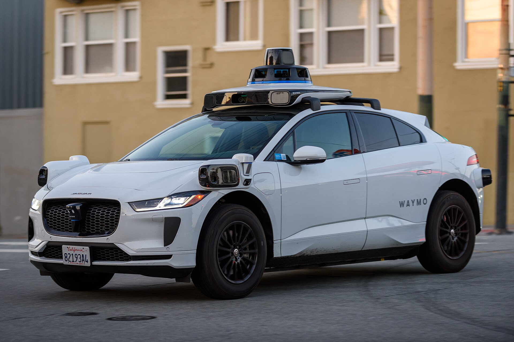
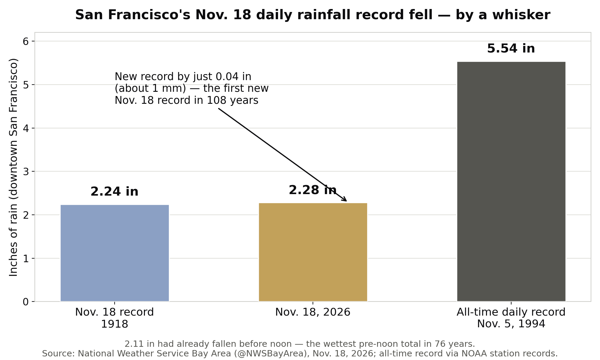

> [中文版 Chinese version](/life/waymo-sf-flood-pause-zh/)

*A Waymo Jaguar I-PACE robotaxi in San Francisco. Photo: 9yz, [CC BY 4.0](https://creativecommons.org/licenses/by/4.0/), via Wikimedia Commons. Not a photo of the November 18 incident.*

At around 11 a.m. on Wednesday, November 18, 2026, America's most advanced taxi fleet gave up. Waymo — Alphabet's self-driving unit, operator of America's largest commercial robotaxi service — suspended driverless ride-hailing across the San Francisco Bay Area: the city, the Peninsula, and the South Bay. The app told riders: "We've paused for now due to weather. We'll be back when road conditions improve and the forecast is clear." No restart time was given, and the service was still paused mid-afternoon.

The cause was not a software bug, a power failure, or a crash. It was rain — the oldest, most ordinary hazard on the road. Hours earlier, several Waymos had stalled in flooded intersections. One sat in a flooded crosswalk at Oak Street and Cole Street, beside the Panhandle, while human drivers steered around it; another was disabled at Bayshore Boulevard and Industrial Street. A passenger said her car froze at Fell Street and Masonic Avenue, and rider Edward Frazer posted on X that he spent 90 minutes trapped in a Waymo going from North Beach to Mission Bay. No injuries involving Waymo vehicles were reported. But the images did more damage in a morning than any crash statistic could: a driverless car, hazard lights on, sitting motionless in standing water as the city drove around it. The question the day asked is simple, and Waymo has not answered it: what is a robotaxi supposed to do when the road turns into a river?

## The storm that broke a 108-year-old record

The weather was no freak accident: the season's first atmospheric river — a narrow plume of Pacific moisture — arrived at the start of what forecasters expect to be a record El Niño winter. By 3 p.m., downtown San Francisco had recorded 2.28 inches of rain since midnight, breaking the 1918 daily record of 2.24 inches by four hundredths of an inch — about a millimeter — after 108 years.

*San Francisco's November 18 daily rainfall record fell by 0.04 inches. Data: NWS Bay Area; all-time record via NOAA. Chart by the author.*

But it did not need to be historic to flood the streets: the combined sewer system overflows when rain arrives faster than the drains can carry it away, and by mid-morning water was pooling in the Mission and around the Panhandle.

The rest of the city felt it: SFO was under a ground stop until noon, rain leaked through the Moscone Center ceiling during Microsoft Ignite, closing two exhibit-hall areas, and more than 18,000 PG&E customers lost power, according to reports. Every transport system was degraded. The difference is that every other one kept going, badly. Waymo stopped.

## Why standing water is a robot's kryptonite

Waymo has not publicly explained why its cars stalled — Engadget has asked for comment, and there is no answer on the record. So be precise: the cars entered flooded stretches, stopped, and did not proceed. Whether they stopped because their sensors could not see, because their software judged the water too deep, or because something failed is not known. Nothing here is a confirmed diagnosis — only an explanation of why water is hard for machines like these.

A Waymo sees with the fifth-generation Waymo Driver — lidar, radar, and a ring of cameras fused into a 3D model of the world. Standing water attacks every sensor at once. Cameras suffer most — a flooded road is a mirror: reflections look like objects that are not there, or hide the ones that are. Lane markings vanish under brown water. Lidar has the opposite problem, too little signal: a calm surface scatters laser pulses away, so the road can disappear from the point cloud, and a rippled surface returns noise. Either way the car loses the ground plane. Radar sees through rain better, but it is coarse.

And depth is the crux: no sensor on a production robotaxi measures the depth of standing water. A puddle can be two inches deep or two feet deep, and from the driver's seat — human or machine — they look identical until you are in them. A human resolves the ambiguity with context: the wake of the car ahead, the height of the curb, the memory that this intersection always floods. A robotaxi has no equivalent of inching forward. Its doctrine is the minimal risk maneuver: when the world becomes uncertain, slow down, pull over if possible, and stop. That is the correct design choice for a vehicle with no driver — and it is what produces the defining image of Wednesday morning: a car that did exactly what it was programmed to do, stopped in the middle of a flooded crosswalk, blocking everyone behind it.

One more asymmetry matters most to the passenger. When a human-driven car stalls, the driver can get out, push, or wade to the sidewalk. When a robotaxi stalls, the passenger is a guest in a machine that has decided everyone should stay put — which is what the car at Fell and Masonic reportedly told its rider to do. Remote assistance can dispatch a tow, but it cannot drive the car out of the water. A stuck robotaxi is a 4,800-pound obstacle nobody present can move.

## This has happened before

Wednesday was not the first time water has beaten Waymo — the third time in about a year flooding has forced the company to pull cars off the road.

In December 2025, Waymo paused San Francisco service when a power outage stranded robotaxis at dark intersections.

In May 2026, the company recalled nearly 4,000 vehicles and paused service after a robotaxi drove into a flooded road in San Antonio, then issued a software update. Then it happened again in Atlanta. San Antonio was supposed to prove the water problem found and fixed. Wednesday suggests the fix was narrower than the problem — or the problem genuinely harder than one software update. The likelier truth is that standing water has no clean software answer: the car must decide, in real time, whether a sheet of water is safe to cross, with sensors that cannot measure its depth. Every other road user resolves that question with judgment and a tolerance for small risks. A robotaxi fleet is not allowed small risks — its entire value proposition is that it never takes them. So it stops. And when it stops in the wrong place, it stops the street.

## The worst week in Waymo's California history

Wednesday's flood pause landed one day after the worst regulatory blow in the company's history: on November 17, the California DMV confirmed it had barred Waymo's driverless vehicles from all freeways in the state — an order effective November 11 but public only six days later. The DMV's language was unusually blunt: it found Waymo's driverless freeway operations "pose an imminent hazard to public safety due to recurring incursions by its vehicles into active construction zones where construction workers, vehicles and equipment are present."

The trigger: on November 5, three Waymos entered an active construction closure on US Route 101 near Burlingame, and the next day one was filmed trying to drive around Highway Patrol vehicles conducting a traffic break on Highway 280. These came despite a prior restriction and corrective actions after similar incursions on May 18, 2026. The ban has no end date — it stays until Waymo demonstrates "effective corrective actions." Waymo complied, then voluntarily pulled freeway rides in every market nationwide.

| Date | Event | Consequence |
|---|---|---|
| May 2026 | Robotaxi enters flooded road, San Antonio; ~4,000-vehicle recall | Pauses in San Antonio, then Atlanta after a repeat |
| Nov 11, 2026 | DMV freeway restriction (public Nov 17) | No driverless freeway operation in CA; Waymo pulls freeway rides nationwide |
| Nov 18, 2026 | Atmospheric river floods SF streets | All Bay Area service paused; cars stall in flooded intersections |

In eight days, the service lost the freeways by order and the surface streets by weather, leaving only dry, uncomplicated city driving — conditions in which a robotaxi was already known to work. That is not a collapse: Waymo still completes more than half a million paid trips a week across ten cities with roughly 3,000 vehicles, a scale no rival has matched. But it shows, in the company's most important market, how thin the operating envelope still is.

## The reliability paradox

Here is the paradox. Waymo is, by the available evidence, a remarkably safe driver: over 71 million rider-only miles through March 2025, its published safety data showed 88 percent fewer crashes resulting in serious injury or worse, and 78 percent fewer injury-causing crashes, than an average human driver over the same distance in the same cities. Those numbers are real, and they are why regulators let the service expand from a Phoenix pilot to ten cities, and why San Francisco opened every street to it in June 2024.

But safety and reliability are not the same thing, and Wednesday showed the gap. The safest car on the road is also the first to quit: its safety comes from refusing to operate in conditions it cannot model with confidence — rain, flooding, construction zones, traffic breaks. The more seriously a robotaxi takes safety, the narrower the world it can drive in. That is not a flaw in the engineering. It is the engineering — and it collides with the promise of a taxi service: the car is there when you need it, especially when you need it most.

Bad weather is when people most need a ride — when walking is miserable and the bus is late in sideways rain. A service that withdraws at the first atmospheric river fails its users at the moment of peak demand, then leaves them competing for the human-driven cars that remain, at surge prices, in the worst conditions. The robotaxi pitch has always assumed more availability than human drivers, not less: no shifts, no fatigue, no refusing a fare in the rain. Wednesday was the opposite of that pitch.

The pause was plainly the right decision. The problem is that the decision keeps being necessary: San Antonio in May, Atlanta after that, San Francisco in December and again in November. A one-off is an incident. A pattern is a limitation of the system.

The freeway order and the flood pause have separate causes, but regulators will remember them as one week. The question is no longer "is the average ride safe?" It is "what does the system do when the average breaks down?"

## What "safe" has to mean now

What would a sufficient answer look like? The fixes are not mysterious, just hard. A robotaxi that wants to drive in the rain needs the depth of the water ahead, which likely means fusing its own sensors with live data it does not have today: municipal flood sensors, real-time fleet reports, street-level flood maps that update as a storm moves. It needs routing that avoids flood-prone intersections before the car reaches them — Waymo tracked the storm hours in advance and scaled back, which suggests the forecasting exists but the last-mile routing did not. And it needs a better failure mode than "stop where you are": a car that can reverse out of water it misjudged, or reach a curb instead of the middle of a crosswalk.

None of those are small changes: the car must reason about a world not in its high-definition map — water is not on the map — and judge under uncertainty, precisely what the current safety architecture avoids. The system is safe because it is conservative, and unavailable because it is conservative. Closing that gap without giving up the safety record is the actual technical problem, and it is much harder than adding a sensor or pushing an update.

So here is the judgment. Wednesday's pause was the right call; anyone who says Waymo should have kept its cars running in flooded streets is not serious. But the right call is also an indictment of the technology as it stands. A transportation service that cannot operate in the rain, in a city where it rains every winter, is not yet a transportation service. It is a fair-weather convenience with extraordinary safety statistics measured in fair weather. Waymo's cars can be far safer than human drivers in the conditions they are designed for, and still not ready for the conditions that define a city's real life.

The rain will be back — forecasters expect more storms this winter, and the El Niño pattern behind this one is getting started. The next test is already scheduled, not by Waymo or the DMV but by the weather. The company has time to show its work before then: a public, technical explanation of why its cars stopped, and a credible plan for next time. Silence will not survive the next storm. The cars can stop. The questions cannot.

## Sources

- Engadget, "Waymo pauses service in San Francisco after robotaxis get stuck on flooded streets," November 19, 2026 — https://www.engadget.com/2321312/waymo-pauses-service-in-san-francisco-after-robotaxis-get-stuck-on-flooded-streets/
- Fox Weather, "Atmospheric river pounds West Coast as floods threaten 30M," November 19, 2026 — https://www.foxweather.com/weather-news/30-million-along-california-coast-under-flash-flood-threat-from-latest-atmospheric-river-storm
- TechCrunch, "Waymo suspends freeway rides nationwide after California DMV order," November 17, 2026 — https://techcrunch.com/2026/11/17/waymo-suspends-freeway-rides-nationwide-after-california-dmv-order/
- The Register, "California tells Waymo to take the next exit after freeway mishaps," November 18, 2026 — https://www.theregister.com/security/2026/11/18/california-tells-waymo-to-take-the-next-exit-after-freeway-mishaps/5310841
- The Arizona Republic, "Waymo suspends Phoenix freeway rides after California incidents," November 18, 2026 — https://www.azcentral.com/story/money/tech/2026/11/18/waymo-suspends-freeway-service-nationwide-california-ban/92842387007/
- KPIX / CBS News Bay Area and San Francisco Chronicle reporting on the Bay Area service suspension, via syndication, November 18, 2026 — https://www.lexingtondailynews.com/stories/bay-area-waymo-robotaxi-service-suspended-amid-storm-flooding,2265623
- National Weather Service Bay Area (@NWSBayArea), record daily rainfall post, November 18, 2026, via Fox Weather — https://www.foxweather.com/weather-news/30-million-along-california-coast-under-flash-flood-threat-from-latest-atmospheric-river-storm
- San Francisco Bay Weather, "San Francisco Rainfall: How Much and How Often It Rains" (NOAA station records) — https://www.sfbayweather.com/learn/san-francisco-rainfall-totals
- Waymo ridership and fleet figures (500,000 paid rides per week, ~3,000 vehicles, 10 cities, March 2026 announcement) — https://happycapyguide.com/blog/waymo-500k-weekly-rides-robotaxi-2026
- Waymo San Francisco service history (testing March 2022; paid launch August 2023; waitlist removed June 2024) — https://newsatw.com/waymo-expands-its-robotaxi-fleet-to-las-vegas-san-diego-and-detroit-everything-to-know/
