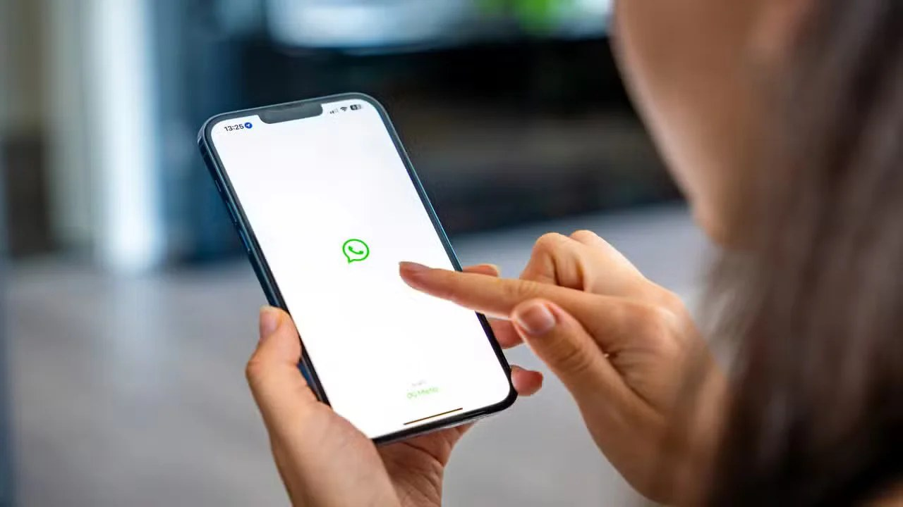
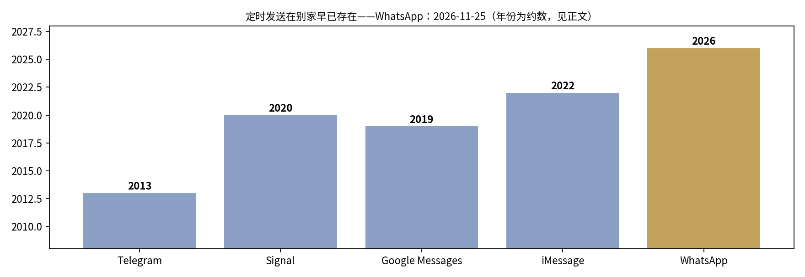

> [English version 英文版](/life/whatsapp-scheduled-messages-14-days/)

*图片：WhatsApp 使用场景资料图（经 Noodou）。WhatsApp 于 2026 年 11 月 25 日在其官方博客与 X 账号宣布该功能。*

## 发布本身

2026 年 **11 月 25 日**，WhatsApp 发布博文《Say it at the right time with scheduled messages》（在恰当的时刻说出来：定时消息），并在 X 上发了一句短帖——"we did it, you can now schedule messages on WhatsApp"——宣布上线一个它称为**用户呼声最高的功能之一**。操作刻意做得平淡无奇：照常写好消息，**长按发送键**，选定你希望它抵达的日期和时间。时间窗为提前 **10 分钟到 14 天**。支持**一对一聊天与群聊**，覆盖 iPhone 与 Android，内容类型包括**文字、照片和视频**。

报道即时而广泛——MacRumors、9to5Google、9to5Mac、Android Authority、TechCrunch、Digital Trends、Neowin、《印度商业线报》都在当天跟进——这本身就说明了积压的需求有多大。这不是什么登月级功能，只是发送键上的一个定时器。全球最大的通讯服务加一个定时器能成为多家媒体的新闻事件，这件事本身就是故事，而它底下的细节比标题更有意思。

WhatsApp 自己的叙事是关于时机与体贴：你晚上 11 点想起要祝某人明天的考试顺利，或者你想让一条生日祝福在朋友所在时区的午夜抵达，而不是你这边的午夜。你现在想到了，但现在不是合适的时刻。用公司的话说，定时消息是"在恰当的时刻为你在乎的人出现"的又一种方式。

## 确切规则：来自博客与帮助中心

功能发布的成败系于小字，而 WhatsApp 帮助中心——经 11 月 25–26 日各家报道一致转述——给出的小字相当多。完整的规则集如下：

- **时间窗：** 从 **10 分钟**到 **14 天**之后。不能定"大概一小时后"，也不能定下个月；选择器要求你在这两周之内选一个具体的日期和时间。
- **内容类型：** 文字、照片、视频。公告**没有**列入语音消息、文档、贴纸或联系人——别指望能定时发这些。
- **聊天范围：** 个人聊天与群聊。据帮助中心，**WhatsApp Business 暂不包含在内**——这是一个值得注意的缺席，因为企业用户恰恰是最有定时发送需求的一群人。
- **送达不依赖你的手机：** 到了选定时间，即使你的手机**关机、没信号或没电**，消息**仍会发出**。你不需要醒着、不需要在线、甚至不需要可联系。
- **加密：** 定时消息与其他个人消息一样**端到端加密**；WhatsApp 表示连它自己也读不到。
- **接收方无感知：** 定时消息抵达时与任何普通消息看起来完全一样，**没有任何标记**表明它是提前写好、由定时器发出的。
- **管理入口：** 点你的头像，再点 **Scheduled messages（定时消息）**，可以看到全部排队中的消息；在那里长按某条即可**删除**。
- **不能编辑：** 无法修改定时消息的文字或时间。唯一的修法是删掉重定。
- **群成员在起草时冻结：** 定时群消息只送达**你写它时**已在群里的人；之后加入的人永远看不到这条消息。
- **推送节奏：** 全球推送，**未来数周**内完成。有公告不等于有功能；它按账号逐批抵达。

测试用户早有预兆：发布前后的报道提到，该功能 10 月 12 日已出现在部分 Android 测试版（2.26.40.7），10 月 22 日扩展到 iOS 测试版（26.42.10.19）。11 月 25 日的宣布是正式版发布，不是突如其来的灰度。

## 为什么拖了这么久：所有人都早发了好几年

无法回避的对照是：定时发送是个老功能。Telegram 2019 年就有了定时消息；Signal 在 2020 年代初加入了定时发送；Google Messages 与苹果 iMessage（2024 年的"稍后发送"）都有；连办公工具 Slack 都有好多年了。下图用的是各主流消费级通讯应用上线定时发送的大致年份——具体月份不重要，重要的是这条线的形状：WhatsApp 是最后一个，晚了好几年，而它的用户手机里同时装着这些对手。

*作者自制图。年份为各应用公开版本历史中定时发送功能的大致上线年份；WhatsApp 为其 2026 年 11 月 25 日公告。重点是排序，而非任何单个月份。*

那么，为什么最大的通讯应用在自己用户呼声最高的功能上最后一个动？WhatsApp 没有给出工程层面的解释，以下属于分析而非报道，三条结构性理由与证据相符。

第一，**端到端加密让"稍后发送"成为一个设计问题，而不只是一个按钮。** 一条定时消息必须以加密形态在某处存放最长 14 天，然后在发送者设备可能关机时被送达。这意味着排队与投递机器要处理它读不懂的密文、要尊重删除、要在起草时冻结群成员名单，还要在"一个 bug 就是一条头条"的规模上做到这一切。功能规则本身——尤其是群成员冻结与关机送达——读起来就像这些设计决策露出水面的尖角。

第二，**WhatsApp 面向的是消费软件里最宽的硬件与网络基数。** 一个在旗舰 iPhone 和五年前的入门 Android、2G 网络上表现完全一致的功能，与同一个功能在小应用里，是两个量级的工程。WhatsApp 历史性的保守——功能来得晚，但一次到齐——与这次推送的一切细节自洽，包括长达数周的全球分批。

第三，也是最不客气的：**此前没有竞争压力，直到现在才有了一点。** 用户不会为了定时发送离开 WhatsApp，因为 WhatsApp 的护城河就是所有人都在 WhatsApp 上。在每个大平台真实的优先级队列里，用户会请求、但无法用脚投票的功能，排在影响增长、留存指标或收入的功能之后。"我们呼声最高的功能之一"与"2026 年才上线"并不矛盾——除非你假设请求本身就是队列。请求只是队列的一个输入。

## 三个值得吵一吵的设计选择

规则集里有三个决定值得审视，因为每一个都交换了某种真实的东西。

**接收方无标记。** 定时消息与即时消息无法区分。这对午夜生日祝福是好事——魔力就在于它看起来像是即兴的；多数对手也做了同样的选择。但这也意味着，一条读起来像即时反应的消息，可能写于数天之前、出自完全不同的情绪语境。在私人聊天里这只是个趣闻；在协调真实计划的群聊里，一条两周前排队的消息像新鲜出炉一样抵达，是可能误事的。WhatsApp 选择了无缝；用户应当知道缝在哪里。

**14 天上限。** 两周足够覆盖生日、提醒和出行，又短到不让队列变成第二个装满过期意图的收件箱。同样大概不是巧合的是，这个上限也限制了系统需要为每个用户保管的加密"未来邮件"的总量。对手的时间窗各有不同，而重度定时用户——比如任何曾用非官方自动化工具跑生日或提醒流程的人，WhatsApp 长期以来并不鼓励这类工具——会觉得 14 天对于"提前一个月排队"这类用法偏紧。这个上限是一个产品判断：定时发送是体贴，不是工作流系统。

**不能编辑，且不含 Business。** 删掉重写对消费者是可忍受的第一版答案，对任何有量的发送者则是很差的答案——而那恰恰是 Business  segment，它这次被整个排除在外。合起来读，第一版的范围很清楚：这是一个个人通讯功能，被刻意与 Meta 收费的、API 驱动的、可定时可模板的商业消息业务隔开。这道篱笆是临时谨慎还是永久分层，是这次发布里商业上最有趣的问题，而 WhatsApp 没有回答。

## 实际怎么用

如果功能已经抵达你的账号，价值最高的用法就是公告带头讲的那些无聊用法：你在不合适的钟点想到的消息（现在写好，他们那边早上 8 点送达）、14 天窗口内的生日与纪念日、在计划定下的当下就设好的群提醒（而不是事后想起来），以及任何你希望在自己飞行或断网期间送达的消息——关机送达这条规则让定时发送成为真正的"失联期工具"，不只是礼貌功能。

两个习惯能帮你避开第一版的坑。其一，**每周检查一次定时消息列表**：没有编辑功能，队列就是过期消息变成尴尬现场的地方，而群冻结规则意味着排队中的公告会悄无声息地漏掉后来加入的人。其二，**暂时不要在它上面搭工作流**：没有语音、没有文档、没有 Business、14 天上限、数周推送——这是便利，不是基础设施。多年来填补这个空白的非官方定时应用与自动化方案，在个人用途上可以退休了；它们一直有服务条款风险，现在连必要性也没有了。

## 我们的判断

WhatsApp 上线定时消息，是一个形状很有揭示性的小功能。工程比标题看上去更用心——加密排队、关机送达、起草时冻结成员名单；而缺席项同样刻意：不能编辑、不含 Business、两周上限、接收方无感知。这是一个清楚知道自己想拥有哪些"稍后发送"（个人体贴）、不想拥有哪些（商业工作流）的平台，把前一半在晚于对手数年之后才发出来，因为它的用户可以大声地、长久地提出要求，却无法离开。

对用户的结论很简单：功能与宣传一致、免费，并且消除了保留第二个通讯应用的最后一个日常理由。对时间线的评判则更尖锐：当全球最大的通讯应用把一个定时器称为呼声最高的功能之一、并在 2026 年底才上线时，"呼声最高"说的是用户；而日期，说的是队列。

*来源：WhatsApp 官方博客《Say it at the right time with scheduled messages》，2026 年 11 月 25 日，及 WhatsApp 帮助中心规则（经 2026 年 11 月 25–26 日报道转述：时间窗、内容类型、加密、关机送达、群冻结、删除、Business 排除）；MacRumors、9to5Google、Android Authority、Digital Trends、Neowin、《印度商业线报》，2026 年 11 月 25–26 日。对手应用定时功能的上线年份为约数，取自公开版本历史。WhatsApp 未公布全部账号获得该功能的具体日期，仅称"未来数周"。*
