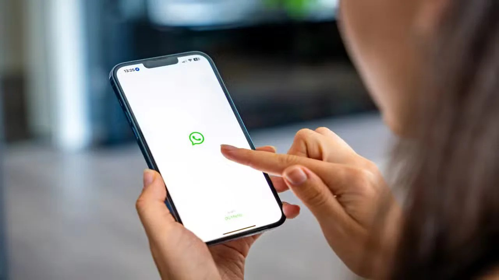
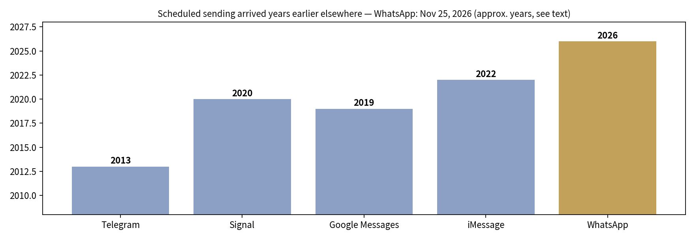

> [中文版 Chinese version](/life/whatsapp-scheduled-messages-14-days-zh/)

*Image: file photo of WhatsApp in use (via Noodou). WhatsApp announced the feature on its official blog and X account on November 25, 2026.*

## The announcement

On **November 25, 2026**, WhatsApp published a blog post titled **"Say it at the right time with scheduled messages"** and a short post on X — "we did it, you can now schedule messages on WhatsApp" — announcing a feature it describes as **one of its most requested**. The mechanics are deliberately ordinary: write a message as usual, **press and hold the send button**, and pick the date and time you want it to arrive. The window runs from **10 minutes to 14 days** ahead. It works in **one-to-one chats and group chats**, on iPhone and Android, and covers **text, photos and videos**.

The coverage was instant and wide — MacRumors, 9to5Google, 9to5Mac, Android Authority, TechCrunch, Digital Trends, Neowin and The Hindu BusinessLine all carried it the same day — which tells you something about the pent-up demand. This is not a moonshot feature. It is a timer on a send button. That the world's largest messaging service adding a timer is a multi-outlet news event is the story, and the details underneath it are more interesting than the headline.

WhatsApp's own framing is about timing and consideration: you remember at 11 p.m. to wish someone luck on tomorrow's exam, or you want a birthday message to land at midnight in your friend's time zone rather than yours. You think of it now; now is not the right time. Scheduled messages are, in the company's words, one more way to show up for the people who matter to you at exactly the right time.

## The exact rules, from the blog and the Help Center

Feature announcements live or die on fine print, and WhatsApp's Help Center — summarised consistently across the November 25–26 reporting — supplies a fair amount of it. The full rule set, as announced:

- **Window:** from **10 minutes** to **14 days** in the future. You cannot schedule a message for "in an hour-ish" vagueness or for next month; the picker wants a specific date and time inside that fortnight.
- **Content types:** text, photos and videos. The announcement does **not** list voice notes, documents, stickers or contacts — do not count on scheduling those.
- **Chats:** individual and group chats. **WhatsApp Business is excluded for now**, per the Help Center — a notable omission, because businesses are arguably the users with the most obvious scheduling needs.
- **Delivery is server-side in effect:** the message **still sends if your phone is off, out of coverage, or out of battery** at the chosen time. You do not need to be awake, online, or even reachable.
- **Encryption:** scheduled messages are **end-to-end encrypted** like other personal messages; WhatsApp says not even it can read them.
- **Invisible to the recipient:** a scheduled message arrives looking exactly like any other message. There is **no indication** it was written earlier or sent by a timer.
- **Management:** tap your profile picture, then **Scheduled messages**, to see everything you have queued. Press and hold an item there to **delete** it.
- **No editing:** there is no way to change a scheduled message's text or time. The only fix is to delete it and schedule a new one.
- **Group membership is frozen at drafting time:** a scheduled group message is delivered only to the people who were in the group **when you wrote it**. Anyone who joins afterwards never sees it.
- **Rollout:** global, **over the coming weeks**. Having the announcement is not the same as having the feature; it lands account by account.

Beta testers had seen this coming: reporting around the launch notes the feature appeared for select Android beta users on October 12 (version 2.26.40.7) and iOS beta testers on October 22 (version 26.42.10.19). The November 25 announcement is the general release, not a surprise test.

## Why it took so long: everyone else shipped this years ago

The unavoidable comparison is that scheduling is old. Telegram has offered scheduled messages since 2019. Signal added scheduling in the early 2020s. Google Messages and Apple's iMessage (with Send Later, in 2024) both have it. Slack, an office tool, has had it for years. The chart below uses approximate introduction years for the mainstream consumer messengers — the exact month matters less than the shape of the line: WhatsApp is last, by years, among the apps its users also have on their phones.

*Author's chart. Years are approximate introduction years for scheduled sending in each app, from the apps' public release histories; WhatsApp's date is its November 25, 2026 announcement. The point is the ordering, not any single month.*

So why did the biggest messenger move last on its own users' most requested feature? WhatsApp has not given an engineering explanation, and this post will label what follows as analysis rather than reportage. Three structural reasons fit the evidence.

First, **end-to-end encryption makes "send later" a design problem, not a button.** A scheduled message must exist somewhere, encrypted, for up to 14 days, and then be delivered when the sender's device may be off. That means the queuing and delivery machinery has to handle ciphertext it cannot read, honour deletions, freeze group membership at draft time, and do all of that at a scale where a bug is a headline. The feature's own rules — especially the group-membership freeze and the phone-off delivery — read like the visible tips of exactly those design decisions.

Second, **WhatsApp ships to the widest hardware and network base in consumer software.** A feature that behaves identically on a flagship iPhone and a five-year-old budget Android on a 2G connection is a different project from the same feature in a smaller app. WhatsApp's historical conservatism — features arriving late, but arriving everywhere at once — is consistent with everything in this rollout, including the weeks-long global ramp.

Third, and least charitably, **there was no competitive pressure until there was.** Users who wanted scheduling could not leave WhatsApp for it, because WhatsApp's moat is that everyone else is on WhatsApp. Features that users request but cannot defect over are, in every large platform's real priority queue, ranked below features that affect growth, retention metrics, or revenue. "One of our most requested features" and "shipped in 2026" are only contradictory if you assume requests are the queue. They are an input to it.

## The design choices worth arguing about

Three decisions in the rule set deserve scrutiny, because each one trades something real.

**No marker for the recipient.** A scheduled message is indistinguishable from a live one. That is good for the birthday-at-midnight use case — the magic depends on it looking spontaneous — and it is the same choice most rivals make. But it also means a message that reads as an immediate reaction may have been composed days earlier, in a different emotional context. In personal chats this is a curiosity. In group chats coordinating real plans, a two-week-old queued message landing as if fresh can misfire. WhatsApp chose seamlessness; users should know the seam exists.

**The 14-day ceiling.** Two weeks is long enough for birthdays, reminders and travel, and short enough to keep the queue from becoming a second inbox of stale intentions. It is also, not coincidentally, a bound that limits how much encrypted future-mail the system must hold per user. Rivals' windows vary, and heavy schedulers — anyone who ran birthday or reminder workflows through unofficial automation tools, which WhatsApp has long discouraged — will find 14 days tight for, say, a message queued a month ahead. The ceiling is a product judgement: scheduling as a courtesy, not as a workflow system.

**No editing, and Business excluded.** Delete-and-rewrite is a tolerable v1 answer for consumers and a poor one for anyone scheduling at volume — which is precisely the Business segment, and it is excluded entirely for now. Read together, the v1 scope is clear: this is a personal-messaging feature, deliberately fenced off from the commercial messaging business where Meta charges for API-driven, scheduled, templated communication. Whether that fence is temporary caution or permanent segmentation is the most commercially interesting question in the launch, and WhatsApp has not answered it.

## What to do with it, practically

If the feature has reached your account, the highest-value uses are the boring ones the announcement leads with: messages you think of at the wrong hour (write now, deliver at 8 a.m. their time), birthdays and anniversaries inside the 14-day window, group reminders set at the moment the plan is made rather than remembered later, and anything you want delivered while you are on a flight or off-grid — the phone-off delivery rule makes scheduling a genuine unreachable-period tool, not just a politeness feature.

Two habits will save you from the v1 edges. First, **review the Scheduled messages list weekly**; with no edit function, the queue is where stale messages go to become embarrassing, and the group-freeze rule means a queued announcement will silently miss anyone added later. Second, **do not rebuild workflows on it yet**: no voice notes, no documents, no Business, a 14-day cap and a weeks-long rollout make this a convenience, not infrastructure. The unofficial scheduler apps and automation workarounds that filled this gap for years can retire for personal use; they were always a terms-of-service risk, and now they are an unnecessary one.

## Our judgment

WhatsApp adding scheduled messages is a small feature with a revealing shape. The engineering is more considered than the headline suggests — encrypted queuing, phone-off delivery, membership frozen at draft time — and the omissions are equally deliberate: no editing, no Business, a fortnight's ceiling, invisibility to recipients. This is a platform that knows exactly which parts of "send later" it wants to own (personal thoughtfulness) and which it does not (commercial workflow), shipping the first half years after its rivals because its users could ask, loudly and for a long time, without being able to leave.

The verdict for users is simple: it works as advertised, it is free, and it removes one of the last everyday reasons to keep a second messenger installed. The verdict on the timeline is the sharper one. When the world's largest messenger calls a timer one of its most requested features and ships it in late 2026, "most requested" tells you about the users. The date tells you about the queue.

*Sources: WhatsApp official blog, "Say it at the right time with scheduled messages," November 25, 2026, and WhatsApp Help Center rules as reported November 25–26, 2026 (window, content types, encryption, phone-off delivery, group freeze, deletion, Business exclusion); MacRumors, 9to5Google, Android Authority, Digital Trends, Neowin and The Hindu BusinessLine, November 25–26, 2026. Introduction years for rival apps' scheduling features are approximate, from public release histories. WhatsApp has not published a firm date by which all accounts will have the feature, beyond "over the coming weeks."*
