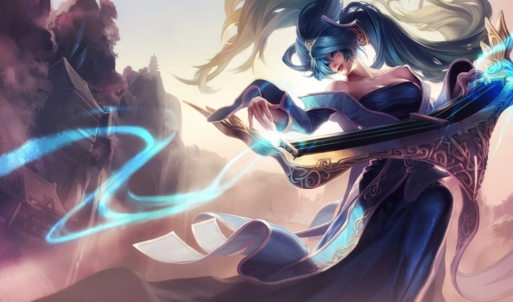
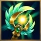
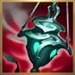
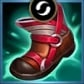

> [English version](/life/wild-rift-sona-guide/)

*娑娜弹奏她的 etwahl。官方原画：Riot Games，经 League of Legends Wiki 转载。*

## 版本现状：7.3f 的娑娜处在什么位置

先给结论：**娑娜是当前版本最稳的上分辅助之一**。英雄联盟手游 7.3f 版本于 2026 年 11 月 11 日上线（国服 11 月 12 日），新英雄塞拉斯加入，法师装备得到加强，辅助经济被小砍。娑娜本人没有直接改动，但她依然站在版本顶端：

- **国服钻石以上：S 级辅助，胜率 52.41%，登场率 2.98%，禁用率仅 0.26%，辅助排名第 5/33**（数据来源：wrchina.gg，国服排行榜，2026 年 11 月 14 日统计）。段位越高她越强：大师以上胜率 52.48%，宗师 53.1%（排名第 3），最强王者 52.95%（登场率 7.22%，排名第 3）。
- **国际服大师以上胜率 52.19%**，过去 30 天还微涨了 0.03 个百分点（数据来源：wildriftcore.com，2026 年 11 月 18 日更新）。
- Wild Rift Fire 的英雄强度榜把她排在**辅助 S 级**。

为什么她强？一句话：**手游节奏快、团战多，而娑娜是全游戏最稳定的团队增益机器**。她的三个小技能全是光环——加攻击、给护盾、加速——只要一直弹，队友就一直受益；大招狂舞终乐章是全游戏最强的团控之一，还能把所有光环强化 20 秒。版本越往后期拖，她越强。

但 7.3f 也有一个对她的小利空，需要知道：**辅助装的经济被砍了**。官方补丁说明里，山岳之壁（Bulwark of the Mountain）和黑雾镰刀（Black Mist Scythe）的"灵魂铸造"每分钟金币从 75 降到 60。Riot 的原话是辅助"赚钱太快了"。实际影响是你的第一件成装会晚大约半分钟到一分钟到来，不改变她的强度等级，但对线期要更注意别白白送人头——经济变慢，劣势更难追。

另外两个版本动向也和她有关：打野被砍（惩戒伤害和"节俭"金币下调），前期节奏放慢，等于给了娑娜更多安全发育到强势期的时间；法师装加强（卢登的回声、时光之杖、巫妖之祸、莫雷洛秘典、火箭腰带）让中路法师更强，而娑娜最喜欢的队友恰恰是需要保护的法师和射手。

**优点一览：**

- 光环永动机：Q、W、E 每放一次就给附近队友 3 秒增益，全程覆盖
- 能量和弦（被动）是免费的控制：每三个技能换一次带 0.5 秒晕眩的强化普攻
- 大招是团战翻盘器：先手开团、反手反打都能用，命中后光环强化 20 秒
- 越到后期越强：装备成型后蓝基本用不完，奶量和护盾量都上一个台阶
- 上手门槛低：没有复杂连招，机制简单直观

**缺点一览：**

- 全游戏最脆的辅助之一，没有位移，被勾到、被切到基本就是死
- 怕钩子、怕强开：布里茨、派克、蕾欧娜都是天敌，一次失误就葬送对线
- 前期蓝耗紧张：前期乱弹技能会空蓝，只能干瞪眼
- 没有硬留人手段：除了大招和被动晕眩，留不住人
- 非常依赖队友：队友不会打，你一个人带不动

## 技能解析

娑娜的技能组是围绕"光环"设计的：**每放一个小技能，身边队友就能吃到 3 秒的增益**。理解这一点，就理解了这个英雄的一半。

*能量和弦（被动）技能图标。图标来源：Riot Games 官方游戏资源。*

### 被动：能量和弦（Power Chord）

每施放 3 次小技能后，下一次普攻变为强化攻击：附加随等级成长的魔法伤害（约 20–160，+15% 法术强度），并**晕眩目标 0.5 秒**。同时，每次施放小技能都会给娑娜一个持续 3 秒的光环增益；小技能的冷却时间随等级降低（每级 2%，最高 20%）。

这是娑娜唯一的硬控，也是她对线期最有杀伤力的工具。0.5 秒晕眩看起来短，但配合 ADC 的一轮输出，经常就是一个人头。记住：**被动是按"施放次数"算的，不是按时间**，所以你可以提前攒两层，留第三层等 ADC 上前再打出来。

### Q：英勇赞美诗（Hymn of Valor）

*英勇赞美诗（Q）技能图标。图标来源：Riot Games 官方游戏资源。*

对最近的两名敌人造成 **50/90/130/170 + 40% 法术强度**的魔法伤害，并给附近友军一个光环：友军下次攻击附加 **8/13/18/23 + 20% 法术强度**的额外伤害。蓝耗 60/65/70/75。

这是你的主升技能，也是对线期的主要消耗手段。Q 会优先锁定英雄，所以站在兵线后面隔着小兵也能打到人。光环的附加伤害会加在 ADC 的下次普攻上——也就是说，**Q 不只是你打伤害，更是帮 ADC 打伤害**，ADC 补刀、换血时 Q 一下，等于白送一次小爆发。

### W：坚毅咏叹调（Aria of Perseverance）

*坚毅咏叹调（W）技能图标。图标来源：Riot Games 官方游戏资源。*

治疗娑娜和附近生命值最低的友军 **35/50/65/80** 点生命，并附加持续治疗 **25/40/55/70 + 20% 法术强度**；同时给两人一个 **25/50/75/100 + 18% 法术强度**的护盾。如果没人受伤，W 会治疗最近的友军。

W 的精髓是"提前给"，不是"残血救"。护盾和持续治疗加起来，相当于一次小换血的全部收益。注意 W 的治疗目标是**生命值最低的友军**，不是你点的那个人——团战里它会自动找最需要的人，你只需要保证自己在光环范围内。

### E：迅捷奏鸣曲（Song of Celerity）

*迅捷奏鸣曲（E）技能图标。图标来源：Riot Games 官方游戏资源。*

给娑娜和附近友军加速，娑娜自身获得 **15/16/17/18%** 移动速度加成。

E 是娑娜唯一的自保和转线工具：追击时给全队加速，逃跑时给全队加速，支援、转线、躲技能都靠它。7.1h 版本把 E 的自身加速从 10/11/12/13% 加强到了 15/16/17/18%，这是她现在能玩的重要原因之一。**E 不要只在逃跑时按**，开团前、转线时、抢龙前都值得按一次。

### R：狂舞终乐章（Crescendo）

*狂舞终乐章（R）技能图标。图标来源：Riot Games 官方游戏资源。*

弹出一道向前推进的音波，持续 3.75 秒，每 0.75 秒发出一次冲击，每次造成 **35/60/85 + 15% 法术强度**的魔法伤害；第一次命中的敌人会被**晕眩 1 秒**，音波范围内的其他敌人会被减速 **25/30/35%**。命中后，娑娜的所有光环在接下来 **20 秒内强化**（效果提升 20%）。冷却时间 **80/75/70 秒**。

这是全游戏最强的团控大招之一，也是娑娜的灵魂技能。注意两个细节：第一，**只有第一次命中的敌人才会被晕眩**，音波穿过去之后命中的敌人只吃伤害和减速，所以角度要瞄准最想控住的那个人；第二，大招命中后 20 秒光环强化，等于你的 Q、W、E 全都变成加强版——**大招不只是控人，更是全队 20 秒的增益窗口**，开团后要立刻接 Q、W、E 循环，把强化光环的价值打满。

## 技能加点

**标准加点：Q > W > E，大招 5/9/13 级必点。**

- **1 级：Q。**开局学 Q，上线就能压人，帮 ADC 抢 2 级。
- **2 级：W。**拿到治疗，对拼不虚。
- **3 级：E。**三个技能齐了，被动循环跑起来。
- **主升 Q，副升 W，E 最后升满。**Q 的伤害和光环加成都随等级涨，是你对线压制力的来源；W 副升保证奶量跟得上；E 只点 1 级前期够用，后期再补。

**什么时候变招：**

- **对线压力极大时（比如对面是德莱文 + 蕾欧娜这种强开组合），主升 W。**活下来比打伤害重要，W 满级后一口奶 + 护盾能顶住对面一轮爆发。代价是对线压制力下降，接受这个交换。
- **己方打野前期要频繁来下路时，3 级后可以先补 1 点 E 再升 Q。**E 的加速能帮打野留人，多一次 gank 成功就值回来了。
- **永远不要主升 E。**E 每级只加 1% 移速，收益最低。

## 符文

符文分两套主流，选哪套看你的打法和段位。

### 主流一：艾黎（Aery）——稳定全面，推荐新手

- **基石：艾黎。**娑娜每几秒就放一个技能，艾黎的触发频率全游戏数一数二，Q 消耗时补伤害，W 治疗时补护盾，两头都吃。
- **法力流系带（Manaflow Band）：**加蓝上限和回蓝，缓解前期蓝耗压力，还能和核心装"诗歌之环"（Diadem of Songs）联动，提高治疗护盾强度。
- **超然（Transcendence）：**技能急速，让你更快地循环光环。
- **焦灼（Scorch）：**Q 消耗时附加额外伤害，对线压制更疼。
- **骸骨镀层（Bone Plating）：**减伤，防被一套秒。

这是 Wild Rift Fire 推荐的符文页，也是最"不会错"的选择。

### 主流二：迅捷步法（Fleet Footwork）——国服高分段最爱

- **基石：迅捷步法。**国服前 30 名娑娜玩家里 **74% 带迅捷步法**，对应的符文页胜率 **53.1%**（使用率 40.11%，钻石以上数据）。迅捷步法给的移速和治疗，等于变相补了娑娜最缺的两样东西：走位和续航。
- 其余四个符文和艾黎页相同：**法力流系带、超然、焦灼、骸骨镀层**。

如果你已经熟悉娑娜，迅捷步法是更强的选择；如果还在练，艾黎更直观。

### 备选符文

- **基石换冰川之主（Ice Overlord，旧名冰霜领主）：**被动晕眩和大招的首次晕眩都能触发冰川之主，冻住一片区域减速敌人，帮你留人、保护后排。国服胜率 50.7%，适合对面突进多、你需要自保的局。
- **焦灼换生命源泉（Font of Life）：**Q 反复命中敌人时，给队友提供额外治疗，适合打消耗拉扯的长对线。
- **骸骨镀层换僵尸守卫（Zombie Ward）：**国服 42% 的顶尖玩家带它。排眼、做视野收益更高，适合视野意识好的玩家。
- **召唤师技能：闪现 + 治疗。**ADC 带屏障时你带治疗；如果 ADC 也带了治疗，你带治疗收益会打折，换成**点燃**（帮 ADC 拿人头）或**虚弱**（防对面刺客切入）。

## 出装

娑娜的出装思路就一句话：**法力 + 技能急速 + 治疗护盾强度**。她不需要法强堆伤害，需要的是"一直有蓝放技能"和"每次治疗护盾都更厚"。

### 出门装

- **幽魂镰刀（Spectral Sickle）：**默认选择。Q 消耗能触发镰刀的赏金，对线压人回钱。
- **上古钱币（Ancient Coin）：**对面是钩子阵容（布里茨、锤石、派克）时选它，缩在后面安全收钱，别上去送。

### 核心出装顺序

| 顺序 | 装备 | 作用 |
|---|---|---|
| 1 | 黑雾镰刀（Black Mist Scythe） | 幽魂镰刀升级，插眼 + 法强 + 急速，辅助装任务完成 |
| 2 | 明朗之靴（Ionian Boots of Lucidity） | 技能急速，越早出越早进入"永动机"状态 |
| 3 | 诗歌之环（Diadem of Songs） | **娑娜专属核心装**：法力、法强、治疗护盾强度全都要 |
| 4 | 海莉亚的回响（Echoes of Helia） | 打伤害就给队友回血，把你的 Q 变成治疗 |
| 5 | 和声回响（Harmonic Echo） | 治疗溢出转护盾，团战续航质变 |
| 6 | 炽热香炉（Ardent Censer） | ADC 攻速 + 伤害，配普攻型 ADC 必出 |
| 7 | 流水法杖（Staff of Flowing Water） | 治疗/护盾给队友加法强，法师多的局优先 |

*黑雾镰刀。图标来源：Wild Rift Fire。*

*诗歌之环。图标来源：Wild Rift Fire。*

*海莉亚的回响。图标来源：Wild Rift Fire。*

*和声回响。图标来源：Wild Rift Fire。*

*炽热香炉。图标来源：Wild Rift Fire。*

*明朗之靴。图标来源：Wild Rift Fire。*

**为什么诗歌之环是第一件大装？** 它是为娑娜量身定做的：前期最缺的法力它给，治疗护盾强度它给，法强它也给。出了它之后，你前期"蓝不够用"的问题基本解决。国服顶尖玩家的出装里，诗歌之环的出场率也是最高的之一。

**鞋子附魔：**守护附魔（Protect Enchant，给队友套盾）是默认选择；对面爆发高时换成**钢铁烈阳附魔（Locket Enchant）**，团战开打前按一下，全队多个盾。

### 局势出装

- **顺风 / 大优势：**海莉亚的回响后直接**灭世者的死亡之帽（Rabadon's Deathcap）**。法强越高，你的奶、盾、Q 伤害全都涨，优势局娑娜是可以打出全队前三伤害的。
- **逆风 / 被针对：**跳过香炉，先出**米凯尔的祝福（Mikael's Blessing）**（解控救队友）或**救赎（Redemption）**（远程大范围治疗）。活着才有输出，逆风局你的命比 ADC 的攻速重要。
- **对面治疗多（索拉卡、悠米、蒙多、索拉卡）：**出**海洋之心三叉戟（Oceanid's Trident）**挂重伤，不然你的治疗会被对面奶回去。
- **对面突进多（劫、卡兹克、阿卡丽）：**鞋子附魔选钢铁烈阳，第四件补**守护者之誓（Protector's Vow）**，ADC 被切时你能救一手。
- **蓝实在不够用：**第二件改出**大天使之杖（Archangel's Staff）**，合成炽天使之拥（Seraph's Embrace）后有个救命护盾。这是国际服高分段的另一条主流路线。
- **山岳之壁开局：**如果出门选了上古钱币，升级成**山岳之壁**，再接诗歌之环。国服最常用的三件套就是山岳之壁 + 诗歌之环 + 炽热香炉，胜率 54.6%。

## 对线期

对线期是娑娜最弱的阶段，也是最容易送掉整局的阶段。目标只有一个：**活着到 5 级，活着到第一件成装**。

### 蓝量管理：前期最大的课题

娑娜前期最大的敌人不是对面 ADC，是自己的蓝条。Q 一下 60 蓝，W 一下 65 蓝左右，前期蓝量总共就三四百，乱弹几下就空了。

- **只在有明确收益时按 Q：**能打到人、能帮 ADC 补刀、能触发能量和弦。没事别空放 Q 炫技。
- **W 更是要省：**满血别按 W，ADC 掉了一格血也别急着按，等对面下一波换血再按，护盾 + 治疗一次顶两次。
- **控蓝的节奏感：**蓝量低于 1/3 时，只用 Q 补被动，别再 W；回家补给前把蓝打空再回，别留着蓝回家。

### 换血节奏

娑娜的换血是"三拍子"：**Q 消耗 → 普攻 → 拉开**。Q 的光环会让 ADC 下次普攻更疼，所以最好的换血是：你 Q 到对面 ADC 的瞬间，你家 ADC 刚好 A 出去。两个人头的伤害叠在一起，对面是亏的。

**能量和弦的用法：**提前用 Q、W、E 攒两层，第三层捏在手里。等对面 ADC 上前补炮车、或者对面辅助走位失误时，第三个技能 + 强化普攻晕 0.5 秒，ADC 跟上输出，经常能直接打出闪现甚至人头。**不要一攒满就急着 A 出去**——强化普攻的晕眩是你的威慑，捏着不用，对面就不敢上前；用掉了，对面就知道你接下来几秒没控制。

### 5 级质变

**5 级学到大招，是娑娜对线期第一个强势点。**5 级之前对面敢压你，5 级之后是你敢压对面。升 5 级的瞬间，立刻找机会：对面 ADC 上前补刀时，E 加速走上去，R 晕住，ADC 跟输出，Q + 被动晕眩再控一次。这套连招在 5 级时基本能打出击杀或两个闪现。很多娑娜玩家输就输在 5 级后还在缩着打——大招在手，你才是主动方。

### 对线 matchup

**难打（劣势）：**

- **布里茨：**最怕的对手。永远站在小兵后面，Q 消耗时也要隔着兵线。被勾到基本就是死。熬到三件套之后，你的射程和poke 能反过来风筝他。
- **派克：**你血量常年处在他的大招斩杀线以下。先给自己奶，别先奶 ADC；草丛视野做满，别让他从暗处出钩。
- **蕾欧娜：**均势偏劣。保持最大距离，她 E 上来时立刻 R 反手晕她，别让她接上控制链。

**均势（看操作）：**

- **锤石、米利欧：**锤石的 E 能打断你走位，灯笼能救他的人；米利欧的净化能解你的大招。对锤石要 R 他和 ADC 两个人一起；对米利欧要 R 一群人，别单 R 一个（会被净化掉）。

**好打（优势）：**

- **索拉卡、悠米、璐璐等软辅：**比拼消耗和续航，娑娜的 Q + 被动晕眩更主动，抢 2 级、抢 5 级都能压住她们。
- **风女、娜美：**对拼消耗不虚，关键是别被她们先手控住，Q 的射程和你家 ADC 的射程要配合好。

## 团战

中后期开始，娑娜的游戏就变成了两件事：**站位**和**大招时机**。其他都是添头。

### 站位：永远站在第二排

你的位置应该是：前排身后、ADC 身边、离对面刺客最远的地方。**不要站 ADC 前面**，你比 ADC 还脆；**不要离 ADC 太远**，你的光环只有几百码范围，离远了 ADC 吃不到增益。

一个简单的自检方法：开打前问自己，"对面劫/卡兹克要切我，需要经过几个人？"如果答案是"直接就能摸到我"，你站错了。

### 大招时机：先手还是反手

娑娜的大招有两种用法，选哪种看阵容：

- **先手开团：**对面站位密集、没有强力反手时，E 加速绕侧面，R 穿过对面前排晕住后排，队友跟上。这是最能carry 的用法，但要求你对"对面交过关键技能没有"有判断——对面控制全在，你冲上去就是送。
- **反手保护：**对面有强开（墨菲特、阿木木、嘉文）时，把 R 捏在手里，等对面开进来、大招交完，再 R 晕住进场的人，保护 ADC 反打。**反手大招的容错率比先手高得多**，段位越低越推荐反手。

**最常见的错误：**把大招当"救命按钮"，团战打输了才按。团战已经输了，你按个大也翻不了，还浪费了 20 秒强化光环。大招是开团和反打的工具，不是止损工具。

### 光环循环：团战里的"呼吸"

团战开始后，你的手指不应该停：**Q → W → E → Q → W → E**，一直循环。每个技能都是 3 秒光环，循环起来等于全队常驻"攻击 + 护盾 + 加速"。哪个技能先放看情况：队友血量低先 W，需要追击先 E，需要伤害先 Q。**不要只按 W 当奶妈**——娑娜的价值是三个光环全覆盖，只奶不加攻不加速，等于只发挥了三分之一。

大招命中后的 20 秒是你的高光时刻：光环全部强化，Q 的伤害、W 的奶量、E 的加速都上一个台阶。这 20 秒里你的循环要更快、更主动，队友的输出窗口就是你创造的。

## 初级技巧：先做到这些，你就是合格的娑娜

1. **永远带扫描，永远做视野。**辅助的第一职责是视野，不是奶。下路河道草、龙坑口、三角草，三个眼位轮流续上。
2. **Q 消耗只打得到的人。**不要隔着兵线空放 Q，也不要为了打人走出安全距离。Q 的射程比你想象的远，站在兵线后一样能打到。
3. **W 别等残血再按。**ADC 掉 1/3 血就按，护盾 + 持续治疗能把换血打回来；等残血再按，经常奶到一半人就死了。
4. **5 级、9 级、13 级准时点大招。**这三个等级是你的强势点，升大招的瞬间就是进攻信号。
5. **死之前先按 E。**被抓时第一反应是 E 加速跑，不是 W 奶自己——奶的那点血不够对面一下普攻，加速才能救命。
6. **回家前把蓝打空。**回城前 Q、W、E 全按一遍帮 ADC 推线或消耗，空蓝回家不亏。

## 中级技巧：从合格到carry 的分水岭

1. **被动晕眩是"威慑武器"，不是"输出技能"。**攒满三层捏着不用，对面辅助就不敢上前开；你一用掉，对面就知道你接下来 6 秒没控。高手的娑娜，被动晕眩一半时间是捏在手里的。
2. **大招可以"闪 R"。**闪现调整角度和距离，让音波穿过更多人、晕住最关键的那个。练熟闪 R，你的开团成功率翻倍。
3. **E 是团队技能，不是个人逃命技能。**开龙前按 E 全队加速进场，追击时按 E 帮队友留人，撤退时按 E 全队加速走。只在自己逃命时按 E，等于浪费了 80% 的价值。
4. **学会"预判 W"。**对面蕾欧娜 E 指过来、墨菲特要 R 的瞬间，提前按 W——护盾先套上，伤害打出来时正好被护盾吃掉。事后奶和事前盾，差距就是一个人头。
5. **能量和弦接 ADC 的节奏。**ADC 补炮车前 1 秒，你的第三个技能 + 强化普攻晕住对面 ADC，ADC 的炮车照单全收，对面 ADC 补不到还被打一套。这种配合练几次就能形成默契。
6. **逆风局先保命，再谈辅助。**逆风时你的出装顺序要变：先米凯尔/救赎，再香炉。先保证自己不死，团战才有你的位置。

## 高级技巧：高分段娑娜的细节

1. **光环"卡时间"：**每个光环持续 3 秒，三个技能轮着按可以做到全程无缝。但最高级的打法是"卡"——在 ADC 要 A 出关键一下（比如收炮车、打防御塔、触发三相之力）前 0.5 秒按 Q，让那一下吃到光环加成。光环不是一直开着就好，是开在刀刃上才好。
2. **大招"穿人"：**狂舞终乐章的音波会向前推进 3.75 秒，晕眩只给第一个命中的敌人。高手会算好角度，让音波先擦过前排的边缘、晕住后排的 C 位，而不是直直地撞在前排坦克身上。侧面 45 度角进场，比正面直推的命中率高得多。
3. **被动晕眩 + 大招的双重控制链：**先用被动晕 0.5 秒骗出对面的位移或净化，再接大招晕 1 秒。两个控制分开交，对面交一个保命技能只能解一个；合起来交，对面一个净化全解了。
4. **"卖"自己勾引大招：**高分段里，娑娜可以故意走位靠前一点，勾引对面刺客交位移切你——你闪现 + E 拉开，对面刺客技能全空，这时你的大招反手晕住他，队友集火秒掉。这是风险最高的打法，只建议在你对自己的闪现和 E 的时机有绝对把握时用。
5. **视野压制：**娑娜是全游戏最需要视野的辅助之一（因为最怕被绕后）。高级打法是：均势时把眼做到对面野区入口，优势时把眼做到对面高地前；每波回家必带两个真眼。视野压住，对面刺客就废了一半。
6. **阵容判断：**选娑娜之前先看阵容——己方有墨菲特、赫卡里姆、加里奥这种能开团的队友，娑娜是 S 级；己方全是脆皮、没人开团，娑娜就是"等死型"辅助，再强也带不动。会选阵容，比会玩英雄更重要。

## 上分思路

### 什么时候选娑娜

- **队友有开团点时：**墨菲特、阿木木、嘉文四世、赫卡里姆在队里，娑娜的价值翻倍——他们开团，你大招跟控，光环强化 20 秒收割。
- **队友是后期大核时：**金克丝、薇恩、卡莎、厄斐琉斯这种需要发育的 ADC，娑娜是最好的保镖。
- **对面没有强开钩子时：**对面辅助是软辅（索拉卡、璐璐、悠米），娑娜对线随便打。

### 什么时候别选娑娜

- **对面是布里茨 + 德莱文：**这对组合前期能把你打穿，别头铁。
- **己方全是脆皮没人开团：**你大招再准，也没人跟得上。
- **对面刺客多（劫 + 卡兹克 + 阿卡丽）：**你活不过团战前 5 秒。

### 最佳 ADC 搭配

- **云纳拉（Yunara）：**国服最佳搭配。她没有护盾、前期站桩输出，正好被你的 W 和 Q 补齐短板。
- **德莱文：**Q 光环加在旋转飞斧上伤害拉满，W 支撑他每一波换血，被动晕眩帮他开人头。
- **厄运小姐：**你的大招控住一片，她的大招弹幕时间就能打满，团战毁灭组合。
- **烬：**你的 Q 能帮他触发 W 的禁锢，大招帮他四发子弹全部命中。
- **克格莫：**前期靠你的 W 活到出装，后期站桩输出时你的 E 是他唯一的位移。

### 最佳队友（全队）

- **墨菲特：**你的大招减速让他的大招变得无法躲，两个大招连起来对面后排直接蒸发。
- **赫卡里姆：**你的 E 加速直接转化成他的伤害，越快越疼。
- **加里奥：**你的大招减速让他的大招落点没人能走出去。

### 常见错误（自查清单）

- ❌ 只按 W 当奶妈，不用 Q 和 E —— 你只发挥了三分之一
- ❌ 大招团战打输了才按 —— 大招是开团工具，不是止损工具
- ❌ 被动一攒满就 A 出去 —— 捏着不用才是威慑
- ❌ 站位和 ADC 一样靠前 —— 你比 ADC 脆，永远站第二排
- ❌ 蓝量见底还在弹 —— 空蓝的娑娜就是个超级兵
- ❌ 逆风还按顺风出装 —— 先保命，再谈辅助

### 排位心态

娑娜是个"下限高、上限更高"的英雄：会按技能就能赢一半的局，会玩细节就能带飞。她的胜率曲线很有意思——段位越高胜率越高（宗师 53.1%），说明她吃的是意识和节奏，不是操作。所以上分的关键不是练连招，是练判断：**什么时候该压、什么时候该缩、什么时候该开大、什么时候该卖**。把这些判断练成本能，娑娜能带你上的分，比你想象的多。

---

## 资料来源

- Riot Games《Wild Rift 7.3f 版本更新说明》，2026 年 11 月 11 日：新英雄塞拉斯、辅助装经济调整（黑雾镰刀/山岳之壁每分钟金币 75→60）、法师装备加强。
- wrchina.gg《娑娜 Wild Rift 出装、符文与克制（7.3f 版本）》：国服钻石以上胜率 52.41%、各段位数据、19 名顶尖玩家实装与符文统计，2026 年 11 月 14 日统计。
- wildriftcore.com《Sona Wild Rift Build, Counters & Tier (Patch 7.3f)》：大师以上胜率 52.19%，2026 年 11 月 18 日更新。
- wildriftfire.com《Sona Build Guide for Wild Rift（7.3f 版本）》：辅助 S 级、出装与符文推荐、技能历史改动数据。
- wildriftguides.com《Sona Support Counters, Best Build & Runes》：大招机制（音波持续 3.75 秒、每 0.75 秒一波）、冰川之主符文、克制关系。

*本文数据截至 2026 年 11 月 18 日，基于 7.3f 版本。后续版本改动请以 Riot 官方更新说明为准。*
