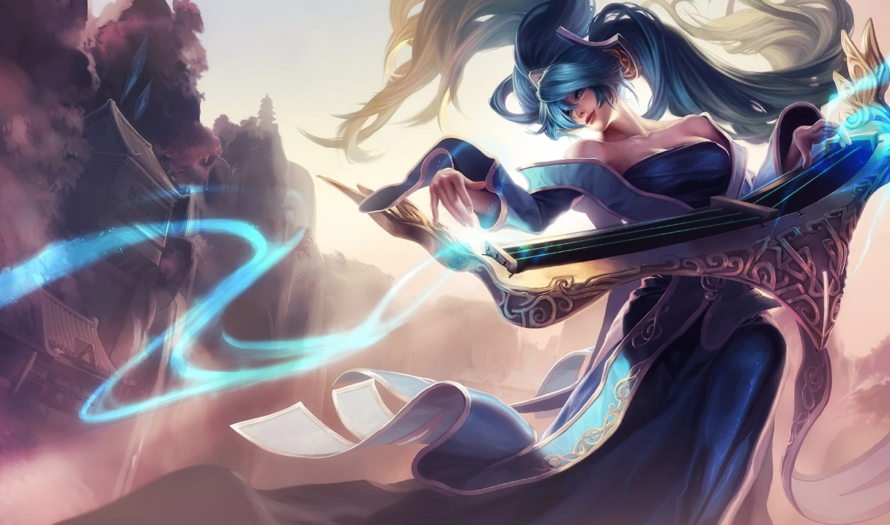
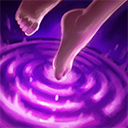
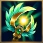
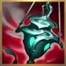
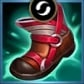

> [中文版 Chinese version](/life/wild-rift-sona-guide-zh/)

*Sona playing her etwahl. Official splash art: Riot Games, via League of Legends Wiki.*

## Where Sona Stands in Patch 7.3f

Bottom line first: **Sona is one of the safest climbing picks in the game right now**. Wild Rift Patch 7.3f went live on November 11, 2026 (November 12 on the China server), adding Sylas, buffing mage items, and trimming support income. Sona herself received no direct changes — and she is still sitting at the top of the support tier list:

- **China server, Diamond+: S-tier support, 52.41% win rate, 2.98% pick rate, 0.26% ban rate, ranked #5 out of 33 supports** (source: wrchina.gg, China server leaderboard, stats captured November 14, 2026). She gets stronger the higher you climb: 52.48% in Master+, 53.1% in Challenger (#3), and 52.95% in Sovereign with a 7.22% pick rate (#3).
- **Global servers, Master+: 52.19% win rate**, up 0.03 points over the last 30 days (source: wildriftcore.com, updated November 18, 2026).
- Wild Rift Fire rates her **S-tier in the Support lane**.

Why is she this strong? In one sentence: **Wild Rift is fast and teamfight-heavy, and Sona is the most reliable team-wide buff engine in the game**. All three of her basic abilities are auras — bonus damage, a shield, movement speed — so as long as she keeps playing, her team keeps getting stronger. Her ultimate, Crescendo, is one of the best teamfight ultimates in the game, and it supercharges every aura for 20 seconds afterward. The longer the game goes, the stronger she gets.

Patch 7.3f does contain one small headwind worth knowing about: **support income was trimmed**. The official notes cut the Soulcast gold on Bulwark of the Mountain and Black Mist Scythe from 75 to 60 per minute — Riot's words were that supports "have been earning Gold a little too quickly." In practice your first completed item arrives about half a minute to a minute later. It doesn't change her tier, but it means dying early hurts more, because a deficit is harder to recover when your income is slower.

Two other patch trends work in her favor: the jungle was nerfed (Smite damage and Conservation gold reduced), which slows the early game and gives Sona more safe time to scale; and mage items were buffed (Luden's Echo, Rod of Ages, Lich Bane, Morellonomicon, Hextech Rocketbelt), which strengthens the mages and marksmen she loves to protect.

**Strengths:**

- An aura engine: every Q, W, or E wraps nearby allies in a 3-second buff
- Power Chord is a free stun: every third ability cast becomes a 0.5-second stun on your next auto-attack
- Crescendo is a fight-winning ultimate that also empowers all auras for 20 seconds
- She scales hard: once her items are online, her mana is effectively unlimited and her heals and shields jump a tier
- Low mechanical floor: no complex combos, straightforward kit

**Weaknesses:**

- One of the squishiest supports in the game, with no dash — get hooked or dove on and you die
- Hook and engage supports (Blitzcrank, Pyke, Leona) punish her instantly
- Early mana is tight: spam carelessly and you'll be out of mana staring at the fight
- Almost no ability to lock someone down outside her ultimate and passive stun
- Very team-dependent: if your teammates can't play around you, you can't carry alone

## Ability Breakdown

Sona's kit is built around one idea: **every basic ability grants a 3-second aura to nearby allies**. Understand that, and you understand half the champion.

*Power Chord (Passive) ability icon. Source: official Riot Games game assets.*

### Passive: Power Chord

After casting 3 basic abilities, your next basic attack is empowered: it deals bonus magic damage that scales with level (roughly 20–160, +15% Ability Power) and **stuns the target for 0.5 seconds**. Each basic ability cast also grants Sona a 3-second, non-stacking aura buff, and her basic ability cooldowns are reduced by 2% per level (up to 20%).

This is Sona's only hard crowd control outside her ultimate, and her most dangerous laning tool. Half a second of stun sounds short, but combined with your ADC's follow-up it regularly turns into a kill or a blown Flash. Remember that the passive counts **casts, not time** — you can bank two stacks, hold the third, and fire the stun exactly when your ADC steps up.

### Q: Hymn of Valor

*Hymn of Valor (Q) ability icon. Source: official Riot Games game assets.*

Deals **50/90/130/170 + 40% Ability Power** magic damage to the two nearest enemies, and grants nearby allies an aura: their next attack deals **8/13/18/23 + 20% Ability Power** bonus damage. Mana cost 60/65/70/75.

This is your max-first skill and your main laning poke. Q prioritizes champions, so you can hit enemies through the minion wave from behind your own line. The aura damage rides on your ADC's next attack — so **Q isn't just your damage, it's your ADC's damage too**. Time it with your ADC's last-hits and trades and you're giving away free burst every few seconds.

### W: Aria of Perseverance

*Aria of Perseverance (W) ability icon. Source: official Riot Games game assets.*

Heals Sona and her lowest-health nearby ally for **35/50/65/80**, plus healing over time of **25/40/55/70 + 20% Ability Power**, and grants both a shield of **25/50/75/100 + 18% Ability Power**. If nobody is injured, it heals the closest allied champion instead.

The key to W is casting it **before** the damage, not after. The shield plus the heal-over-time is worth an entire trade on its own. Note that W targets the **lowest-health ally** automatically — in teamfights it finds the person who needs it, so your job is just to stay in aura range.

### E: Song of Celerity

*Song of Celerity (E) ability icon. Source: official Riot Games game assets.*

Grants Sona and nearby allies movement speed; Sona herself gains **15/16/17/18%**.

E is Sona's only self-peel and rotation tool: chase with it, escape with it, rotate with it, dodge skillshots with it. Patch 7.1h buffed her self-move-speed from 10/11/12/13% to 15/16/17/18%, a big part of why she's playable now. **Don't save E only for escapes** — press it before engages, rotations, and objective contests too.

### R: Crescendo

*Crescendo (R) ability icon. Source: official Riot Games game assets.*

Sona plays a chord that sends a wave of sound forward for 3.75 seconds, emitting a pulse every 0.75 seconds. Each pulse deals **35/60/85 + 15% Ability Power** magic damage; enemies hit for the first time are **stunned for 1 second**, and everyone caught in the wave is slowed **25/30/35%**. After casting, all of Sona's auras are **empowered (+20% effect) for 20 seconds**. Cooldown **80/75/70 seconds**.

This is one of the strongest teamfight ultimates in the game and the soul of the champion. Two details matter: first, **only the first enemy hit gets stunned** — everyone after that takes damage and a slow — so aim the wave at the target you most want locked down. Second, the 20-second empowered-aura window means **your ultimate is a team-wide buff window, not just crowd control**. The moment it lands, start cycling Q, W, and E to cash in the empowered auras.

## Skill Order

**Standard order: Q > W > E, ultimate at levels 5/9/13.**

- **Level 1: Q.** Poke from the start and help your ADC win the level 2 race.
- **Level 2: W.** Sustain for trades.
- **Level 3: E.** All three abilities online, passive loop running.
- **Max Q first, then W, E last.** Q's damage and aura scaling drive your lane pressure; W second keeps your healing relevant; E gains only 1% move speed per rank, so it goes last.

**When to deviate:**

- **Against heavy kill lanes (e.g. Draven + Leona), max W first.** Surviving matters more than poking. Accept the trade: less pressure, more sustain.
- **If your jungler plans to gank bot repeatedly,** put a second point in E after level 3 — the speed helps them stick to targets, and one successful gank pays for it.
- **Never max E first.** The per-rank value is the lowest in her kit.

## Runes

Two mainstream pages dominate Patch 7.3f. Pick based on your playstyle and rank.

### Option 1: Aery — stable, all-around, best for learning

- **Keystone: Aery.** Sona casts constantly, so Aery procs as often as any champion in the game — bonus damage on Q pokes, bonus shielding on W heals.
- **Manaflow Band:** more max mana and regen to ease early mana pressure; it also synergizes with Diadem of Songs to boost heal and shield power.
- **Transcendence:** ability haste, so your aura cycle runs faster.
- **Scorch:** extra damage on Q pokes, making your trades sting.
- **Bone Plating:** damage reduction so you don't get one-shot.

This is Wild Rift Fire's recommended page — the "can't go wrong" choice.

### Option 2: Fleet Footwork — the China-server high-elo favorite

- **Keystone: Fleet Footwork.** **74% of the top 30 Sona players on the China server run it**, and the rune page posts a **53.1% win rate** (40.11% usage in Diamond+). The movement speed and healing patch Sona's two biggest weaknesses: positioning and sustain.
- The other four runes are identical: **Manaflow Band, Transcendence, Scorch, Bone Plating.**

If you're already comfortable on Sona, Fleet Footwork is the stronger pick. If you're still learning her, Aery is more straightforward.

### Alternatives

- **Keystone: Ice Overlord.** Your passive stun and your ultimate's first-hit stun both trigger it, freezing a zone that slows enemies — great for peel and self-defense when the enemy has divers. 50.7% win rate on the China server.
- **Scorch → Font of Life:** repeated Q hits grant extra healing to allies — good for long, grindy poke lanes.
- **Bone Plating → Zombie Ward:** 42% of top China-server players take it. More vision value if your warding is solid.
- **Summoner spells: Flash + Heal.** If your ADC takes Barrier, you take Heal; if your ADC also takes Heal, the second Heal loses value — swap to **Ignite** (to secure kills) or **Exhaust** (to blunt enemy assassins).

## Item Build

Sona's item logic in one line: **mana + ability haste + heal and shield power**. She doesn't need AP for damage — she needs to never run out of mana and to make every heal and shield thicker.

### Starting items

- **Spectral Sickle:** the default. Q pokes trigger its bounty gold, so pressuring lane pays for itself.
- **Ancient Coin:** against hook lanes (Blitzcrank, Thresh, Pyke), sit back and collect safely instead of dying for poke gold.

### Core build order

| Order | Item | Why |
|---|---|---|
| 1 | Black Mist Scythe | Sickle upgrade: wards, AP, haste; completes the support quest |
| 2 | Ionian Boots of Lucidity | Ability haste — the earlier the better, this is when the "perpetual motion" starts |
| 3 | Diadem of Songs | **Sona's signature core item:** mana, AP, and heal/shield power in one slot |
| 4 | Echoes of Helia | Your damage becomes ally healing — Q turns into sustain |
| 5 | Harmonic Echo | Excess healing converts to shields; teamfight sustain changes tier |
| 6 | Ardent Censer | Attack speed + damage for your ADC; mandatory with auto-attack carries |
| 7 | Staff of Flowing Water | Heals/shields grant allies AP; prioritize when your team has multiple mages |

*Black Mist Scythe. Icon source: Wild Rift Fire.*

*Diadem of Songs. Icon source: Wild Rift Fire.*

*Echoes of Helia. Icon source: Wild Rift Fire.*

*Harmonic Echo. Icon source: Wild Rift Fire.*

*Ardent Censer. Icon source: Wild Rift Fire.*

*Ionian Boots of Lucidity. Icon source: Wild Rift Fire.*

**Why Diadem of Songs first?** It's tailored for Sona: the mana she desperately needs early, heal/shield power, and AP, all in one item. Once it's done, her early mana problems are basically solved. It's also among the most-built items on top Sona players.

**Boot enchant:** Protect Enchant (shield an ally) is the default; against heavy burst, switch to **Locket Enchant** and pop it as the fight starts for a team-wide shield.

### Situational builds

- **Ahead / snowballing:** after Echoes of Helia, go straight **Rabadon's Deathcap**. AP scales everything — heals, shields, Q damage — and a fed Sona can post top-three team damage.
- **Behind / being focused:** skip Ardent Censer and rush **Mikael's Blessing** (cleanse a teammate out of hard CC) or **Redemption** (long-range AoE heal). Staying alive matters more than your ADC's attack speed when you're behind.
- **Enemy has heavy healing (Soraka, Yuumi, Dr. Mundo):** build **Oceanid's Trident** for Grievous Wounds, or your healing gets matched.
- **Enemy has many divers (Zed, Kha'Zix, Akali):** Locket Enchant on boots, and **Protector's Vow** as your fourth item to save your ADC when they dive in.
- **Still running out of mana:** build **Archangel's Staff** second instead — Seraph's Embrace also gives an emergency shield. This is the other mainstream high-elo route on global servers.
- **Bulwark start:** if you opened Ancient Coin, upgrade into **Bulwark of the Mountain**, then Diadem of Songs. The most-used three-item core on the China server is Bulwark + Diadem + Ardent Censer, at a 54.6% win rate.

## Laning Phase

Laning is Sona's weakest phase — and the phase where one mistake can lose the whole game. The goal is simple: **stay alive until level 5, stay alive until your first completed item.**

### Mana management: the early game skill check

Sona's biggest early enemy isn't the enemy ADC — it's her own mana bar. Q costs 60 mana, W around 65, and your early pool is only 300–400. Spam and you're empty.

- **Only press Q when it pays:** it hits someone, helps your ADC last-hit, or procs Power Chord. Don't fire it into the air for style.
- **Save W even harder:** don't heal at full HP, and don't panic-heal when your ADC is down one bar. Wait for the enemy's next trade, then press W — shield plus heal-over-time wins the exchange.
- **Feel the rhythm:** below one-third mana, use Q only to bank passive stacks; stop pressing W. Before recalling, dump your mana into Q/W/E to help push or poke — don't go home with a full bar.

### Trading pattern

Sona's trade is a three-beat rhythm: **Q poke → auto-attack → back off**. The Q aura makes your ADC's next attack hit harder, so the best trade is when your Q lands the same moment your ADC attacks. Two damage sources arriving together always win the exchange.

**Using Power Chord:** bank two stacks early, hold the third. When the enemy ADC steps up for a cannon minion, or the enemy support mispositions, fire the third ability plus the empowered auto for the 0.5-second stun, and your ADC follows up. That often forces a Flash or a kill. **Don't auto-attack the moment the passive is ready** — a held stun is a threat that keeps the enemy from walking up; once you spend it, they know you have no CC for the next several seconds.

### The level 5 power spike

**Level 5, when Crescendo comes online, is Sona's first real power spike.** Before 5, the enemy can pressure you; after 5, you can pressure them. The moment you hit 5, look for it: enemy ADC steps up for a last-hit, you E forward, R to stun, ADC follows, Q plus passive stun for a second layer of CC. At level 5 this combo usually forces a kill or two Flashes. Many Sona players lose because they keep playing scared after 5 — with your ultimate up, you're the aggressor now.

### Matchups

**Hard (unfavorable):**

- **Blitzcrank:** the scariest matchup. Always stay behind minions, even when poking with Q. One hook is usually a death. After three items, your range and poke let you kite him instead.
- **Pyke:** your health bar lives below his ultimate execute threshold most of the lane. Heal yourself first, not your ADC; keep the bushes warded so he can't hook from the dark.
- **Leona:** unfavorable but playable. Keep maximum range; when she engages, R her mid-dash to break the CC chain.

**Even (skill matchups):**

- **Thresh, Milio:** Thresh's Flay disrupts your positioning and his Lantern saves his ADC; Milio's cleanse answers your ultimate. Against Thresh, ult him and the ADC together. Against Milio, ult groups, not singles — his cleanse saves one person, not five.

**Favorable:**

- **Soraka, Yuumi, Lulu and other enchanters:** your Q plus passive stun out-trades their sustain; win the level 2 and level 5 races and you own the lane.
- **Janna, Nami:** even in poke, and your range plus your ADC's range wins the trades if you don't get caught first.

## Teamfights

From mid game on, Sona's game becomes two things: **positioning** and **ultimate timing**. Everything else is garnish.

### Positioning: always the second row

Your spot is behind the frontline, next to your ADC, as far from enemy assassins as possible. **Don't stand in front of your ADC** — you're squishier than they are. **Don't drift away from your ADC either** — your auras only reach a few hundred units, and out of range means no buffs.

Quick self-check before a fight: "How many people does the enemy Zed/Kha'Zix have to walk through to reach me?" If the answer is "none," you're standing wrong.

### Ultimate timing: engage or peel

Crescendo has two uses. Which one depends on team comps:

- **Engage:** when the enemy is grouped and lacks strong counter-engage, E around the flank and R through their frontline to stun the backline while your team follows. This is the highest-carry usage, but it demands judgment about whether the enemy has already spent their key cooldowns — diving in while their CC is up is suicide.
- **Peel:** when the enemy has strong engage (Malphite, Amumu, Jarvan IV), hold R, wait for them to commit and spend their ultimates, then R the divers to protect your ADC and turn the fight. **Peel ultimates are far more forgiving than engage ultimates**, and at lower ranks they're the better default.

**The most common mistake:** treating Crescendo as a panic button and pressing it after the fight is already lost. A lost fight stays lost, and you've wasted the 20-second empowered-aura window. Your ultimate is an engage and counter-engage tool, not damage control.

### Aura cycling: the "breathing" of teamfights

Once the fight starts, your fingers shouldn't stop: **Q → W → E → Q → W → E**, on loop. Each cast is 3 seconds of aura, so a steady cycle means your team permanently has bonus damage, shielding, and speed. Which ability leads depends on the moment: W first if teammates are low, E first if you need to chase, Q first if you need damage. **Don't just press W and play healbot** — Sona's value is all three auras at once; healing alone is one-third of the champion.

The 20 seconds after Crescendo lands are your highlight reel: every aura is empowered, Q hits harder, W heals more, E speeds more. Cycle faster and more aggressively in that window — your team's damage window is the one you're creating.

## Beginner Techniques: Do These and You're a Solid Sona

1. **Always carry a sweeper, always ward.** A support's first job is vision, not healing. Rotate wards through river bush, dragon pit, and tri-bush.
2. **Only Q what you can hit.** Don't fire Q through the wave at nothing, and don't walk into danger to land it. Q's range is longer than it feels — you can poke from behind your own minions.
3. **Don't wait until someone is almost dead to press W.** Heal at one-third HP missing; shield plus heal-over-time wins the trade. Waiting until critical usually means the heal lands on a corpse.
4. **Level your ultimate the moment you hit 5, 9, and 13.** Those levels are power spikes — hitting them is an attack signal.
5. **Press E before you die, not W.** When caught, your first instinct should be E to run, not W to heal — the heal won't survive one auto-attack, but the speed might save you.
6. **Empty your mana before recalling.** Dump Q/W/E to help push or poke before you back. Going home with mana is wasted mana.

## Intermediate Techniques: From Solid to Carrying

1. **The passive stun is a deterrent, not a damage skill.** Holding a charged Power Chord keeps the enemy support from engaging; spending it tells them you have no CC for the next few seconds. Good Sona players hold the stun half the time.
2. **Flash + R.** Flash to adjust angle and range so the wave passes through more people and stuns the highest-value target. Mastering Flash-R doubles your engage success rate.
3. **E is a team skill, not a personal escape.** Press it before dragon to speed the whole team in, during chases to help teammates stick, and during retreats to get everyone out. Using it only to save yourself wastes 80% of its value.
4. **Learn to pre-cast W.** When Leona's Zenith Blade is flying or Malphite is about to ult, press W first — the shield lands before the damage does. A shield applied before damage is worth far more than a heal applied after.
5. **Sync Power Chord with your ADC.** One second before your ADC last-hits a cannon minion, fire your third ability plus the empowered auto to stun the enemy ADC — they miss the cannon and eat a full trade. A few reps and this becomes muscle memory for the duo.
6. **In losing games, build to survive first.** Rush Mikael's Blessing or Redemption before Ardent Censer. If you die, the teamfight has no Sona in it at all.

## Advanced Techniques: High-Elo Sona Details

1. **Aura timing, not aura uptime:** auras last 3 seconds, so cycling keeps them up permanently — but the advanced play is to *time* them. Press Q half a second before your ADC's key auto (a cannon last-hit, a tower hit, a Trinity Force proc) so that specific hit gets the bonus. Auras aren't best when always on; they're best when they land on the hit that matters.
2. **Ult "through" the team:** Crescendo travels for 3.75 seconds and only stuns the first enemy hit. Skilled players angle it so the wave grazes the frontline's edge and stuns the backline carry, instead of slamming straight into the tank. A 45-degree flank entry lands far more often than a head-on cast.
3. **The double-CC chain:** use the passive stun first to bait out a dash or cleanse, then follow with Crescendo's 1-second stun. Two controls spent separately force the enemy to answer twice; spent together, one cleanse answers both.
4. **Baiting with your own body:** at high elo, Sona can deliberately step slightly forward to bait an assassin's gap-closer — then Flash + E away, leaving their cooldowns burned, and answer with a reverse Crescendo while your team collapses. This is the highest-risk play in her kit; only attempt it when you're certain of your Flash and E timing.
5. **Vision dominance:** Sona needs vision more than almost any support, because she dies hardest to flanks. When even, ward the enemy jungle entrances; when ahead, ward up to their inhibitor turret. Carry two control wards every recall. If your vision is dominant, the enemy assassins lose half their kit.
6. **Draft awareness:** check the draft before locking Sona. With Malphite, Hecarim, or Galio on your team, she's S-tier — they engage, you follow with CC and 20 seconds of empowered auras. With a full squishy team and no engage, she's a "wait to die" pick no matter how well you play. Knowing when to pick her matters more than knowing how to play her.

## Climbing With Sona

### When to pick her

- **Your team has engage:** Malphite, Amumu, Jarvan IV, Hecarim on the team doubles Sona's value — they go in, your ultimate chains the CC, and the empowered auras clean up.
- **Your team has a late-game hypercarry:** Jinx, Vayne, Kai'Sa, Aphelios — Sona is the best bodyguard for a carry that needs time.
- **The enemy support is an enchanter:** against Soraka, Lulu, or Yuumi, Sona wins lane almost for free.

### When NOT to pick her

- **Blitzcrank + Draven on the enemy team:** that duo can end your lane before it starts. Don't force it.
- **Your team is all squishy with no engage:** your ultimate lands and nobody can follow up.
- **The enemy has multiple assassins (Zed + Kha'Zix + Akali):** you won't survive the first five seconds of a teamfight.

### Best ADC pairings

- **Yunara:** the best pairing on the China server. She has no shield and plays stationary early — your W is the missing shield and your Q loads damage onto her autos.
- **Draven:** the Q aura rides on Spinning Axe in full, W sustains his every-trade playstyle, and the passive stun opens his kills.
- **Miss Fortune:** your ultimate groups them up, her Bullet Time finishes the job — a devastating teamfight combo.
- **Jhin:** your Q arms his Deadly Flourish root, and Crescendo lets all four Curtain Call shots land.
- **Kog'Maw:** your W keeps him alive until his items come online; your E is his only repositioning tool while he stands and shreds.

### Best teammates across the map

- **Malphite:** your ultimate's slow makes Unstoppable Force undodgeable — two ultimates together delete the enemy backline.
- **Hecarim:** your E movement speed converts directly into his damage. Faster Hecarim is a stronger Hecarim.
- **Galio:** your ultimate's slow traps enemies inside his Hero's Entrance landing zone.

### Common mistakes (self-check)

- ❌ Only pressing W and playing healbot — you're using one-third of the champion
- ❌ Ultimating after the fight is already lost — it's an engage tool, not damage control
- ❌ Auto-attacking the moment Power Chord charges — hold it as a threat
- ❌ Standing as far forward as your ADC — you're squishier, always play the second row
- ❌ Spamming abilities at zero mana — a mana-empty Sona is a super minion
- ❌ Building the ahead-game build while behind — survive first, then support

### Ranked mindset

Sona is a "high floor, higher ceiling" champion: knowing how to press her buttons wins you half your games; knowing the details wins you the other half. Her win-rate curve says it all — the higher the rank, the higher her win rate (53.1% in Challenger). She rewards game sense and tempo, not mechanics. So climbing on Sona isn't about practicing combos; it's about practicing judgment: **when to pressure, when to back off, when to ult, when to bait**. Get those calls right on instinct, and Sona will take you further than you'd expect.

---

## Sources

- Riot Games, *Wild Rift Patch Notes 7.3f*, November 11, 2026: Sylas's arrival, support item economy changes (Black Mist Scythe / Bulwark of the Mountain gold 75→60 per minute), mage item buffs.
- wrchina.gg, *Sona Wild Rift Build, Runes & Counters — China Server (Patch 7.3f)*: 52.41% win rate in Diamond+, per-bracket stats, builds and rune stats from 19 top-ranked players, captured November 14, 2026.
- wildriftcore.com, *Sona Wild Rift Build, Counters & Tier (Patch 7.3f)*: 52.19% win rate in Master+, updated November 18, 2026.
- wildriftfire.com, *Sona Build Guide for Wild Rift (Patch 7.3f)*: S-tier support ranking, item and rune recommendations, ability patch history.
- wildriftguides.com, *Sona Support Counters, Best Build & Runes*: ultimate mechanics (3.75-second travel, pulses every 0.75 seconds), Ice Overlord runes, matchup data.

*All data is current as of November 18, 2026, based on Patch 7.3f. Check Riot's official patch notes for changes in later patches.*
