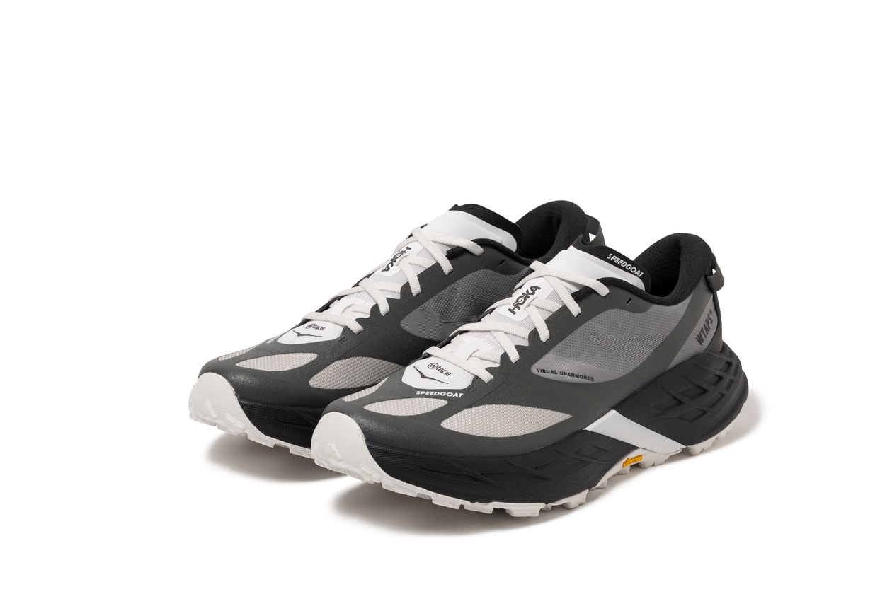
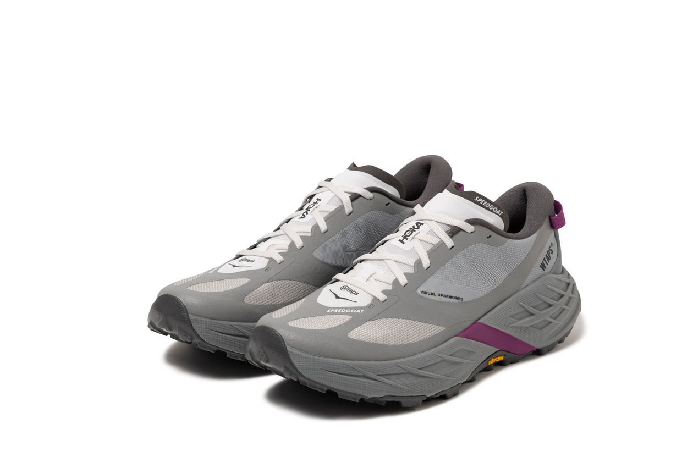
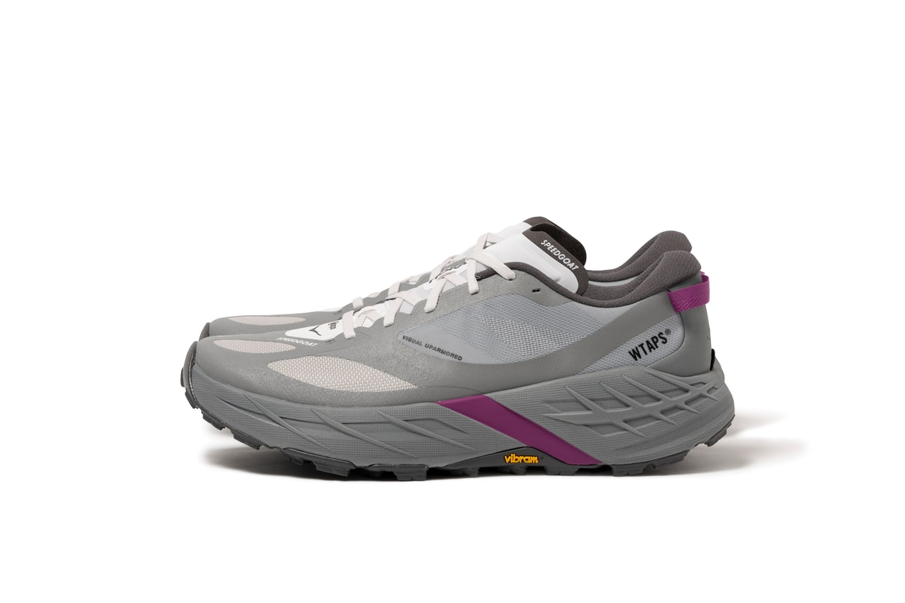
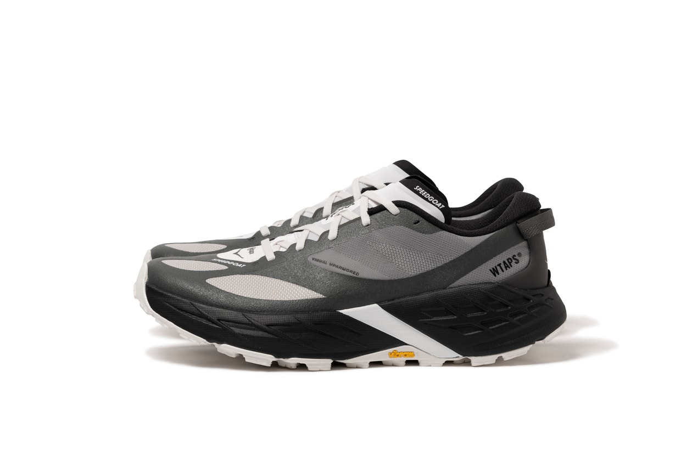
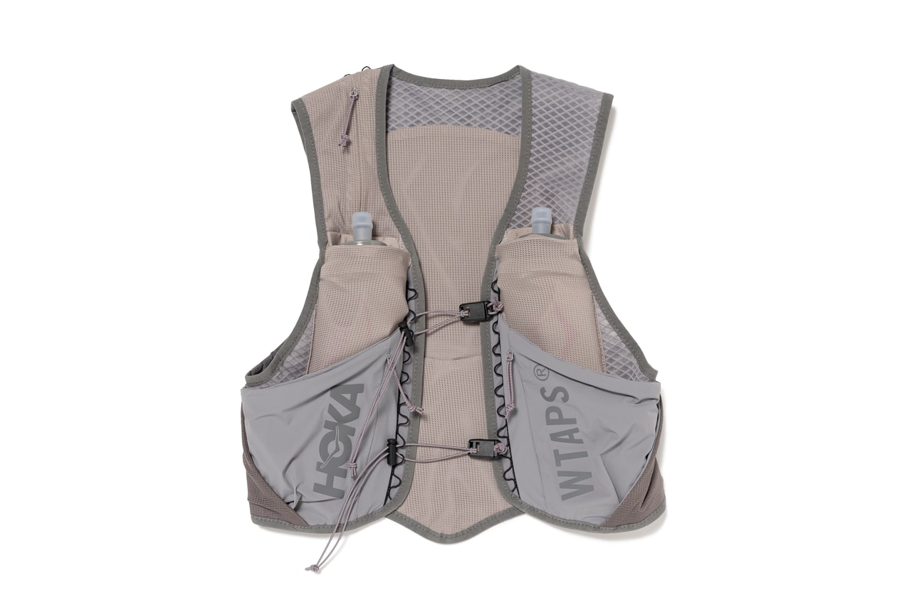
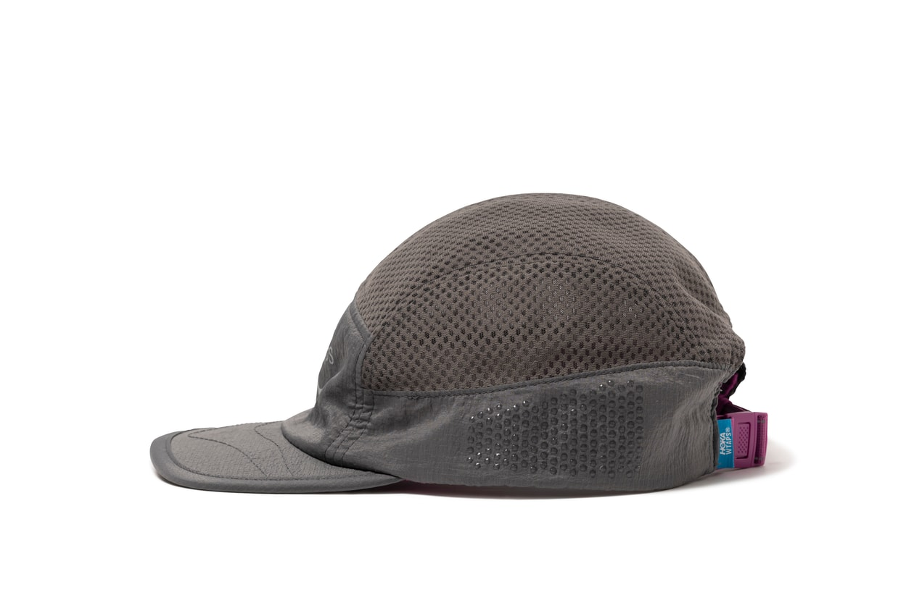

> [English version 英文版](/life/wtaps-hoka-speedgoat-ts/)

黑五这一天，一如几乎每一年，属于一双复刻 Jordan。但越过头条往下翻，今天——2026 年 11 月 27 日星期五——还有一双更安静、却更能说明球鞋行业正在往哪走的发售：WTAPS x HOKA Speedgoat TS，西山彻的东京品牌与这家源自法国的越野巨头第二次联名，今晨起经 HOKA 官方线上店、WTAPS 门店及官方线上店和指定零售商开售。两个配色——Galactic Grey/High Rise 与 Black/Volcanic Ash——美国售价 175 美元，日本含税 25,300 日元。没有抽签闹剧，没有编号限量，没有怀旧 IP。只有越野跑领域销量根基最深的平台，被一个街头品牌重构——而这个品牌的全部设计哲学，就印在鞋身侧面：VISUAL UPARMORED（视觉装甲）。

热度有据可查，且来自决定这类话题生死的那批媒体。Hypebeast 两度报道：11 月 17 日的产品拆解（附双配色货号）与 11 月 26 日发售前一天的完整系列报道（背心与跑帽俱全），后者在站内收获 2.1K 热度；Sole Retriever 发布了系列发售报道与两个配色的独立产品页；Sneaker News 11 月 24 日把这双鞋推给其千万粉丝的 Instagram 账号（截至发稿点赞 4.2K 并在增长）；Highsnobiety 将其定义为「粗野主义风格的越野跑鞋」；Gear Patrol 直接按户外装备而非潮流单品来报道——这永远是一双 HOKA 联名真正出圈的信号；HOKA 官方 Instagram 的宣传帖于 11 月 26 日上线。日本方面，HOKA 涩谷与心斋桥旗舰店以提前抽签方式分配货量——门店只有在预期排队不可控时才会这么做。这不是一双被博客顺手提到的普通量产越野鞋，而是黑五当天的越野头条：与 Air Jordan 4 "Bred" 同晨发售，依然守住了自己的话题角落。

## 基本信息

| | |
|---|---|
| **型号** | WTAPS x HOKA Speedgoat TS |
| **配色** | Galactic Grey/High Rise —— 1185590-GHG · Black/Volcanic Ash —— 1185590-BKVL |
| **发售** | 2026 年 11 月 27 日星期五 —— HOKA 官方线上店、WTAPS 门店及线上店、指定零售商；日本 HOKA 涩谷 / 心斋桥店为提前抽签 |
| **价格** | 美国 175 美元 / 日本 25,300 日元（含税）—— 2026 年 11 月 27 日查询 snapshot，subject to change |
| **鞋面** | 透气网布基底，鞋头、中足与后跟大面积防护覆片；鞋头与后跟外侧 WTAPS 标识；侧面网布印「VISUAL UPARMORED」 |
| **中底 / 大底** | EVA 中底 · Vibram Megagrip 大底，粗齿纹，干湿两用抓地 |
| **尺码** | 中性款；日本版尺码 22.0–29.0 cm，另有 30.0 cm |
| **系列其他单品** | Trail Run Vest 8L WTAPS —— 美国 180 美元 / 28,600 日元 · Trail Run Hat WTAPS —— 美国 45 美元 / 6,930 日元 |
| **系列脉络** | WTAPS x HOKA 第二弹，前作是 2024 年的 Anacapa Low GTX 与 Ora Luxe |

*Black/Volcanic Ash：装甲感拉满的一双——深色甲片、切口里透出的浅色网布、底下一副白色「底盘」。图片：HOKA / WTAPS，经 Hypebeast。*

## 为什么 Speedgoat 是对的画布

要理解这次联名为什么重要，先要理解没人联名时 Speedgoat 是什么。这双以超马选手 Karl "Speedgoat" Meltzer 命名的 HOKA 旗舰越野鞋，十年来一直是一个难题的默认答案：脚下能垫多少缓震，技术地形才仍然跑得动？它的配方——高而防护的鞋底堆叠、抓地的 Vibram Megagrip 大底、中足锁定、脚趾放开的贴合——让它常年出现在各大最佳越野鞋榜单上，从本地 50 公里到百英里赛的起跑线上。这次 TS 版本保留的，正是该系列的标志性元素：Megagrip 橡胶、防护鞋头、内部支撑结构。HOKA 官方对这个系列的产品文案罕见地自信，称它为山径上唯一的 GOAT。

这正是 WTAPS 成为一个有意思的伙伴、而非装饰性伙伴的原因。由西山彻在东京创立的 WTAPS，靠军事与工装参照的服装立身——衣服按装备的方式设计，每一块裁片、每一个口袋都要有理由。双方 2024 年 5 月的第一弹，拿 Anacapa Low GTX 徒步鞋与 Ora Luxe 恢复拖鞋开刀，视觉上几乎什么都没加：素色 GORE-TEX 鞋面、十字骨图案与克制；Highsnobiety 当时的评价是 WTAPS「没有把鞋变厚实」，因为不需要。第二弹是完全相反的动作：这次交给 WTAPS 的是性能旗舰——不是徒步鞋，不是拖鞋，是正经的比赛日越野鞋——而它没有把鞋往休闲里拉，而是往上装：装甲。

## 设计：覆片即论点

Speedgoat TS 保留了透气网布基底——官方图里看得很清楚，浅色、开放织纹——然后把大部分网布盖住。大面积防护覆片包覆鞋头、中足与后跟，切成大块光滑、近乎模压成型的甲片，甲片上开椭圆形窗口，让网布从切口里透出来。两个配色效果一致，确实像装甲：整双鞋读起来像一只柔软的内靴穿着一副坚硬的外壳——而这正是侧面那行字的字面意思。「VISUAL UPARMORED」以小字印在外侧面板上，难得地，一次联名鞋上的口号是对实物的精确描述，而不是氛围词。这些甲片，就是设计本身。

美学之下还有一层功能论证，值得诚实地讲。越野鞋的死法，鞋面与鞋底一样常见：网布被岩石磨破、鞋头开胶、中足覆片开裂。覆片式结构把耐磨材料精确放在越野鞋面最容易坏的位置——鞋头、中足、后跟——同时用网布窗口保住全合成外壳会杀死的透气性。至于 WTAPS 的甲片是否厚到能改变这双鞋的寿命，只有里程能回答，本文不装懂：TS 今晨才发售，尚不存在任何权威的长期实测，本文一切关于耐久的说法都是从结构出发的推断，而非使用证据。但这个推断至少方向正确。多数时尚联名会给性能鞋增加重量与脆弱性；这一次的核心动作增加的是防护，且加在防护该在的地方。这样一句话能写出来的次数，比想象中少得多。

品牌标识按 WTAPS 的标准相当克制。WTAPS 字样位于后跟外侧与鞋头，鞋舌并置双标——WTAPS 字标与 HOKA 的飞鸟标，「SPEEDGOAT」沿鞋舌边缘与鞋头排布。没有夜光，没有超大 logo，2024 年那一弹的十字骨也消失了。这双鞋的身份由结构与两个配色故事承载，不靠商标。

*Galactic Grey/High Rise：WTAPS 说这套配色取意城市景观。那一抹紫色是全鞋唯一非「城市」的音符——也正是它在干活。图片：HOKA / WTAPS，经 Hypebeast。*

### Galactic Grey/High Rise（1185590-GHG）：水泥那一双

灰色配色的身份完全由同色系深浅建立——甲片上的层层灰、窗口里更浅的网布、灰色雕塑感中底——然后把唯一的点缀色用得极有分寸：中底里切入一道紫罗兰色条纹，后跟一枚同色拉带。WTAPS 称这套配色灵感来自城市景观，Gear Patrol 的报道进一步指明参照物是混凝土。它的读感是好的 WTAPS 产品一贯的读感：市政、克制、微微粗野主义——Highsnobiety 的原词——紫色只保留到刚好不让鞋融进它所参照的路面为止。侧面图里结构故事最清楚：斜切的中底雕刻、大底边缘黄色的 Vibram 字标、后跟的 WTAPS 印字，以及印着 VISUAL UPARMORED 的网布面板，像装备上的规格钢印。

*侧面图，Galactic Grey：覆片接缝、网布窗口与中底几何就是全部设计——几乎没有平面图案可以躲。图片：HOKA / WTAPS，经 Hypebeast。*

### Black/Volcanic Ash（1185590-BKVL）：图形感那一双

黑色配色把灰色那双的平衡反了过来。Galactic Grey 是从上到下的同调，Black/Volcanic Ash 则以黑灰覆片鞋身配一副干净的白色鞋底单元，对比之下同样的结构变得更锐利、更图形化——白色大底像深色鞋身下的一副底盘，白色中底楔块斜切过黑色后跟，让 HOKA 最出名的那个元素——鞋底厚度——成为整双鞋最响的部分。Sole Retriever 描述这双是黑与白在网布与合成材料间的混合；在照片里，它是两双中日常穿搭更容易成立的一双，也是越野硬件——鞋头上翻的齿纹、Vibram 标识——保持最可见的一双。如果说灰色那双是概念，黑色这双就是产品。

*侧面图，Black/Volcanic Ash：同一副装甲，相反的光。白色鞋底把 HOKA 的厚底变成了设计的头条。图片：HOKA / WTAPS，经 Hypebeast。*

## 脚下：哪些已确认，哪些没有

已确认的脚下故事简短而扎实。中底为 EVA，提供 HOKA 靠以成名的缓震与冲击吸收层；日本发售报道补充其内部有支撑结构，并保留了 Speedgoat 系列的防护鞋头。大底是 Vibram Megagrip——半个严肃越野行业都在用的高抓地橡胶配方——配粗深齿纹，意在干湿地面都咬得住。这两个事实是这双鞋的性能核心，而且是对的两个事实：一双保留了原型抓地与缓震、只换了外衣的联名，保留住的是要紧的东西。

没有确认的部分同样重要，认真的评测应当标出边界。在发售时可查的报道里，HOKA 尚未公布 TS 版本专门的重量或落差数据，本文不会借用普通版 Speedgoat 的数字冒充 TS 的——覆片鞋面是不同的结构，重量是多少就是多少。谁在发售日就能给你精确的 TS 堆叠高度，谁就是在猜。诚实的总结是建筑式的、而非数字式的：一副 Speedgoat 传统的缓震 EVA 平台、一副带真齿纹的 Megagrip 大底，以及一个以覆盖度换掉普通版部分开放性的鞋面。在 TS 与普通版 Speedgoat 之间纠结的跑者，应当把它们当作鞋面不同的兄弟，而不是同一双鞋的两个配色。

选码建议从结构出发。覆片式鞋面通常比开放网布更保形、更少延展，因此 TS 的中足体感大概率比网布版 Speedgoat 更结构化、更锁定，弹性余量由网布窗口提供。日本版尺码 22.0 至 29.0 cm，另有 30.0 cm，中性款。如果你平时在 HOKA 越野鞋里卡在两码之间，结构化鞋面支持选你惯常的越野码，而不是为网布的贴合去选小——甲片不会像网布那样穿松。再次说明：这是基于结构的建议，标注清楚——这双鞋开售才几个小时。

## 套装：WTAPS 不再联名一双鞋，而是联名一整套跑山装备

这个系列最具战略意味的部分不是鞋。双方合作以来第一次加入配件——而且不是周边级的配件。Trail Run Vest 8L WTAPS（美国 180 美元 / 28,600 日元）是一件正经的越野装备：8 升容量、贴身剪裁、11 个口袋分散负重，附两只 500 ml HydraPak 软水壶。Trail Run Hat WTAPS（美国 45 美元 / 6,930 日元）是一顶透气网布跑帽：柔性短帽檐、弹力扣调节，以及侧面用于固定太阳镜的硅胶点条——一个小而具体的、懂跑者的细节，假装进军越野的生活方式品牌想不出来。

*这件背心是全系列的题眼：11 个口袋、两只 500 ml HydraPak 软水壶、按装备逻辑分配负重——因为它就是装备。图片：HOKA / WTAPS，经 Hypebeast。*

*跑帽把灰色配色的紫色点缀延续到了扣具上——还有那个固定太阳镜的细节，暴露了设计简报有多懂跑者。图片：HOKA / WTAPS，经 Hypebeast。*

把这套装备读作 HOKA 对自身增长方向的表态。鞋类联名卖给球鞋买家；背心联名只卖给真跑山的人——没人会把一件 8 升 11 袋的水袋背心当时尚单品买——这意味着 HOKA 用 WTAPS 不是来借街头信誉，而是往运动核心里招人：给 WTAPS 的受众一套完整、连贯、真正能用的越野套装，鞋、背心、帽合计 400 美元。Gear Patrol 把这个系列当装备报道。这正是重点。

## 结论：谁该买哪一双

以发售日证据看，Speedgoat TS 是今年较诚实的联名之一：一双性能旗舰，合作方改善了——或至少可信地强化了——自己动过的那部分，EVA 加 Megagrip 的核心原封不动，定价 175 美元，只比普通版 Speedgoat 6 首发价高 20 美元，落在正常越野鞋价格带内，而不是联名税价格带。本文全部价格为 2026 年 11 月 27 日查询 snapshot，subject to change。

两个配色之间：Galactic Grey/High Rise 是 WTAPS 原教旨主义者的那双——同调、水泥参照、紫色点缀是唯一的花活，也是与 WTAPS 自家服装搭在一起最成立的一双。Black/Volcanic Ash 是更好穿的第一双 HOKA：白色鞋底提气，对比之下藏不住山土，但在城里读感更利落，也是非跑者最快能理解其轮廓的一双。按功能选的越野跑者可以放心按颜色偏好下单——平台、覆片与大底是共享的——同时记住那条常设提醒：TS 尚不存在长期实测，装甲的耐久论证是一个论证，不是一个结果。

最后的诚实注脚属于日历。今天会被记住是 Bred 4 之日，这很公平——那双鞋身后站着 1989 年。但 Speedgoat TS 是更能描述 2026 年的那次发售：一双越野鞋、一个跑步品牌、一个东京工装品牌给它装甲、作为一套能干活的跑者套装出售、被户外媒体与球鞋媒体以同样的认真程度报道。这个行业花了十年把生活方式覆片贴在篮球鞋上；今天早上，它把装备覆片贴在了一双越野鞋上，并且是认真的。

*来源：Hypebeast（2026 年 11 月 17 日与 26 日系列报道与产品拆解——价格、货号、背心与跑帽细节、发售渠道）；Sole Retriever（2026 年 11 月系列报道与双配色产品页——美国定价、货号、中性尺码）；Gear Patrol（2026 年 11 月——Galactic Grey 的混凝土参照、美国配件定价、2024 年系列脉络）；Highsnobiety（2024 年第一弹与 2026 年定调）；Sneaker News 与 HOKA 官方 Instagram（2026 年 11 月 24–26 日——宣传图与互动数据）；ST Magazine 日本发售报道（2026 年 11 月 27 日——日本定价、尺码、内部结构与鞋头、日本门店抽签细节）。价格为 2026 年 11 月 27 日零售 snapshot，subject to change。本文为发售日设计与背景评测，非上脚实测。*
