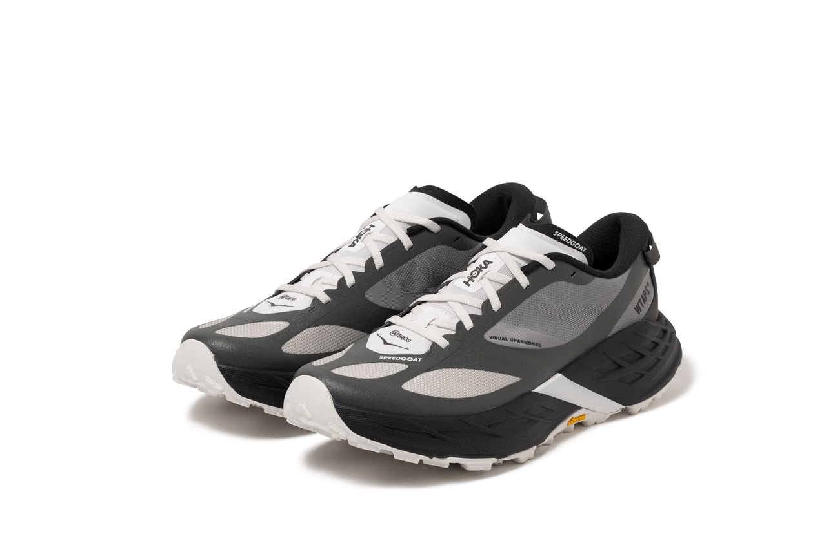
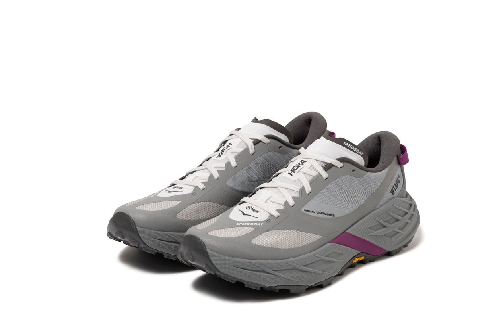
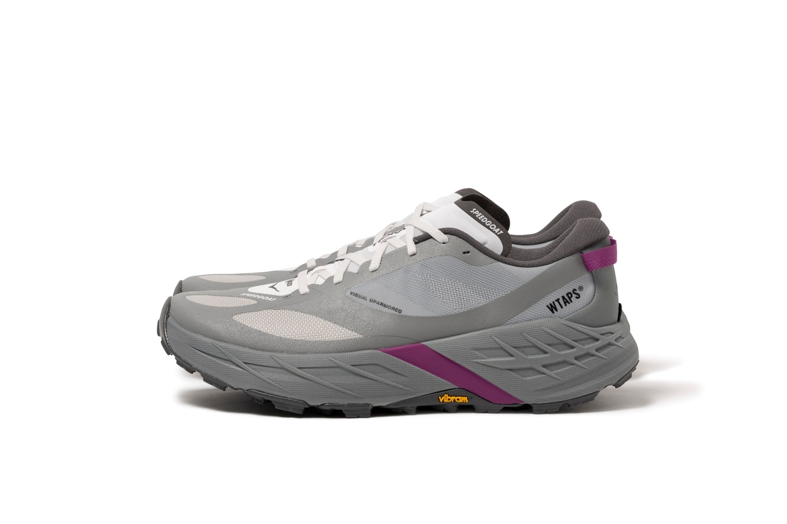
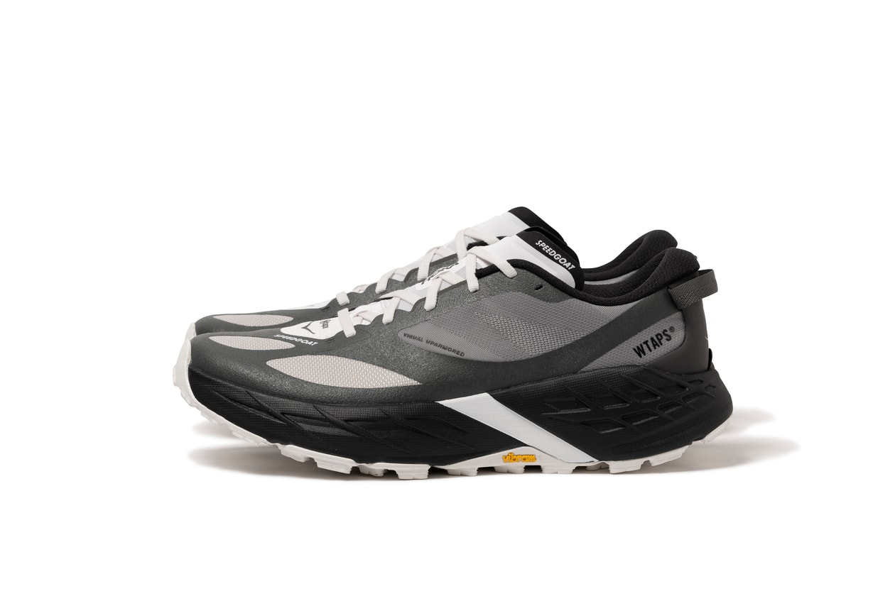
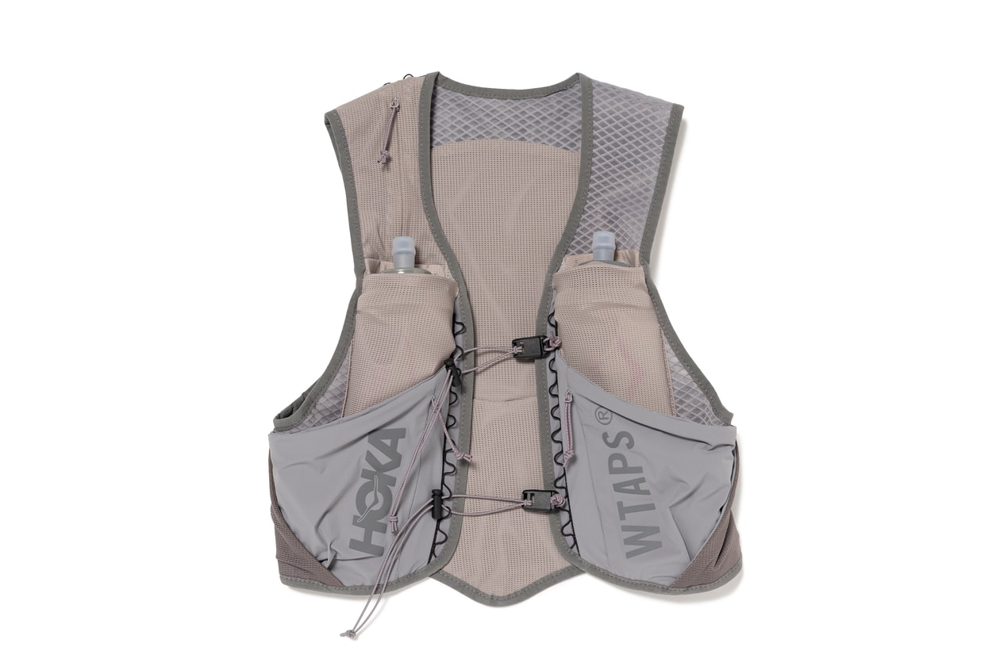
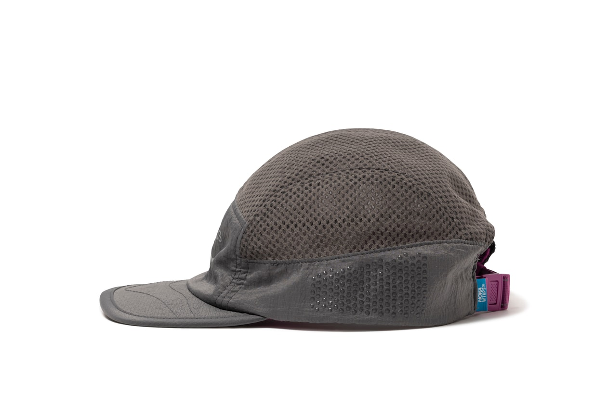

> [中文版 Chinese version](/life/wtaps-hoka-speedgoat-ts-zh/)

Black Friday belongs, as it almost always does, to a retro Jordan. But scroll past the headline act and today, Friday, November 27, 2026, has a quieter release that says more about where sneakers are actually going: the WTAPS x HOKA Speedgoat TS, the second collaboration between Tetsu Nishiyama's Tokyo label and the French-born trail giant, on sale from this morning through HOKA's official online store, WTAPS stores and its official online store, and select retailers. Two colorways — Galactic Grey/High Rise and Black/Volcanic Ash — at $175 in the US and ¥25,300 tax-included in Japan. No raffle drama in the US listing, no numbered pairs, no nostalgia IP. Just the best-selling trail platform in the business, rebuilt by a streetwear label whose entire design philosophy can be read, literally, on the side of the shoe: VISUAL UPARMORED.

The heat is documented across the exact outlets that decide these things. Hypebeast ran the collection twice — a product breakdown with both style codes on November 17 and a full collection story, with the vest and hat, on November 26, the day before release; its collection post drew 2.1K hypes. Sole Retriever published the pack's release story and individual product pages for both colorways. Sneaker News put the shoes in front of its ten-million-follower Instagram audience on November 24 (4.2K likes and counting at last check), Highsnobiety framed the shoe as a "brutalist-style trail runner," Gear Patrol covered it as outdoor gear rather than fashion — always the tell that a HOKA collab has crossed over — and HOKA's own Instagram campaign post landed November 26. In Japan, HOKA's Shibuya and Shinsaibashi flagships handled their allocation by advance raffle, which is what stores do when they expect a line they cannot manage. This is not a general-release trail shoe that a blog noticed. It is the Black Friday trail release, arriving the same morning as the Jordan 4 "Bred" and holding its own corner of the conversation anyway.

## The facts

| | |
|---|---|
| **Model** | WTAPS x HOKA Speedgoat TS |
| **Colorways** | Galactic Grey/High Rise — 1185590-GHG · Black/Volcanic Ash — 1185590-BKVL |
| **Release** | Friday, November 27, 2026 — HOKA official online store, WTAPS stores and online, select retailers; HOKA Shibuya / Shinsaibashi by advance raffle in Japan |
| **Price** | $175 US / ¥25,300 (tax incl.) Japan — snapshot as of November 27, 2026, subject to change |
| **Upper** | Breathable mesh base with extensive protective paneling across toe, midfoot and heel; WTAPS branding on vamp and lateral heel; "VISUAL UPARMORED" on the lateral panel |
| **Midsole / Outsole** | EVA midsole · Vibram Megagrip outsole with aggressive lugs, for wet and dry traction |
| **Sizing** | Unisex; Japanese listing runs 22.0–29.0 cm plus 30.0 cm |
| **Also in the collection** | Trail Run Vest 8L WTAPS — $180 US / ¥28,600 · Trail Run Hat WTAPS — $45 US / ¥6,930 |
| **Series** | Second WTAPS x HOKA collection, after the 2024 Anacapa Low GTX and Ora Luxe |

*Black/Volcanic Ash: the armor read at full strength — dark plates, pale mesh showing through the cut-outs, and a white sole unit underneath like a chassis. Image: HOKA / WTAPS, via Hypebeast.*

## Why the Speedgoat is the right canvas

To understand why this collaboration matters, you have to understand what the Speedgoat is when nobody famous is touching it. Named for ultrarunner Karl "Speedgoat" Meltzer, HOKA's flagship trail shoe has spent a decade as the default answer to a hard question: how much cushion can you put under a runner before technical terrain stops being runnable? Its formula — a tall, protective stack, a grippy Vibram Megagrip outsole, a fit that locks the midfoot and lets the toes work — made it a perennial fixture of best-trail-shoe lists and start lines from local 50Ks to hundred-milers. The current inline generations carry the same signature elements this TS version keeps: the Megagrip rubber, the protective toe bumper, the internal support chassis. HOKA's own product copy for the line calls it, with unusual confidence for marketing, the one GOAT on the trail.

That is precisely why WTAPS is an interesting partner rather than a decorative one. WTAPS, founded in Tokyo by Tetsu Nishiyama, built its reputation on military- and utility-referenced clothing — garments designed the way equipment is designed, with every panel and pocket argued for. Its first HOKA collection, in May 2024, took the Anacapa Low GTX hiker and the Ora Luxe recovery slide and did almost nothing to them visually beyond tonal GORE-TEX uppers, crossbones motifs and restraint; Highsnobiety's verdict at the time was that WTAPS "didn't beef up" the shoes because it didn't have to. Round two is the opposite move. This time WTAPS has been handed the performance flagship — not the hiker, not the slide, the actual race-day trail shoe — and instead of dressing it down, it has dressed it up: in armor.

## The design: paneling as an argument

The Speedgoat TS keeps a breathable mesh base — you can see it clearly in the official photography, pale and open-textured — and then covers most of it. Extensive protective paneling wraps the toe, the midfoot and the heel, cut into large, smooth, almost molded plates with oval windows that let the mesh show through. The effect, consistent across both colorways, is genuinely armor-like: the shoe reads as a soft inner boot wearing a hard outer shell, which is exactly the visual WTAPS is named for on the lateral panel. "VISUAL UPARMORED" is printed there in small type, and for once the slogan on a collaboration shoe is a precise description of the object rather than a vibe. The plates are the design.

There is a functional argument underneath the aesthetic one, and it deserves to be made honestly. Trail shoes die from the upper as often as from the outsole: mesh tears on rock, toe boxes delaminate, midfoot overlays crack. A paneled construction puts abrasion-resistant material exactly where trail uppers fail — toe, midfoot, heel — while the mesh windows preserve the breathability that a full synthetic shell would kill. Whether WTAPS' plates are thick enough to change the shoe's lifespan is a question only miles can answer, and this review will not pretend otherwise: the TS released this morning, no authoritative long-term wear test of it exists yet, and everything said here about durability is inference from construction, not evidence from use. But the inference is at least pointed in the right direction. Most fashion collaborations add weight and fragility to a performance shoe. This one's central gesture adds protection, in the places protection belongs. That is a rarer sentence to be able to write than it should be.

The branding, by WTAPS standards, is disciplined. WTAPS lettering sits at the lateral heel and on the vamp, the tongue carries both marks — the WTAPS wordmark alongside HOKA's bird — and "SPEEDGOAT" runs along the tongue edge and the vamp. Nothing glows, nothing is oversized, and the crossbones of the 2024 collection are gone. The shoe's identity is carried by its construction and its two color stories, not by logos.

*Galactic Grey/High Rise: WTAPS says the palette channels concrete. The violet accent is the only non-urban note — and it is doing all the work. Image: HOKA / WTAPS, via Hypebeast.*

### Galactic Grey/High Rise (1185590-GHG): the concrete one

The grey colorway builds its identity entirely from tonal variation — layered greys across the plates, lighter mesh in the windows, a grey sculpted midsole — and then spends its one accent with real precision: a violet-purple stripe cut through the midsole and a matching pull tab at the heel. WTAPS describes the colorway as inspired by urban landscapes, and Gear Patrol's account specifies the reference as concrete. It reads the way good WTAPS product usually reads: municipal, deliberate, faintly brutalist — Highsnobiety's word — with the purple kept just visible enough to keep the shoe from disappearing into the pavement it references. On the lateral shot the construction story is clearest: the diagonal midsole sculpting, the yellow Vibram wordmark at the outsole edge, the WTAPS heel print, and the mesh panel carrying the VISUAL UPARMORED line like a spec stamp on equipment.

*Lateral view, Galactic Grey: the panel seams, the mesh windows and the midsole geometry are the whole design — there is almost no applied graphics work to hide behind. Image: HOKA / WTAPS, via Hypebeast.*

### Black/Volcanic Ash (1185590-BKVL): the graphic one

The black colorway inverts the grey pair's balance. Where Galactic Grey is tonal top to bottom, Black/Volcanic Ash pairs its black-and-grey paneled upper with a crisp white sole unit, and the contrast turns the same construction into something sharper and more graphic — the white outsole reads as a chassis under a dark body, and the white midsole wedge slashing through the black heel makes the stack height, the thing HOKA is famous for, the loudest element of the shoe. Sole Retriever describes the pair as black and white mixed across mesh and synthetics; in the photography it is the more immediately wearable of the two with ordinary clothing, and the one whose trail hardware — the lugs wrapping up at the toe, the Vibram mark — stays most visible. If the grey pair is the concept, the black pair is the product.

*Lateral view, Black/Volcanic Ash: same armor, opposite lighting. The white sole unit turns HOKA's stack into the design's headline. Image: HOKA / WTAPS, via Hypebeast.*

## Underfoot: what is confirmed, and what is not

The confirmed underfoot story is short and solid. The midsole is EVA, providing the cushioned, impact-absorbing layer HOKA built its name on; Japanese release reporting adds a supportive internal chassis and the protective toe bumper carried over from the Speedgoat line. The outsole is Vibram Megagrip — the high-traction compound Vibram supplies to half the serious trail industry — with aggressive, deep lugs intended to bite on wet and dry surfaces alike. Those two facts are the performance core of the shoe, and they are the right two facts: a collaboration that kept the base model's grip and cushion while changing its clothes has kept the things that matter.

What is not confirmed matters too, and a careful review should mark the boundary. HOKA has not, in the coverage available at release, published a weight or heel-to-toe drop figure for the TS specifically, and this article will not borrow the inline Speedgoat's numbers and present them as the TS's — the paneled upper is a different construction and will weigh what it weighs. Anyone quoting you a precise TS stack height on release day is guessing. The honest summary is architectural, not numerical: a cushioned EVA platform in the Speedgoat tradition, a Megagrip outsole with real lugs, and an upper that trades some of the inline shoe's openness for coverage. Runners choosing between the TS and a standard Speedgoat should treat them as siblings with different uppers, not as the same shoe in two colorways.

Fit guidance follows from the construction. Paneled, plated uppers generally hold their shape more and stretch less than open mesh, so the TS is likely to feel more structured — more locked — through the midfoot than a mesh Speedgoat, with the mesh windows supplying what give there is. Japanese sizing runs 22.0 to 29.0 cm plus a 30.0, in unisex sizing. If you are between sizes in HOKA trail shoes, the structured upper argues for your usual trail size rather than sizing down for a snugger mesh fit; the plates will not relax the way mesh does. That, again, is construction-based guidance, clearly labeled — the shoe has been on sale for a matter of hours.

## The kit: WTAPS stops collaborating on shoes and starts collaborating on running

The most strategically interesting part of this collection is not the shoe. For the first time in the partnership, WTAPS x HOKA includes accessories — and not merch-grade accessories. The Trail Run Vest 8L WTAPS ($180 US / ¥28,600) is a real piece of trail equipment: an 8-liter vest built to fit close to the body, with 11 pockets to distribute weight, supplied with two 500 ml HydraPak soft flasks. The Trail Run Hat WTAPS ($45 US / ¥6,930) is a breathable mesh run cap with a flexible short visor, an elastic-buckle adjustment, and silicone dot strips at the sides whose job is to keep sunglasses from sliding off — a small, specific, runner-literate detail that no lifestyle brand faking its way into trail would think to specify.

*The vest is the collection's tell: 11 pockets, two 500 ml HydraPak flasks, weight distributed like equipment — because it is equipment. Image: HOKA / WTAPS, via Hypebeast.*

*The hat carries the grey colorway's violet accent to the buckle — and a sunglasses-grip detail that gives away how runner-literate the design brief was. Image: HOKA / WTAPS, via Hypebeast.*

Read the kit as a statement about where HOKA believes its growth is. A shoe collaboration sells to sneaker buyers. A vest collaboration sells only to people who actually run trails — nobody buys an 8-liter, 11-pocket hydration vest as a fashion object — which means HOKA is using WTAPS not to borrow street credibility but to recruit into the sport's core, offering the WTAPS audience a complete, coherent, genuinely usable trail kit at a combined $400 for shoe, vest and hat. Gear Patrol covered the collection as gear. That is the point.

## The verdict: who should buy which

The Speedgoat TS is, on release-day evidence, one of the more honest collaborations of the year: a performance flagship whose collaborator improved — or at minimum, plausibly reinforced — the part of the shoe it touched, kept the EVA-and-Megagrip core untouched, and priced the result at $175, twenty dollars over where the inline Speedgoat 6 sat at its launch and squarely in normal trail-shoe territory rather than collaboration-tax territory. All prices here are snapshots as of November 27, 2026, subject to change.

Between the colorways: Galactic Grey/High Rise is the WTAPS purist's pair — tonal, concrete-referenced, the violet accent as its only flourish, and the one that will look most deliberate with the label's own clothing. Black/Volcanic Ash is the easier daily wear and the better first HOKA: the white sole keeps it bright, the contrast hides trail dirt less well but reads sharper in the city, and it is the pair whose silhouette a non-runner will understand fastest. Trail runners choosing on function should buy on color preference without anxiety — the platform, paneling and outsole are shared — while remembering the standing caveat: no long-term wear test of the TS exists yet, and the durability case for the armor is an argument, not a result.

And the honest closing note belongs to the calendar. Today will be remembered as Bred 4 day, and fairly — that shoe has 1989 behind it. But the Speedgoat TS is the release that describes 2026: a trail shoe, from a running brand, armored by a Tokyo utility label, sold as part of a working runner's kit, and covered as seriously by outdoor press as by sneaker press. The industry spent a decade putting lifestyle panels on court shoes. This morning it put equipment panels on a trail shoe, and meant it.

*Sources: Hypebeast (collection story and product breakdown, November 17 and 26, 2026 — prices, style codes, vest and hat details, release channels); Sole Retriever (pack story and per-colorway product pages, November 2026 — US pricing, SKUs, unisex sizing); Gear Patrol (November 2026 — concrete reference for Galactic Grey, US accessory pricing, 2024 collection history); Highsnobiety (2024 first collection and 2026 framing); Sneaker News and HOKA official Instagram (November 24–26, 2026 — campaign imagery and engagement); ST Magazine Japan release report (November 27, 2026 — Japanese pricing, sizing, chassis and toe bumper, store raffle details). Prices are retail snapshots as of November 27, 2026, subject to change. This is a release-day design and context review, not an on-foot wear test.*
