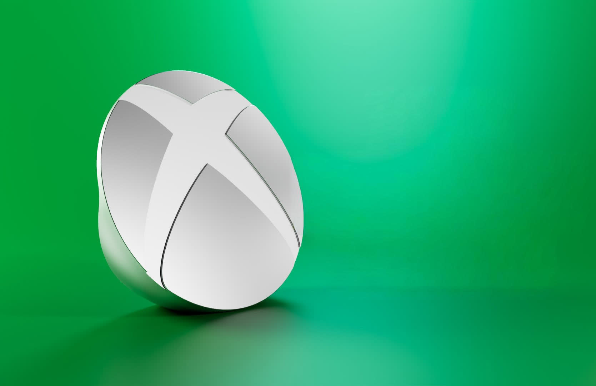
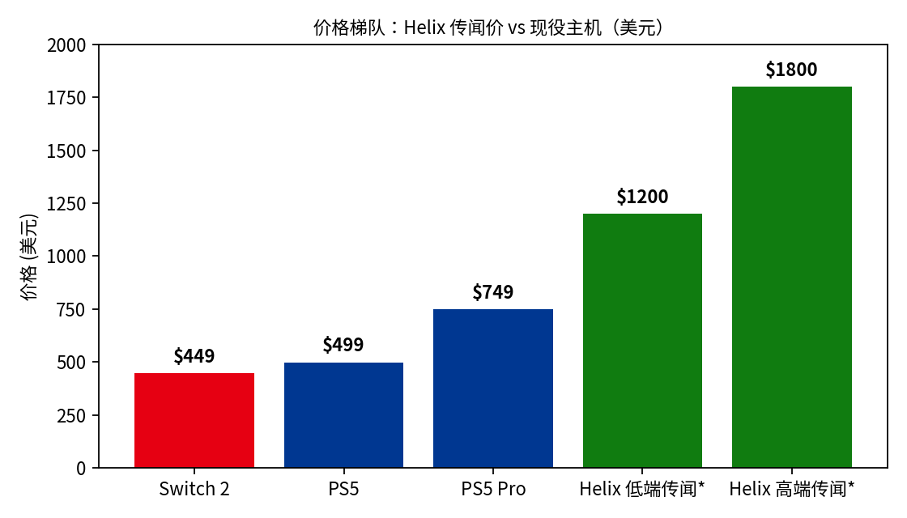

> [English version 英文版](/life/xbox-helix-pc-hybrid-pivot/)

*报道状态，开篇明说：本文所述的 Helix 原始计划是 **Windows Central 报道的传闻**，经 TechSpot 与 Club386 于 2026 年 11 月 24 日转述，消息源为未具名人士，微软没有确认。微软确认过的只有更窄的一部分：下一代 Xbox 代号 Helix、将以某种形式支持 PC 游戏、开发者明年将收到 alpha 开发机。其余内容在正文中逐句标注为报道、传闻或推断。*

*图片：TechSpot，2026 年 11 月 24 日报道。微软尚未发布任何 Helix 硬件图片。*

## 据报道已经死掉的那个计划

据 Windows Central 的消息源（TechSpot 2026 年 11 月 24 日报道），下一代 Xbox 在今年早些时候领导层变更之前，被设计成主机行业从未出过货的东西：一台伪装的 PC。

这台机器运行 Windows。它默认开机进入微软新的 Xbox Mode——一个主机风格的界面。但用户可以退出该界面，回到普通的 Windows 桌面，安装任何 Windows 应用——明确包括 **Steam**。它同时能玩 Xbox 主机游戏，而这正是该设计激进而非仅仅"融合"的原因：主机游戏库与 PC 游戏库，在同一台机器上，且 PC 一侧完全开放。

该设计有两个必然结果，Windows Central 的报道两个都点了名。第一，一台开放的 Windows 机器无法可信地在 PC 一侧收联机费，所以计划据报要求**取消联机付费墙**——免费在线游戏，终结一个自 2002 年 Xbox Live 开创、Sony 随后效仿的收费模式。第二，Asus ROG Xbox Ally 掌机在这个叙事里不是一个支线实验，而是**草稿**：Windows 加 Xbox Mode 体验的第一次公开测试，Helix 本要把这套体验带进客厅，它是在时任 Xbox 负责人 Phil Spencer 治下开发的。

报道说，这个计划属于 Spencer 时代。Asha Sharma 于今年 2 月接替 Spencer 出任 Xbox CEO，而微软目前的官方口径描述的是一台实质不同的机器。

## 那句反过来的话

微软自己最近对 Helix 的描述（见 11 月 24 日报道引述）值得逐字读，因为反转完全由语序承载：Helix 是**"一台能玩 PC 游戏的主机，而不是一台能玩主机游戏的 PC"**。

这两个短语包含相同的组件——主机、PC 游戏、主机游戏——却是相反的产品。一台能玩主机游戏的 PC，是一个带主机兼容层的开放平台：商店是可选的，桌面是真实的，每次用户按 Alt+Tab 切到 Steam，厂商的抽成都可以被绕过。一台能玩 PC 游戏的主机，是一个带兼容功能的封闭平台：商店才是重点，界面受控，而"能玩 PC 游戏"可以指从完整的 Steam 接入，到通过微软自家渠道、按微软条款交付的精选子集，什么都可能。

微软确认了第二句话和代号。它描述了一个新界面：即时进入游戏、为高级用户提供更多自定义、并"消除传统障碍"——11 月 24 日的报道指出，这套语言模糊到两个方向都能套。它没有确认 Steam 支持，没有确认桌面模式，也没有确认免费联机。在新领导层之下，TLDR Daily News 11 月 24 日的报道摘要明确把这次转变框定为：回归传统主机、**大概率保留付费联机模式**，驱动力是 Sharma 让 Xbox 部门更赚钱的任务。

具体细节按传闻对待；方向则按微软自己话语的最佳支持读法对待：无论 Helix 在 2025 年要成为什么，微软在 2026 年末描述的机器是主机优先的。

## 开放版为什么养不起

很容易把这读成一个关于企业勇气的故事——一任领导勇敢，下一任怯懦。报道中的经济学暗示了更冷的东西：开放计划是被自己的物料清单和自己的商业模式同时定价定死的。

先看商业模式。一台让用户在 Steam 上买游戏的主机，等于把一个 30% 级别抽成的生态拱手让给 Valve，而硬件是微软补贴的；微软自家商店则变成一个只有躲不开时才用的店。TechSpot 的分析说得很直白：Steam 在 PC 游戏中的地位如此之强，以至于没有 Steam 的"能玩 PC 游戏"在实际意义上近乎无意义——而这恰恰是纳入 Steam 代价如此之高的原因。再加上免费联机，Helix 就要在一台微软有史以来最贵的硬件上，放弃主机模式最可靠的两个利润引擎——商店抽成与订阅门槛。一个刚被要求赚钱的部门，看着这张表就会拿起红笔，不管这张表是谁签的。

再看硬件。11 月 24 日报道中最具体的传闻规格描述了一颗定制 APU：**10 个 Zen 6 CPU 核心（20 线程）**与一颗约 **40 TFLOP 的 RDNA 5 GPU**——如果准确，这个规格远远超出当前主机，深入游戏 PC 的地盘。同一批报道对价格同样直白：存储与内存成本过去一年被描述为混乱状态，**远超 1,000 美元的建议零售价是一个真实可能**；一份二手摘要给出的传闻区间是 **1,200 至 1,800 美元**，发售目标为 **2028 年假期季**。后面这组数字来自 TLDR Daily News 的摘要，应视为本文中最软的数字——关于传闻的传闻报道——但即使是最硬的版本，即 TechSpot 的"远超 1,000 美元"，描述的也是一台按 PC 定价的主机。

*作者制图。现役主机价格为 2026 年 11 月 24 日美国标价（snapshot，subject to change）。Helix 数字为 11 月 24 日报道摘要中的传闻区间，以星号标注，不是微软的指引。*

现在故事的两半锁在一起了。在 499 美元价位，主机可以是亏本引流的门，开放在是增长策略。在 1,200 美元以上，这扇门本身必须赚钱，商店抽成变成承重墙，联机付费墙也不再是尴尬，而变成财务团队会捍卫的科目。今年挤压每个硬件厂商的内存危机——同一场短缺让 PC 装机圈在同一天的报道里讨论"回到 8GB 作为预算标准"——不只是抬高了 Helix 的价格，它改变了 Helix 能负担得起成为什么样的产品。开放平台，是廉价硬件的奢侈品。

## 时间线，以及到底什么被确认了

剥掉传闻，被确认的骨架很短。微软确认了 **Helix 代号**。确认了 Helix 将支持 PC 游戏，程度未明。确认了**明年（2027 年）开发者将收到 alpha 开发机**——这把零售发售放在**最早 2027 年末、按报道更可能在 2028 年某个时间**。11 月另一则归于 Xbox 副总裁 Jason Ronald 的澄清已经提前释放了主机优先的方向，强调主机用户体验与渲染效率高于完整的 PC 兼容性。

其余一切——Zen 6 核心数、TFLOPs、Steam、免费联机、Ally 是原型机的框定、1,200–1,800 美元区间——截至 2026 年 11 月 24 日都是报道或传闻，本文通篇如此标注。距离发售这么远的主机计划也确实会变：开发机还没发货，最终芯片还没到开发者手里，2026 年 11 月报道的转向，到 2028 年可以再转一次。正确的持有方式不是"微软取消了开放 Xbox"，而是"开放 Xbox 是一任领导之下的计划，更封闭的 Xbox 是下一任之下的描述，而成本曲线比任何人事故事都更好地解释了这次过渡"。

还有一层常被忽略的背景值得单独说清：这不是微软第一次在"开放"与"封闭"之间摇摆。Xbox One 在 2013 年发布时曾试图用全数字、常联网的模式重写主机规则，被玩家与舆论在一周内打回去；此后十多年，Xbox 的轨迹是逐步向 PC 靠拢——Play Anywhere、Game Pass 双平台、第一方游戏登陆 Steam、再到 Ally 掌机。按这条轨迹读，Spencer 时代的 Helix 不是一时冲动，而是这条十年路线的逻辑终点：一台彻底不再假装自己不是 PC 的 Xbox。也正因如此，2026 年的转向才格外值得记录——它不是在路线中段踩刹车，而是在距离终点一步之遥的地方掉头。掉头的原因若真是成本与利润率，那么掉头的持久性也取决于同一组变量：若内存与存储价格在 2027 年回落、若四位数定价被市场证明可以接受，开放版的经济学就可能重新成立。这也是为什么本文坚持把这次转向描述为"当前领导层之下的当前描述"，而不是微软的最终答案。

## 我们的判断

据报道的原始 Helix，是这一代最有趣的主机设计——而它内含自我取消的种子。一台真正是 PC 的机器，要和 PC 竞争，包括用户自己已经拥有的那台；它必须为一个四位数的价格辩护，而买家已经拥有一个 Steam 游戏库、并且已经能在别处玩。一台真正是主机的机器，则按老规矩和 PlayStation 竞争：独占、价格、商店。微软据报道的转向选择了第二场仗。这是可辩护的商业决定，也是没那么 exciting 的产品，这句话的两半都是故事。

要盯的数字不是 TFLOPs，而是"能玩 PC 游戏"这句话在 2027 年开发机披露时，是否以任何 PC 玩家认得出的形式存活下来——一个真正的 Steam 客户端、一个真正的桌面、一条真正走出围墙花园的路——还是以微软商店内一个精选兼容列表的形式到来。第一种结果意味着这次转向比 11 月报道所暗示的更浅；第二种则完全证实它。在那之前，Helix 是共享一个代号的两台机器：微软据报道差点造出来的那台 PC，和它现在说自己正在造的那台主机。

*来源：TechSpot，2026 年 11 月 24 日，转述 Windows Central 关于 Helix 原始计划的消息源、微软的主机优先描述、传闻中的 Zen 6 / RDNA 5 规格与定价风险；Club386 新闻摘要，2026 年 11 月 24 日；TLDR Daily News 摘要，2026 年 11 月 24 日（1,200–1,800 美元传闻区间与 2028 假期目标——本文按二手、未确认报道处理）。截至 2026 年 11 月 24 日，Helix 除代号、PC 游戏支持与 2027 年 alpha 开发机之外的一切规格、价格与日期均为传闻，不是微软的公告。*
