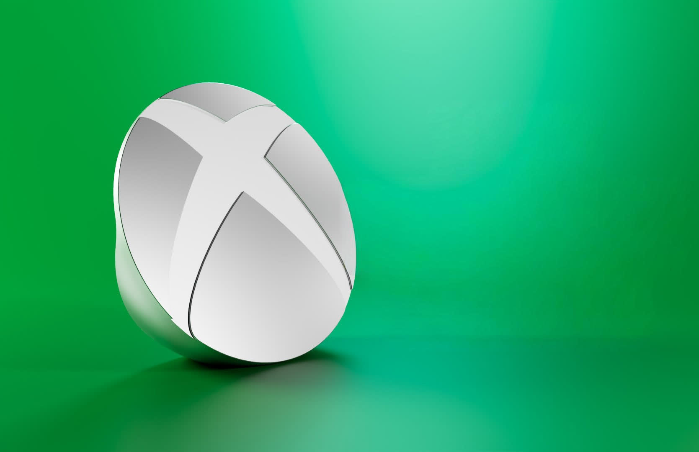
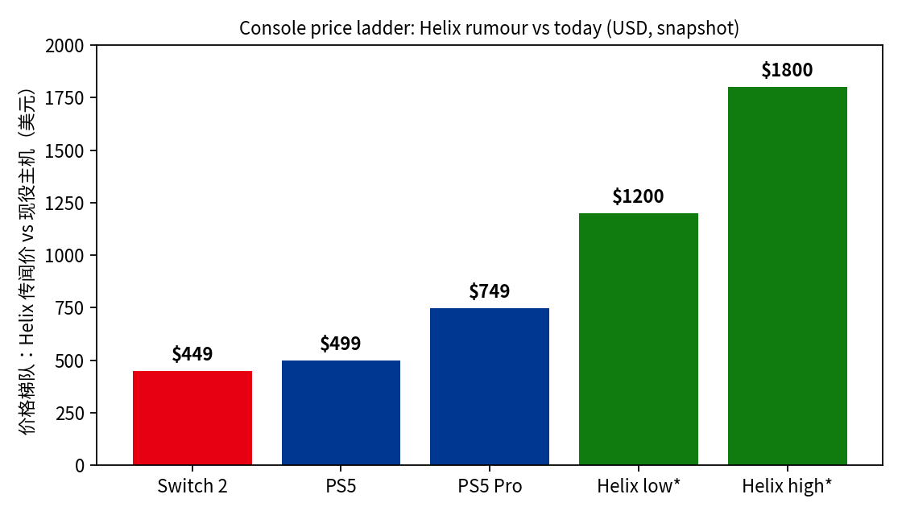

> [中文版 Chinese version](/life/xbox-helix-pc-hybrid-pivot-zh/)

*Reporting status, stated plainly at the top: the original Helix plan described in this post is a **rumour reported by Windows Central**, via TechSpot and Club386 coverage on November 24, 2026, citing unnamed sources. Microsoft has not confirmed it. What Microsoft has confirmed is narrower: the next Xbox is codenamed Helix, it will play PC games in some form, and developers will receive alpha development kits next year. Everything beyond that is labelled as reported, rumoured or inferred, sentence by sentence.*

*Image: TechSpot, November 24, 2026 report. Microsoft has released no Helix hardware images.*

## The plan that reportedly died

According to Windows Central's sources, as reported by TechSpot on November 24, 2026, the next Xbox was — until a leadership change earlier this year — designed to be something the console industry has never shipped: a PC in disguise.

The machine would have run Windows. It would have booted by default into Microsoft's new Xbox Mode, a console-style interface. But the user could exit that interface to the ordinary Windows desktop and install any Windows application — including, explicitly, **Steam**. It would have played Xbox console games, which is the part that makes the design radical rather than merely convergent: the console library and the PC library, on one box, with the PC side fully open.

Two consequences followed from that design, and Windows Central's reporting names both. First, an open Windows box cannot credibly charge for online multiplayer on the PC side, so the plan reportedly required **dropping the multiplayer paywall** — free online play, ending a paid-access model that has defined console economics since Xbox Live launched it in 2002 and Sony copied it. Second, the Asus ROG Xbox Ally handhelds were, in this telling, not a side experiment but a **rough draft**: a first public test of the Windows-plus-Xbox-Mode experience that Helix was meant to bring to the living room, developed under then-Xbox chief Phil Spencer.

That plan, the reporting says, belongs to the Spencer era. Asha Sharma replaced Spencer as Xbox CEO in February, and Microsoft's current official messaging describes a materially different machine.

## The sentence that reversed

Microsoft's own recent description of Helix, as quoted in the November 24 reporting, is worth reading word by word, because the reversal is carried entirely by word order: Helix is **"a console that plays PC games, not a PC that plays console games."**

Those two phrases contain the same components — console, PC games, console games — and opposite products. A PC that plays console games is an open platform with a console compatibility layer: the store is optional, the desktop is real, the manufacturer's cut is negotiable by the user every time they alt-tab to Steam. A console that plays PC games is a closed platform with a compatibility feature: the store is the point, the interface is controlled, and "plays PC games" can mean anything from full Steam access to a curated subset delivered through Microsoft's own channels, on Microsoft's terms.

Microsoft has confirmed the second sentence and the codename. It has described a new interface that gives immediate access to games, allows more customisation for advanced users and "eliminates traditional barriers" — language the November 24 reporting notes is vague enough to fit either machine. It has not confirmed Steam support, has not confirmed a desktop mode, and has not confirmed free multiplayer. Under the new leadership, reporting summarised by TLDR Daily News on November 24 frames the shift explicitly as a refocus toward a traditional console that **likely retains the paid multiplayer model**, driven by Sharma's mandate to make the Xbox division more profitable.

Treat the specifics as rumour. Treat the direction as the best-supported reading of Microsoft's own words: whatever Helix was going to be in 2025, the machine Microsoft describes in late 2026 is console-first.

## Why the open version was so expensive to keep

It is tempting to read this as a story about corporate courage — one leadership brave, the next timid. The economics in the reporting suggest something colder: the open plan was being priced out of existence by its own bill of materials and its own business model, simultaneously.

Start with the business model. A console that lets users buy games on Steam hands Valve a 30%-class cut ecosystem on hardware Microsoft subsidises, while Microsoft's own store becomes the shop you use only when you cannot avoid it. TechSpot's analysis makes the point bluntly: Steam's position in PC gaming is so dominant that "plays PC games" without Steam is close to meaningless in practical terms — which is precisely why including Steam is so costly. Add free multiplayer, and Helix would have surrendered the two most reliable profit engines of the console model — store cut and subscription gate — on the most expensive hardware Microsoft has ever built. A division newly instructed to be profitable would look at that spreadsheet and reach for the red pen regardless of who signed it.

Then the hardware. The most concrete rumoured specifications in the November 24 reporting describe a custom APU with **10 Zen 6 CPU cores (20 threads)** and an **RDNA 5 GPU rated around 40 TFLOPs** — a specification that, if accurate, sits far beyond current consoles and deep into gaming-PC territory. The same reporting is blunt about price: with storage and RAM costs described as chaotic for the past year, an MSRP **well over $1,000 is a real possibility**, and one secondary summary of the reporting puts a rumoured range of **$1,200 to $1,800** with a launch targeted at the **2028 holiday season**. Those last figures come from TLDR Daily News's summary and should be treated as the softest numbers in this post — reported rumour about a rumour — but even the hardest version of the story, TechSpot's "well over $1,000," describes a console priced like a PC.

*Author's chart. Current console prices are US list prices as of November 24, 2026 (snapshot, subject to change). Helix figures are rumoured ranges from November 24 reporting summaries, marked with an asterisk, and are not Microsoft guidance.*

Now the two halves of the story lock together. At $499, a console can be a loss-leading doorway and openness is a growth strategy. At $1,200-plus, the doorway itself must make money, the store cut becomes load-bearing, and a multiplayer paywall stops being an embarrassment and becomes a line item the finance team will defend. The memory crisis that has squeezed every hardware maker this year — the same shortage that has PC builders discussing a return to 8GB as a budget standard, per the same day's reporting — did not just raise Helix's price. It changed what kind of product Helix can afford to be. Open platforms are a luxury of cheap hardware.

## The timeline, and what is actually confirmed

Strip away the rumour and the confirmed skeleton is short. Microsoft has confirmed the **Helix codename**. It has confirmed Helix will support PC games, extent unspecified. It has confirmed **alpha development kits go to developers next year** — 2027 — which places a retail launch in **late 2027 at the earliest and, more plausibly per the reporting, sometime in 2028**. A separate November clarification attributed to Xbox VP Jason Ronald had already signalled the console-first direction, emphasising console user experience and rendering efficiency over full PC compatibility.

Everything else — Zen 6 core counts, TFLOPs, Steam, free multiplayer, the Ally-as-prototype framing, the $1,200–$1,800 range — is reported or rumoured as of November 24, 2026, and this post has labelled it that way throughout. Console plans at this distance from launch also genuinely change; dev kits have not shipped, final silicon is not in developers' hands, and a pivot reported in November 2026 can pivot again by 2028. The right way to hold this story is not "Microsoft cancelled the open Xbox." It is "the open Xbox was the plan under one leadership, the closed-er Xbox is the description under the next, and the cost curve explains the transition better than any personality story."

## Our judgment

The original Helix, as reported, was the most interesting console design in a generation — and it contained the seeds of its own cancellation. A machine that is truly a PC competes with PCs, including the ones its own owner already has, and it must justify a four-figure price against a Steam library the buyer already owns and can already play elsewhere. A machine that is truly a console competes with PlayStation, on the old terms: exclusives, price, and the store. Microsoft's reported pivot chooses the second fight. That is the defensible business decision and the less exciting product, and both halves of that sentence are the story.

The number to watch is not the TFLOPs. It is whether "plays PC games" survives contact with 2027's dev-kit disclosures in any form a PC player would recognise — a real Steam client, a real desktop, a real exit from the walled garden — or whether it arrives as a curated compatibility list inside Microsoft's store. The first outcome would mean the pivot was shallower than November's reporting suggests. The second would confirm it completely. Until then, Helix is two machines sharing a codename: the PC Microsoft reportedly almost built, and the console it now says it is building instead.

*Sources: TechSpot, November 24, 2026, reporting Windows Central sourcing on the original Helix plan, Microsoft's console-first description, rumoured Zen 6 / RDNA 5 specifications and pricing risk; Club386 news summary, November 24, 2026; TLDR Daily News summary, November 24, 2026 (rumoured $1,200–$1,800 range and 2028 holiday target — treated in this post as secondary, unconfirmed reporting). All Helix specifications, prices and dates beyond the codename, PC-game support and 2027 alpha dev kits are rumours as of November 24, 2026, not Microsoft announcements.*
