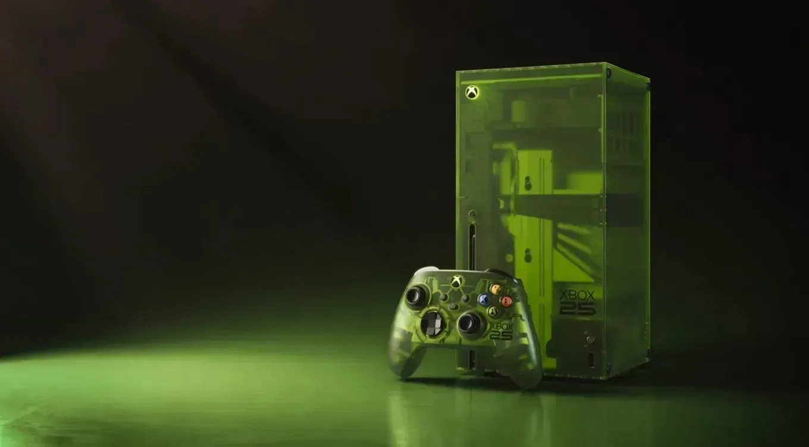
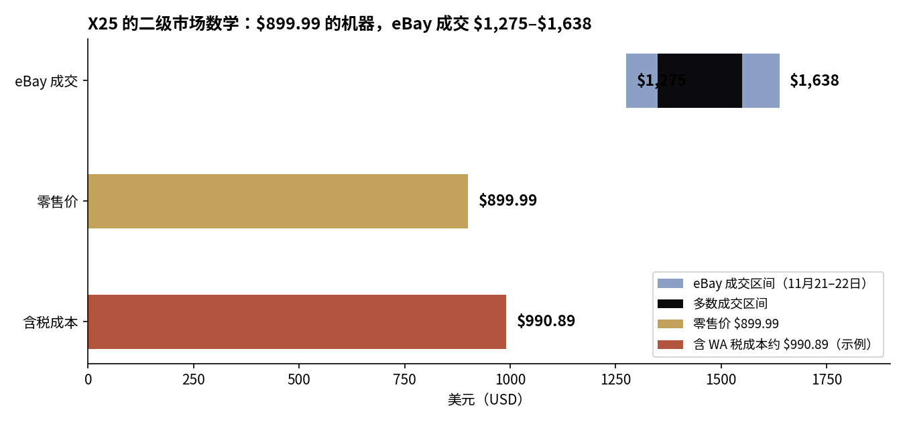

> [English version 英文版](/life/xbox-x25-best-buy-drops-sold-out/)

*X25 限量版。照片：Microsoft，经 The Shortcut。*

## 这一天，如实记录

Xbox Series X25 限量版是微软的 25 周年主机：一台标准性能的 Series X，穿上以 2001 年初代机为蓝本的半透明 **OG 绿** 外壳，开机时正面的 X 会亮起绿光，每台机器**逐台编号、带唯一镌刻**，附赠配套的 X25 特别版手柄与《Halo: Campaign Evolved》完整下载。Best Buy 商品页（SKU **6690019**）把产量事实写得很直白："only **25,000** of these numbered consoles will be available to the public"——面向公众的编号主机只有 25,000 台。售价 **899.99 美元**——比标准版 Series X 贵 100 美元——手柄另售 79.99 美元。本文价格均为 2026年11月25日 snapshot，后续可能变动。

11月25日是这台主机在 Best Buy 的 **Drops** 发售日：只在 Best Buy 手机 App 内、排队制的发售，只公布了日期。Best Buy 从未公布开抢时间——商品页没有，Drops 说明页也没有——而这一天的公开记录展示了这种"不公布"会产生什么：

- **美东时间上午：** The Shortcut 的补货追踪板记录 Best Buy 在 11月25日**最后一次有货为美东时间 10:24**。追踪与 deals 账号（Threads 上的 Wario64 等）把这次 drop 推向大量粉丝；买家的社交帖描述了一个"起初很容易、随后几分钟售罄"的窗口，并对 App 表现与地区限制表达了不满。
- **美东中午 12:01（UTC 17:01）前：** Best Buy 商品页已从"Coming Soon"变为 **"Sold Out"**——"The item is currently sold out but we are working to get more inventory"——价格仍为 899.99 美元。微软商店的 listing 同样显示缺货。
- **Amazon：** 未测到库存；其通道仍是**邀请制申请**——本质上是一场不保证中选的抽选。
- **GameStop：** 今日未测到库存。（在 11月13日发售周的补货中，The Shortcut 记录 GameStop 在美东凌晨 4:09 挂出过一个令人咋舌的 **4,950 美元**标价——且页面显示售罄。请注意：该数字是单一追踪方记录的、单一零售商在发售周的挂牌价，不是市场成交价。）

这正是 X25 从一开始的模式。预购于 8月27日开启、每人限购一台，**五分钟内售罄**。主机 11月13日发售；当晚 Best Buy 在美东凌晨 1:02 补货，瞬间被买走。今天的 Drops 是同一出戏的第三幕：一件编号、封顶的产品，遇上注定装不进 25,000 台的需求。

## 机器本身，简要说

外壳之下，X25 就是一台 Series X：1TB 定制 NVMe SSD、16GB GDDR6，与标准版相同的 Zen 2 / RDNA 2 性能（据微软商店规格 listing）。芯片层面没有任何"限量"成分。限量的是所有看得见的东西：第一款半透明 Series X 外壳、源自 2001 年初代机的 OG 绿配色、带独立编号的周年镌刻、按键采用初代 Xbox 配色的配套手柄，以及附赠的《Halo: Campaign Evolved》——那是 2001年11月15日随品牌一同诞生的游戏的重制版，距这台主机的发售周几乎整整 25 年。

这个构成就是产品本身。微软卖的不是性能——同样的性能它卖 799.99 美元、黑色。100 美元的溢价、编号与封顶，三者合起来把一台主机变成了一件带序列号的收藏品。而收藏品遵循的市场规则与电子产品不同：价值来自"封顶被相信"。

## 转卖数学，用成交价算

稀缺的说法很便宜，成交记录才是证据。X25 在 11月21–22日的 eBay 成交聚合数据（经 resell.ing 的成交 listing 聚合）显示：已完成交易在 **1,275 至 1,638 美元**之间，多数成交落在 **1,350 至 1,550 美元**。对比 899.99 美元的零售价，这意味着发售补货后数日内，每台的毛溢价约为 **375 至 738 美元**——而这还没算上今天 Drops 日新增的一波挂牌。

对卖家来说，诚实的算法要穿过成本：以一位付了华盛顿州销售税的美国买家为例，含税总成本约为 **990.89 美元**；再扣约 13% 的平台费与运费，典型成交区间净得约为 **+160 至 +360 美元**。这是一笔真实但并不丰厚的钱——一旦把排队时间、盯货精力与发货人工计价，它就更薄了。这正是 2026 年限量硬件转卖的典型形态：价差宽到足以吸引专业玩家，又窄到足以惩罚在区间顶部接盘的业余者。

*作者自制图。零售价 899.99 美元（Best Buy / 微软商店）。含税示例：零售价加华盛顿州销售税，约 990.89 美元。eBay 成交区间 1,275–1,638 美元、多数成交 1,350–1,550 美元：resell.ing 对 eBay 已成交 listing 的聚合，2026年11月21–22日。2026年11月25日 snapshot，后续可能变动。*

对买家来说，同一张图是另一种读法。超过约 1,000 美元的每一块钱，买的都是编号与外壳——买的是"25,000 台之一"的确定性——因为游戏性能任何一天都能以 799.99 美元买到。这不是非理性的购买；它只是一次收藏品购买，因此应该用收藏品的纪律来做：核对镌刻编号、走带真伪保障的渠道，并假设两个月后的价格由"25,000 台中有多少还保持未拆封"决定。

## 微软为什么这样设计

很容易把五分钟售罄的预购和不公布的开抢时间读作无能。但结构本身另有说法，每个元素都有其功能。

**封顶制造资产。** 25,000 台编号产品，相对于数千万的装机量是极小的，而镌刻让每台都可唯一识别——"一台绿色 Xbox"与"25,000 台中的第 N 台"之间的区别，就是 merchandise 与 registry（登记册）之间的区别。**队列制造事件。** Best Buy Drops 把购买变成一次必须在 App 内赴约的行为，催生了普通商品页永远赚不到的社交倒计时生态（追踪账号、"Live in 5"帖子、逐分钟更新的库存板）。**缺失的开抢时间制造守候。** 没有公布的时刻，认真的买家就得全天监控——对他们昂贵，对产品则是整整一天的注意力。**100 美元溢价为故事定价，而不是为硬件定价**，既保住标准版主机的价值主张，又让周年版浮在它之上。

成本面同样真实，今天的评论区就能看到：做对了一切却还是错过的买家、结账时才冒出的地区限制、以及无人能审计其公平性的 App 队列。稀缺营销在赚取注意力的同时也在消耗好感；微软自家商店同日缺货更说明：起约束作用的是封顶，而不是渠道。这套打法可以用在周年纪念上；若用在普通硬件上，好感账单迟早会到——索尼本周可以从反方向作证：它的 PS5 完全没有封顶，却因供应原因同样售罄。

## 三种买家，三台不同的主机

今天之后的 X25 市场里有三种截然不同的买家，关于这台主机的多数争论，本质上是他们之间的争论：

1. **周年纪念型拥有者**：想要的是物件本身——架子上的绿色外壳、编号、Halo 套装——899.99 美元零售价就是交易的全部。今天的售罄伤他们最深，因为队列不会把他们与任何人区分开。
2. **倒卖者**：对他们来说，这台主机就是 899.99 美元与 1,350–1,550 美元成交带之间的价差。上面的数学表明，按当前价格这是一门 modest、劳动密集型的生意，不是中彩票——而且每次补货都在压缩它。
3. **迟到的收藏者**：将在 12 月或 1 月以二级市场价格买入。他们的价格将由未拆封存量决定，也由微软是否推出无编号的第二批决定——The Shortcut 对此有过猜测，微软**并未**宣布。无编号批次对玩家是好事，对首批 25,000 台的登记价值是坏事——这正是它会成为一个重大决策的原因。

## 接下来会发生什么

Amazon 的邀请制仍是唯一敞开的门，而它通过邮件、按 Amazon 的节奏开启，不公布中选概率。The Shortcut 的追踪器仍在盯 Best Buy 与 GameStop；发售周的行为（美东凌晨 1:02 补货）说明未来的 drop 不会尊重任何人的睡眠。微软没有宣布任何追加生产。在它宣布之前，X25 的市场就是一个固定供给市场：25,000 台编号主机、1,000 美元中段的成交带，以及一场在今天以 Sold Out 页面为大多数赴约者收尾的 drop 日仪式。

## 结论

以"主机发售"的标准看，X25 是一台挫败制造机：标准硬件、不公布的开抢时间、以分钟计的窗口。以它真实的身份看——一件恰好能玩游戏的编号周年收藏品——它近乎完美的执行：可信的封顶、登记册级的镌刻、小到在零售端显得公平、大到足以锚定二级市场的溢价。今天愤怒的人，大多是因为他们想以主机的价格买到收藏品，而这套系统的设计初衷就是不让所有人都如愿。这种张力不是 X25 设计的缺陷，它就是设计本身。微软是否应该把自己的周年纪念建立在这种张力之上，是一个值得吵的问题——而 25,000 台售罄的主机说明，市场已经投过票了。

*来源：Best Buy 商品页，Xbox X X25 Special Edition（SKU 6690019），2026年11月25日核查——899.99 美元、"只有 25,000 台编号主机"、状态于 UTC 17:01 前变为 Sold Out；The Shortcut X25 补货追踪与发售报道（Best Buy 最后有货：11月25日美东 10:24；11月13日补货：Best Buy 美东 1:02、GameStop 美东 4:09 挂牌 4,950 美元；手柄另售 79.99 美元）；Xbox Wire 预购公告，2026年8月26日（逐台编号镌刻、附赠 Halo: Campaign Evolved、每人限购一套）；微软商店 X25 listing（规格、缺货）；Geek Planet Xbox 25 周年汇总（预购五分钟内售罄）；resell.ing eBay 成交聚合，2026年11月21–22日（1,275–1,638 美元，多数 1,350–1,550 美元）。全部价格为 2026年11月25日 snapshot，后续可能变动。*
