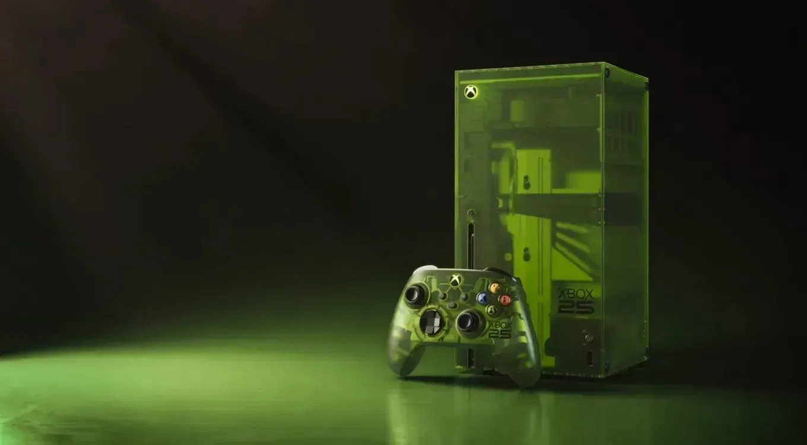
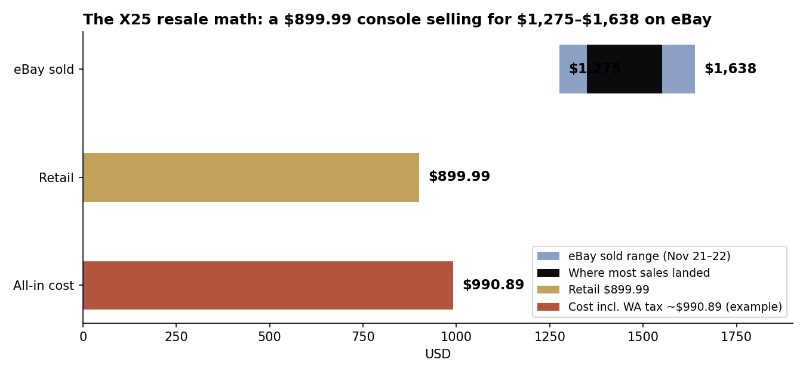

> [中文版 Chinese version](/life/xbox-x25-best-buy-drops-sold-out-zh/)

*The X25 Limited Edition. Photo: Microsoft, via The Shortcut.*

## The day, as it happened

The Xbox Series X25 Limited Edition is Microsoft's 25th-anniversary console: a standard-power Series X in a translucent **OG Green** shell modelled on the 2001 original, its front X lighting up green at power-on, each unit **individually numbered with a unique engraving**, bundled with a matching X25 Special Edition controller and a full download of *Halo: Campaign Evolved*. Best Buy's product page (SKU **6690019**) states the production fact plainly: "only **25,000** of these numbered consoles will be available to the public." The price is **$899.99** — $100 more than the standard Series X — with the controller also sold separately for $79.99. Prices in this post are snapshots as of November 25, 2026, subject to change.

November 25 was the console's Best Buy **Drops** day: an app-only, queue-based release inside the Best Buy mobile app, announced by date only. Best Buy never published a start time — not on the product page, not in the Drops explainer — and the day's public record shows what that omission does:

- **Morning, ET:** The Shortcut's restock board recorded Best Buy **last in stock at 10:24am ET** on November 25. Tracker and deal accounts (Wario64 on Threads among them) pushed the drop to large follower counts; social posts from buyers describe a window that was easy at first, then gone within minutes, with frustration about app behaviour and location restrictions.
- **By 12:01pm ET (17:01 UTC):** Best Buy's product page had flipped from "Coming Soon" to **"Sold Out"** — "The item is currently sold out but we are working to get more inventory" — at the unchanged $899.99. The Microsoft Store listing likewise shows the console out of stock.
- **Amazon:** no stock detected; its route remains an **invite request** — effectively a lottery with no guarantee.
- **GameStop:** no stock detected today. (In the launch-week restock on November 13, The Shortcut recorded GameStop listing the X25 at an eye-watering **$4,950** at 4:09am ET — and the page showing sold out. Treat that figure as one retailer's launch-week listing, recorded by one tracker, not as a market price.)

This was the X25's pattern from the start. Pre-orders opened August 27, limited to one per customer, and sold out in **under five minutes**. The console launched November 13; that night Best Buy restocked at 1:02am ET and units moved immediately. Today's Drops release was the third act of the same play: a numbered, capped product meeting demand that was never going to fit inside 25,000 units.

## The machine, briefly

Under the shell, the X25 is a Series X: 1TB custom NVMe SSD, 16GB GDDR6, the same Zen 2 / RDNA 2 performance as the standard console, per the Microsoft Store specification listing. Nothing about the silicon is limited edition. What is limited is everything visible: the first translucent Series X shell, the OG Green colourway carried from the 2001 machine, the anniversary engraving with its individual number, the matching controller whose face buttons use the original Xbox colours, and the bundled *Halo: Campaign Evolved* — the remake of the game that launched the brand on November 15, 2001, almost exactly 25 years before this console's launch week.

That composition is the product. Microsoft is not selling performance — it sells the same performance for $799.99 in black. The $100 premium, the numbering and the cap together convert a console into a collectible with a serial number, and collectibles obey different market rules than electronics: value comes from the cap being believed.

## The resale math, from sold prices

Scarcity claims are cheap; sold listings are evidence. Aggregated eBay sold data for the X25 over November 21–22 (via resell.ing's sold-listing aggregation) shows completed sales from **$1,275 to $1,638**, with most sales landing between **$1,350 and $1,550**. Against the $899.99 retail price, that is a gross premium of roughly **$375 to $738** per console within days of the launch restocks — before today's Drops day added its own wave of listings.

For a seller, the honest arithmetic runs through costs: a US buyer who paid Washington-state tax, for example, is all-in at about **$990.89**; after roughly 13% in marketplace fees and shipping, the typical sold range nets on the order of **+$160 to +$360** over that all-in cost. That is real money per unit and thin money per hour once queue time, monitoring and shipping labour are priced in — the familiar shape of limited-hardware resale in 2026, where the spread is wide enough to attract professionals and narrow enough to punish amateurs who buy the top of the range.

*Author's chart. Retail $899.99 (Best Buy / Microsoft Store). All-in example: retail plus Washington sales tax, ~$990.89. eBay sold range $1,275–$1,638 with most sales $1,350–$1,550: resell.ing aggregation of eBay sold listings, November 21–22, 2026. Snapshot as of November 25, 2026, subject to change.*

For a buyer, the same chart reads differently. Every dollar above roughly $1,000 is payment for the number and the shell — for certainty of having one of 25,000 — because the gaming performance is available any day at $799.99. That is not an irrational purchase; it is simply a collectible purchase, and it should be made with a collectible's discipline: verify the engraving number, buy through authenticity-checked channels, and assume the price two months from now is set by how many of the 25,000 stay sealed.

## Why Microsoft designs it this way

It is tempting to read a five-minute pre-order sell-out and an unannounced drop time as incompetence. The structure suggests otherwise; each element does a job.

**The cap creates the asset.** 25,000 numbered units is small against an installed base in the tens of millions, and the engraving makes each unit uniquely identifiable — the difference between "a green Xbox" and "unit N of 25,000" is the difference between merchandise and a registry. **The queue creates the event.** Best Buy Drops turns a purchase into an appointment the buyer must keep inside an app, generating the social-media countdown behaviour (tracker accounts, "Live in 5" posts, minute-by-minute stock boards) that a normal product page never earns. **The missing start time creates the vigil.** With no published hour, serious buyers monitor all day — costly for them, and a full day of attention for the product. And **the $100 premium prices the story, not the hardware**, keeping the standard console's value proposition intact while the anniversary edition floats above it.

The cost side is real too, and today's comments show it: buyers who did everything right and still missed out, location restrictions surfacing at checkout, an app queue whose fairness nobody can audit. Scarcity marketing spends goodwill as well as earning attention, and Microsoft's own store being out of stock on the same day underlines that the cap, not the channel, is the binding constraint. A company can run this play for an anniversary. Run it for ordinary hardware and the goodwill bill arrives — as Sony, whose entirely un-capped PS5 is also sold out this week for supply reasons, could testify from the other direction.

## Three buyers, three different consoles

The X25 market after today contains three distinct buyers, and most arguments about the console are really arguments between them:

1. **The anniversary owner**, who wanted the object — the green shell on the shelf, the number, the Halo bundle — and for whom $899.99 at retail was the whole transaction. Today's sell-out mostly hurt this buyer, because the queue does not distinguish them from anyone else.
2. **The flipper**, for whom the console is the spread between $899.99 and the $1,350–$1,550 sold band. The math above says this is a modest, labour-intensive business at current prices, not a lottery win — and every restock compresses it.
3. **The late collector**, who will buy in December or January at secondary prices. Their price will be set by sealed supply and by whether Microsoft ever produces an unnumbered second run — something The Shortcut has speculated about and Microsoft has **not** announced. An unnumbered run would be good for gamers and bad for the registry value of the first 25,000, which is precisely why it would be a significant decision.

## What happens next

Amazon's invite system remains the only open door, and it opens by email, on Amazon's schedule, with no published odds. The Shortcut's tracker continues to watch Best Buy and GameStop; launch-week behaviour (a 1:02am ET restock) says future drops will not respect anyone's sleep. Microsoft has announced no further production. Until it does, the X25's market is a fixed-supply market: 25,000 numbered consoles, a sold band in the mid-$1,000s, and a drop-day ritual that ended today, for most of the people who kept the appointment, at a Sold Out page.

## The verdict

Judged as a console launch, the X25 is a frustration machine: standard hardware, an unannounced start time, minutes-long windows. Judged as what it actually is — a numbered anniversary collectible that happens to play games — it is a nearly perfect execution: a believable cap, a registry-grade engraving, a price premium small enough to feel fair at retail and large enough to anchor the secondary market. The people angry today are mostly angry because they wanted the collectible at the console price, in a system designed so that not everyone can. That tension is not a flaw in the X25's design. It is the design. Whether Microsoft should build its anniversary on that tension is the argument worth having — and 25,000 sold-out consoles say the market has already voted.

*Sources: Best Buy product page, Xbox X X25 Special Edition (SKU 6690019), checked November 25, 2026 — $899.99, "only 25,000 numbered consoles," status flipped to Sold Out by 17:01 UTC; The Shortcut Xbox Series X25 restock tracker and launch coverage (Best Buy last in stock November 25, 10:24am ET; November 13 restocks at 1:02am ET Best Buy and 4:09am ET GameStop at a $4,950 listing; controller $79.99 separately); Xbox Wire pre-order announcement, August 26, 2026 (individually numbered engraving, Halo: Campaign Evolved included, one per customer); Microsoft Store X25 listing (specifications, out of stock); Geek Planet Xbox 25th anniversary roundup (pre-orders sold out in under five minutes); resell.ing eBay sold aggregation, November 21–22, 2026 ($1,275–$1,638, most $1,350–$1,550). All prices are snapshots as of November 25, 2026, subject to change.*
