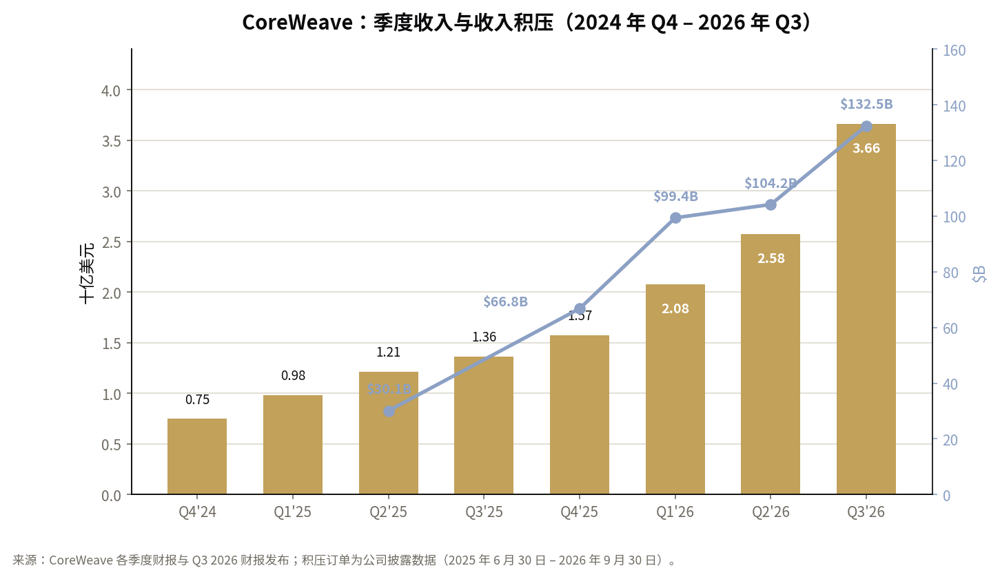
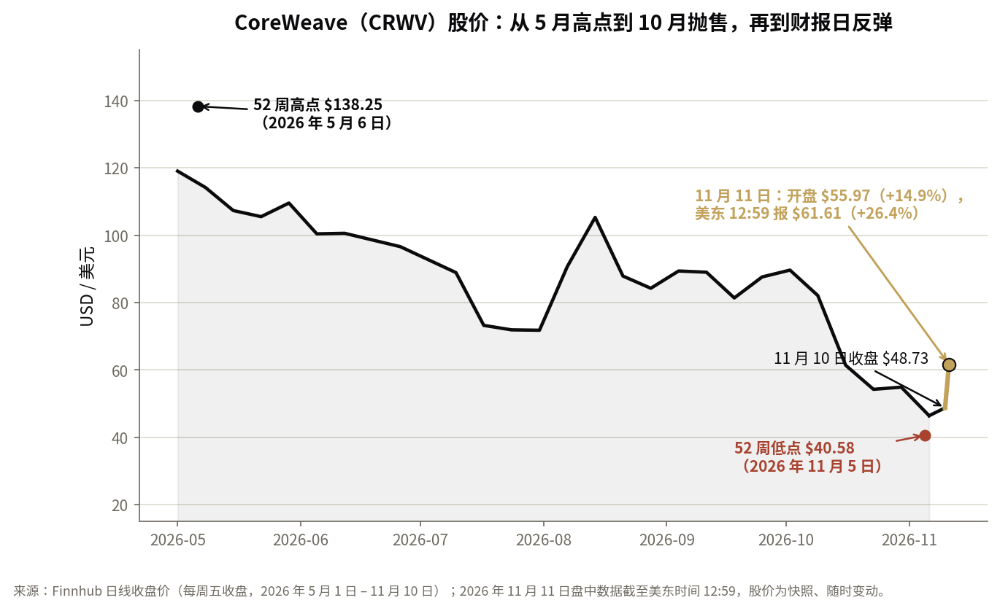
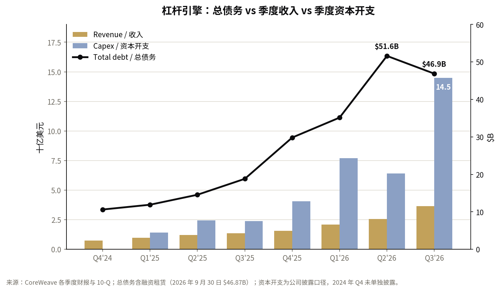

*除特别注明外，所有数据来自 CoreWeave 2026 年第三季度财报、10-Q 文件及 11 月 10 日财报电话会。股价为 2026 年 11 月 11 日美东时间 12:59 的快照，盘中随时变动。本文为公开信息分析，不构成投资建议。相关阅读：[CoreWeave 债券收益率突破 15%：信用市场到底在说什么](/portfolio/coreweave-bond-yield-15/)。*

## 发生了什么

CoreWeave 于 11 月 10 日（周一）收盘后发布第三季度财报，股价随即暴涨。先把涨幅说精确，因为标题数字已经开始走样：该股周一收于 **48.73 美元**，盘后上涨约 5.6% 至约 51.49 美元，周二**开盘 55.97 美元，上涨 14.9%**，随后冲至盘中高点 61.78 美元，截至**美东时间 12:59 报 61.61 美元，日内上涨 26.4%**。它并不是开盘就涨 25%，+25% 是盘中后段才达到的。这个区分很重要，因为开盘跳空和盘中延续由不同的力量驱动：跳空是财报超预期，延续是市场在重新定价这份财报对公司生存意味着什么。

背景是：该股在一个月内跌了 **40.6%**（10 月 9 日 82.08 美元 → 11 月 10 日 48.73 美元），自 10 月 1 日以来跌了 50.7%，自 5 月 6 日 52 周高点 138.25 美元跌至 11 月 5 日 52 周低点 40.58 美元，跌幅达 70.6%。一个月前，[债券市场对其债务的定价是约 15% 的收益率](/portfolio/coreweave-bond-yield-15/)，五年期信用违约互换（CDS）一度突破 1140 个基点。周二的走势，是对这种困境叙事的重新定价。问题是，这份财报到底在多大程度上配得上这波重新定价。

## 一、关键数字

| 指标 | 2026 年 Q3 | 背景 |
|---|---|---|
| 收入 | 36.61 亿美元，同比 +168% | 高于 LSEG 一致预期的约 35.5 亿美元，高于指引上限；环比增加 10.9 亿美元 |
| 调整后 EBITDA | 22.56 亿美元，利润率 62% | 高于 Q2 的 59% |
| 调整后营业利润 | 3.79 亿美元，利润率 10% | 指引为 2.0–2.6 亿美元；Q1 约 1%、Q2 约 5% |
| GAAP 净亏损 | 7.09 亿美元（每股 −1.27 美元） | 去年同期亏损 1.10 亿美元 |
| 净利息支出 | 8.46 亿美元 | 是调整后营业利润的 2.2 倍 |
| 收入积压订单 | 1325 亿美元 | 创纪录；同比 +138%；Q2 末为 1042 亿美元 |
| 2026 全年收入指引 | 130–133 亿美元 | 自 124–132 亿美元上调 |
| 2026 全年调整后营业利润指引 | 12.75–13.75 亿美元 | 中点上调 26% |
| 2026 年末年化收入 run-rate | 200–210 亿美元 | 基于产能部署计划的退出 run-rate 目标 |
| Q3 资本开支 | 145 亿美元 | 约为季度收入的 4 倍；部分自 Q4 提前 |
| 2026 全年资本开支指引 | 370–390 亿美元 | 约为全年指引收入的 3 倍 |
| 总债务（9 月 30 日） | 468.7 亿美元 | 低于 6 月 30 日的 516.1 亿美元；含租赁约 662 亿美元 |
| Q3 自由现金流 | −74.7 亿美元 | 经营现金流 19.8 亿美元减去现金购置不动产及设备 94.4 亿美元 |

这张表里真正起作用的是三个数字。收入增长 168%、超出一致预期约 1 亿美元——不错，但市场早就知道需求强劲。积压订单单季增加 283 亿美元至 1325 亿美元——这是需求故事最具体的形态。而调整后营业利润 3.79 亿美元，大幅高于 2.0–2.6 亿美元的指引，利润率在 Q1 约 1%、Q2 约 5% 之后达到 10%——这是经营杠杆比计划提前一个季度到来。管理层表示，公司比计划提前一个季度进入了低双位数的调整后营业利润率。指引上调——调整后营业利润中点上调 26%——说明这是一条轨迹，而不是一次性事件。

*季度收入（柱状，左轴）与收入积压订单（折线，右轴）。收入两年内增长约 5 倍，积压订单自 2025 年 6 月以来增长 4.4 倍。来源：CoreWeave 各季度财报。*

## 二、市场为什么这样反应

10 月抛售的论点很具体：CoreWeave 是一家靠债务买 GPU 再出租的公司，其融资模式正在断裂——债券收益率 15%、CDS 市场定价困境、自由现金流烧钱看起来不可持续。这份财报从四个方面攻击了这个论点，而且每一击都命中了。

**第一，经营杠杆提前到来。** 10% 的调整后营业利润率不只是超指引，更是曲线形状的改变：Q1 约 1%、Q2 约 5%、现在 10%。原因是业务组合：随着机队规模扩大、公司以溢价出售更多短期算力，增量收入的利润率非常高。管理层上调指引，说明这是趋势。

**第二，融资问题得到了具体答案。** 公司预计未来三个月内将收到约 **90 亿美元的客户预付款和押金**，客户为合同价值的最高 100% 预付——今年 70% 的交易包含预付款。其中超过 30 亿美元是*现有*基础设施的续约，溢价成交：收到现金而无需新增资本开支。管理层表示不会按当前收益率发行无担保债，也不需要发行，并预计到 2027 年底前只需不到 **50 亿美元**的母公司层面新增资本。加权平均债务成本降至 **7.9%，同比下降 250 个基点**，公司已偿还超过 40 亿美元债务，包括近一半的首两笔（也是最贵）的延迟提款定期贷款。

**第三，机队在升值，而不是贬值。** 空头的核心假设是 GPU 抵押品会贬值——今天的 H100 是明天的废铁。电话会上，CEO 表示 Ampere 和 Hopper 算力的续约价格环比上涨 **30–50%**，*高于*原始合同价。当你所谓不断贬值的资产以 30–50% 的溢价重新出租时，抵押品的故事就反转了。这是这份财报中对信用论点最重要的一个数据。

**第四，需求仍比供给大一个数量级。** 管理层估计，到 2027 年底，合格需求约为可用产能的 **10 倍**，2028 年的产能已经售罄（就已推向市场的部分而言），并披露短期算力定价超过**每兆瓦每年 4000 万美元**，而新的四到五年期合同为 2000–2500 万美元。稀缺性正在以有利于 CoreWeave 的方式定价。

**第五，仓位因素。** 一只一个月跌掉 40%、看空叙事高度拥挤、CDS 处于困境水平的股票，遇到好消息时必然剧烈波动。周二 +26% 的一部分是真正的重新定价，一部分是单边交易的 unwind。两者在当下无法区分，但在接下来的两个季度里会非常容易区分。

*2026 年 5 月 1 日至 11 月 10 日每周五收盘价，加上 11 月 11 日开盘与盘中走势。股价自 5 月高点跌至 11 月 5 日低点 70.6%，随后自低点反弹 51.8% 至 61.61 美元——仍比 5 月高点低 55.4%。来源：Finnhub 日线收盘价；11 月 11 日盘中数据截至美东时间 12:59。*

## 三、核心矛盾：杠杆引擎

以上这些都没有改变资产负债表。这仍然是一家借钱买英伟达 GPU 再出租的公司，而这种模式在当前规模下的算术非常残酷。

*季度收入（金色柱）与资本开支（蓝色柱），对照总债务（折线，右轴）。资本开支连续六个季度为收入的 2–4 倍，总债务从 106 亿美元升至 469 亿美元。来源：CoreWeave 各季度财报与 10-Q 文件。*

先看利润表。季度净利息支出 **8.46 亿美元——是 3.79 亿美元调整后营业利润的 2.2 倍**。第四季度利息指引为 **10.5–11.5 亿美元**，约为*全年*调整后营业利润指引（12.75–13.75 亿美元）的 80%。调整后营业利润率就算翻倍，公司仍无法用经营利润覆盖利息账单。GAAP 净亏损从去年同期的 1.10 亿美元扩大到 7.09 亿美元，因为利息和折旧随建设规模同步增长——这是模式的成本，不是会计假象。

再看现金流。单季度资本开支 **145 亿美元——约为季度收入的 4 倍**，全年资本开支指引 370–390 亿美元约为全年指引收入的 3 倍。Q3 自由现金流为 **−74.7 亿美元**。这家公司的烧钱速度，只有在预付款和有担保债务机器每个季度都持续运转、直到经营现金流赶上来的前提下才成立。

再看资产负债表。总债务 468.7 亿美元，低于 Q2 的 516.1 亿美元，这是真正的进展——但加上经营租赁和融资租赁，总额约为 **662 亿美元**，约为 200–210 亿美元退出 run-rate 收入的 3.2 倍。而且这些债务不是普通的公司债：大部分是与具体合同挂钩的资产层面融资（延迟提款定期贷款，定价为 SOFR 加 225–550 个基点，高端折合不到 10%）。这种结构既是优势也是脆弱性：合同签了、客户付了款，这些贷款会自我摊销——已有 40 亿美元通过这种方式偿还；合同落空或客户不付款时，同样的结构就变成对 GPU 转售价值的索求，而转售价值正是悬而未决的问题。

诚实的框架是：CoreWeave 是一门利差生意。它赚的是 GPU 租金与购买 GPU 的资金成本之间的利差。现在利差在扩大——续约溢价 30–50%、债务成本下降、稀缺定价超过每兆瓦 4000 万美元。扩大的利差也能迅速收窄，而收窄会恰恰体现在本季度看起来最好的地方：续约定价、预付款条款和融资定价。

## 四、通往 2028 年的路：必须成立的几件事

管理层目标是 **2028 年上半年实现调整后盈利**。以下是他们描述的桥梁，以及这座桥必须通过的算术检验。

- **续约。** 约 13 万块 GPU 将于 2027 年到期，2028 年约 17 万块。管理层预计 2027 年续约带来约 **40 亿美元**的增量年化收入，计入 2028 年续约后约 **100 亿美元**——这部分收入*不包含*在 1325 亿美元积压订单中。这是模型中最大的单一变量，完全取决于续约价格能否维持在当前水平。
- **EBITDA 减利息在 2027 年翻倍以上**，按管理层的估计——这是减少对外融资依赖的内部造血引擎。
- **已还清的机队。** 一旦延迟提款贷款还清，设备即归公司无负担所有，无需新增投资即可产生收入。随着每年更多机队进入这种状态，资本密集度会结构性下降。这是让模型随时间*去杠杆*而非加杠杆的机制——前提是设备保持生产力和合同状态。
- **预付款继续为建设融资。** 70% 的交易带有预付款，未来三个月将有 90 亿美元到账，公司可以用客户的钱而非新的母公司债务为大部分资本开支融资。

现在做算术检验。取 2026 年末 200–210 亿美元的退出 run-rate，按今天 10% 的调整后营业利润率计算，run-rate 口径的调整后营业利润约为 20–21 亿美元。按 Q4 指引的利息年化计算，年利息约为 42–46 亿美元。所以即使在退出 run-rate 上，调整后营业利润也覆盖不了利息。要在 2028 年上半年实现调整后盈利，需要利润率从 10% 大幅扩张（向 20% 或更高）、债务偿还使利息下降、续约溢价保持——三者同时成立。这是可能的，但目前数字里还看不到。而且“调整后”盈利不包括股权激励等项目；GAAP 盈利还要再往后一步。

让这座桥变得可见的，将是 Q4 和 2027 年 Q1 的利润率走势、13 万块 GPU 到期后的第一批真实续约定价数据，以及债务偿还的速度。这三个数据点，而不是股价，才是记分牌。

## 五、行业风向：超大规模资本开支、新云问题与电力

故事的需求端没有疑问。四大超大规模云厂商 2026 年合计资本开支指引约为 **7300 亿美元**——亚马逊约 2200 亿美元、Alphabet 1950–2050 亿美元、Meta 1350–1450 亿美元、微软约 1700 亿美元——比 2025 年的约 4100 亿美元增长约 78%，高盛预计 2027 年约为 **1.14 万亿美元**。仅 Q3，Alphabet 就花了 514 亿美元、Meta 花了 349 亿美元。CoreWeave 的 1325 亿美元积压订单相对这个支出规模只是零头——这既是机会也是风险，因为积压订单存在的意义，恰恰是超大规模厂商和 AI 实验室自己建得不够快。

这就是新云（neocloud）问题最尖锐的形态。CoreWeave 的卖点是速度和专业化：它比超大规模厂商自己的建设更快地上线产能，卖给等不及的实验室和企业。但它最大的客户同时也是它在产能上最大的竞争者——微软占 2025 年收入的 67%，前三大客户占 2026 年 Q2 收入的 72%，OpenAI 和 Meta 的承诺分别高达约 224 亿美元和约 352 亿美元。新云在一定程度上是超大规模厂商自身需求的溢出阀。悬而未决的问题是，这种溢出是结构性的——因为建设规模永久性地超过任何一家公司能融资和建设的能力——还是周期性的，一旦超大规模产能赶上来，阀门就会关闭。

泡沫辩论就在这个背景之上。Gartner 被广泛引用的算术是：AI 到 2030 年累计需要约 8.5 万亿美元收入来支撑建设规模，而预测最多只有约 3.6 万亿美元。CoreWeave 自己的五年期 CDS 在 10 月中旬突破 1140 个基点，财报后初步回落但仍在约 1038 个基点——信用市场即使在股价反弹后仍持怀疑态度。富国银行的 Michael Turrin 估计，2027 年资本开支可能达到 660 亿美元，资金缺口 250 亿美元或更多（这是分析师的估计，不是公司数字）。诚实的立场是：AI 算力需求真实且增长迅速；但当前的*建设速度*能否赚回资本成本尚未得到证明——而 CoreWeave 作为这个问题上最纯粹的杠杆标的，答案会最先在它身上显现。

然后是电力，这才是整个行业的真正约束。CoreWeave 的在运电力达到 **1.7 吉瓦**——是 2025 年末的两倍——已签约电力为 **4.6 吉瓦**。积压订单只有在电力上线后才能转化为收入，所以已签约电力向在运电力的转化速度，是每个季度都要盯的运营数字。

关于我一直关注的供电架构问题：当前的这波需求是 H100/H200/GB200 系统，运行在 **54V 机架内供电架构**上。英伟达的 **800V 直流**全规模量产与 Kyber 机架（576 块 Rubin Ultra GPU）同步，定在 2027 年，机架旁的 800V 电源硬件才在 2026 年 Q3 进入量产。今天的需求证明的是 GPU 的胃口，不是 800V 的时间表。800V 供应链（Vertiv、台达、Eaton、施耐德）是 2027 年的故事；2026 年的故事是多快把电力、冷却和 GPU 装进楼里。（一个提示：Kyber 的时间表存在争议——SemiAnalysis 报道称推迟到 2028 年，英伟达表示路线图未变。值得关注，不宜直接采信任何一方。）

## 六、风险与接下来要看什么

1. **信用市场是否跟随股市。** 10 月中旬，2032 年到期债券的收益率约为 15%——见[此前的文章](/portfolio/coreweave-bond-yield-15/)。如果收益率维持在困境水平而股价上涨，市场就是在说，股票是一张关于生存的看涨期权，而不是对一家能自我造血的公司的索求权。持续的重新定价需要债券市场确认。
2. **客户集中度。** 微软占 2025 年收入的 67%，前三大客户占 2026 年 Q2 收入的 72%。积压订单集中在少数交易对手身上，而这些对手自身的 AI 支出正是被争论的对象。
3. **续约定价。** 2027 年有 13 万块 GPU 到期。如果现货价格走软，40 亿美元的增量续约收入估计会随之缩水——而这个估计正是 2028 年桥梁的核心。
4. **利用率与电力转化。** 在运 1.7 吉瓦，已签约 4.6 吉瓦。积压订单在电力上线前不是收入；每个季度盯转化速度。
5. **英伟达供应与 Rubin 过渡。** 率先把 Vera Rubin 上线并交付给 Cognition 用于生产负载，是真正的竞争优势。供应受限或 Kyber 推迟会拖慢 2027–28 年的建设。
6. **利息与再融资。** Q4 利息 10.5–11.5 亿美元，加权平均债务成本 7.9%，融资定价为 SOFR 加 225–550 个基点。利率上升或利差扩大，利差生意会从另一侧被压缩。
7. **自由现金流。** Q3 为 −74.7 亿美元。预付款和有担保债务机器必须每个季度持续运转，直到经营现金流赶上来——未来三个月到账的 90 亿美元预付款就是第一次检验。

## 结论

周二改变了什么：这份财报去掉了导致 10 月抛售的近期融资尾部风险。90 亿美元预付款、30–50% 的续约定价溢价、下降的债务成本、已偿还的 40 亿美元债务，以及约 10 倍于供给的需求，让通往 2027 年的桥在一个月前不可信的时候变得可信。

没有改变的是：公司每季度仍烧掉约 75 亿美元自由现金流，每季度支付超过 8.5 亿美元利息，而调整后营业利润只有 3.79 亿美元；要到 2028 年上半年实现调整后盈利，续约定价、电力转化和信用市场准入必须全部不出差错。从 200–210 亿美元退出 run-rate 到一家能自我造血的公司，这笔账目前还没有算平。

+26% 最好理解为生存风险的重新定价，而不是对长期回报的定论。股价仍比 5 月高点低约 55%。从这里往下看，记分牌是三个数字：债券收益率、续约定价、利润率走势。它们会决定周二是一个底部还是一次熊市反弹——而且它们的决定会比股价早得多。

---

**来源：** CoreWeave 2026 年第三季度财报（Business Wire / CoreWeave 投资者关系，2026 年 11 月 10 日）；CoreWeave 2026 年第三季度 10-Q（SEC）；CoreWeave 2026 年第三季度财报电话会文字稿（Motley Fool，2026 年 11 月 10 日）；路透社对 Q3 财报与 10 月信用抛售的报道；Finnhub 市场数据（股价截至 2026 年 11 月 11 日美东时间 12:59）；英伟达 800V 直流供电架构资料（英伟达技术博客，2025 年 5 月；Open Compute Project）；超大规模厂商资本开支指引来自各公司财报与电话会；高盛 2027 年资本开支预测为公开报道口径。*本文为公开信息分析，不构成投资建议。*
