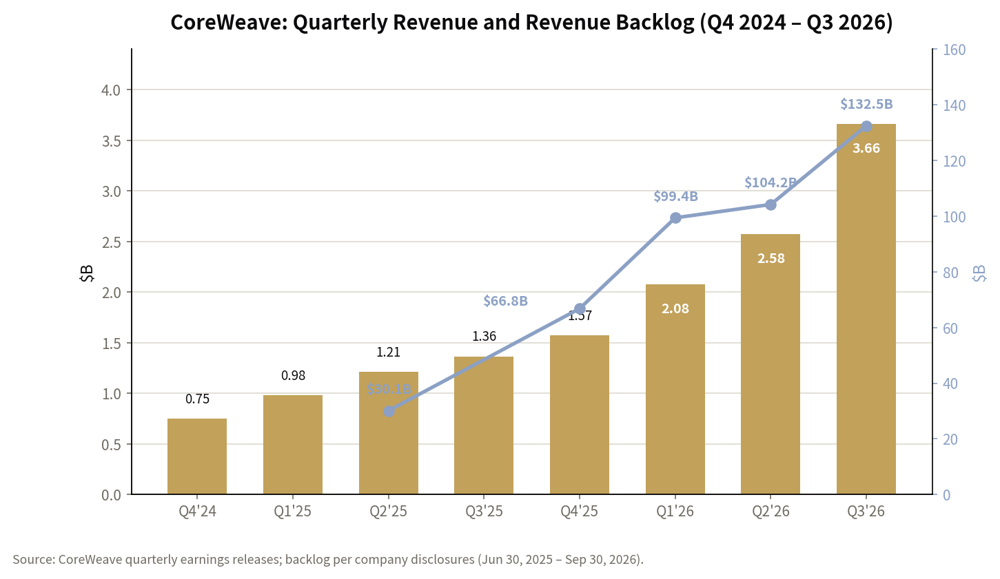
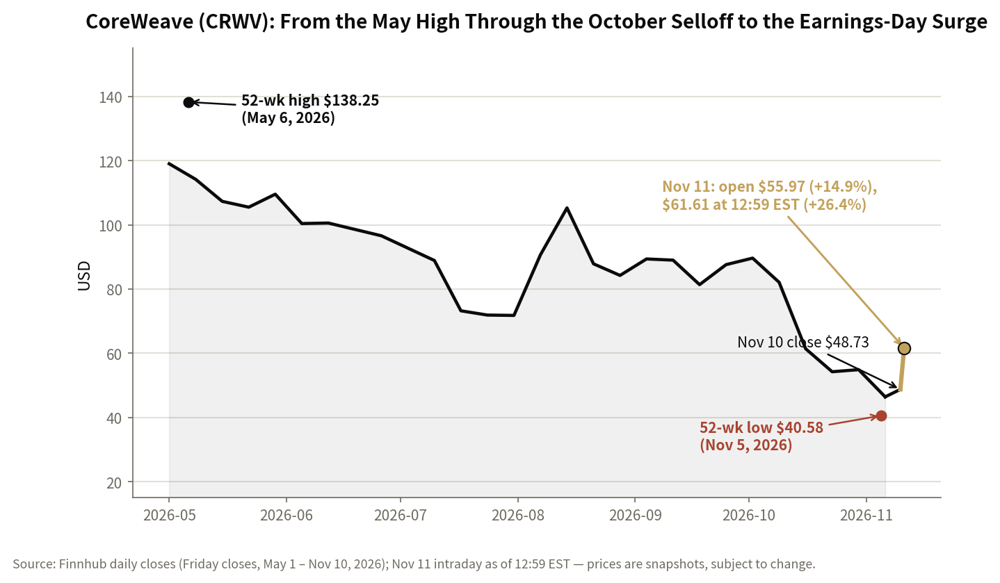
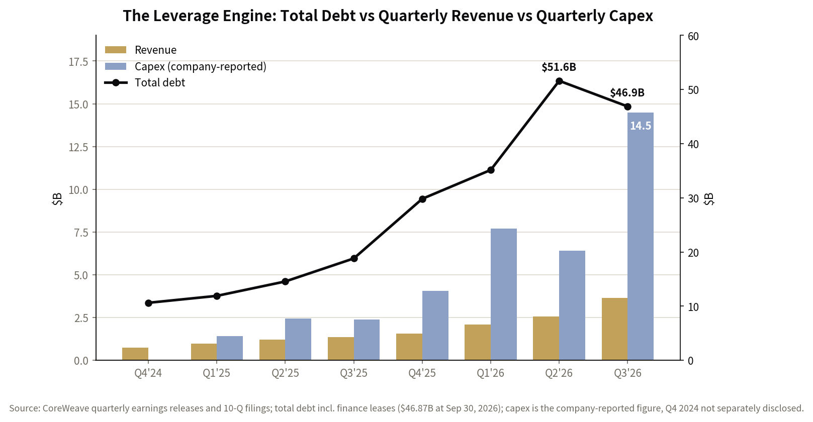

*All figures are from CoreWeave's Q3 2026 earnings release, its 10-Q, and the earnings call on November 10, 2026, unless noted. Stock prices are a snapshot as of 12:59 PM EST on November 11, 2026, and move fast. This is analysis, not investment advice. Related reading: [CoreWeave's Bonds Hit 15%: What the Credit Market Is Actually Saying](/portfolio/coreweave-bond-yield-15/).*

## What happened

CoreWeave reported third-quarter results after the close on Monday, November 10, and the stock ripped. To be precise about the move, because the headline numbers are already getting sloppy: the stock closed Monday at **$48.73**, rose about 5.6% after hours to ~$51.49, and on Tuesday **opened at $55.97 — up 14.9%** — before running to an intraday high of $61.78 and trading at **$61.61 at 12:59 PM EST, up 26.4%** on the day. It did not open up 25%. The +25% came later in the session, and the distinction matters, because the morning gap and the intraday extension were driven by different things: the gap was the earnings beat, and the extension was the market repricing what the beat means for the company's survival.

Context: the stock had fallen **40.6% in a month** (from $82.08 on October 9 to $48.73 on November 10), **50.7% from October 1**, and **70.6% from its 52-week high of $138.25 on May 6** to its 52-week low of $40.58 on November 5. A month ago, [the bond market was pricing this company's debt at ~15% yields](/portfolio/coreweave-bond-yield-15/) and its five-year credit default swaps had blown out past 1,140 basis points. Tuesday's move is a repricing of that distress narrative. The question is how much of it the quarter actually earned.

## 1. The numbers that matter

| Metric | Q3 2026 | Context |
|---|---|---|
| Revenue | $3.661B, +168% YoY | vs ~$3.55B LSEG consensus; above the high end of guidance; +$1.09B sequentially |
| Adjusted EBITDA | $2.256B, 62% margin | Up from 59% in Q2 |
| Adjusted operating income | $379M, 10% margin | vs $200–260M guidance; up from 1% in Q1 and 5% in Q2 |
| GAAP net loss | $709M (EPS −$1.27) | vs a $110M loss a year ago |
| Net interest expense | $846M | 2.2× adjusted operating income |
| Revenue backlog | $132.5B | Record; +138% YoY; $104.2B at the end of Q2 |
| FY2026 revenue guidance | $13.0–13.3B | Raised from $12.4–13.2B |
| FY2026 adj. operating income guidance | $1.275–1.375B | Midpoint raised 26% |
| Year-end 2026 annualized run-rate | $20–21B | Exit-rate target, based on capacity deployment plans |
| Q3 capex | $14.5B | ~4× quarterly revenue; pulled forward from Q4 |
| FY2026 capex guidance | $37–39B | ~3× guided annual revenue |
| Total debt (Sep 30) | $46.87B | Down from $51.61B at Jun 30; ~$66.2B including leases |
| Q3 free cash flow | −$7.47B | Operating cash flow $1.98B minus cash PPE purchases $9.44B |

Three numbers do most of the work in this table. Revenue grew 168% and beat consensus by about $100M — solid, but the market already knew demand was strong. The backlog jumped $28.3B in a single quarter to $132.5B — that is the demand story in its most concrete form. And adjusted operating income of $379M, against guidance of $200–260M, with the margin reaching 10% after 1% in Q1 and 5% in Q2, is the operating-leverage story arriving a quarter ahead of schedule. Management said it reached low-double-digit adjusted operating margins one quarter earlier than planned.

*Quarterly revenue (bars, left axis) and revenue backlog (line, right axis). Revenue has grown roughly 5× in two years; the backlog has grown 4.4× since June 2025. Source: CoreWeave quarterly earnings releases.*

## 2. Why the market reacted this way

The October selloff had a specific thesis: CoreWeave is a debt-funded GPU landlord whose funding model was breaking — bond yields at 15%, a CDS market pricing distress, and a free-cash-flow burn that looked unsustainable. The quarter attacked that thesis on four fronts, and each one landed.

**First, operating leverage arrived early.** The 10% adjusted operating margin is not just a beat against guidance; it is the shape of the curve changing. In Q1 the margin was ~1%, in Q2 ~5%, now 10%. The reason is mix: as the fleet scales and the company sells more short-term capacity at premium prices, incremental revenue carries very high margins. Management's guidance raise — adjusted operating income midpoint up 26% — says this is a trajectory, not a one-off.

**Second, the funding question got a concrete answer.** The company expects to collect approximately **$9 billion in customer prepayments and deposits in the next three months**, on deals where customers fund up to 100% of the contract value upfront — 70% of this year's deals included prepayments. More than $3 billion of that $9 billion is recontracting of *existing* infrastructure at a premium: cash with no new capex attached. Management said it will not issue unsecured debt at current yields, does not need to, and expects to need **less than $5 billion of additional parent-level capital through 2027**. The weighted average cost of debt fell to **7.9%, down 250 basis points year over year**, and the company has already paid down more than $4 billion of debt, including nearly half of its first two (and most expensive) delayed-draw term loans.

**Third, the fleet is appreciating, not depreciating.** The bears' core assumption is that GPU collateral decays — that today's H100s are tomorrow's paperweights. On the call, the CEO said pricing for Ampere and Hopper capacity rose **30–50% quarter over quarter** on recontracting, *above* the original contract prices. When your supposedly depreciating asset re-rents at a 30–50% premium, the collateral story inverts. This is the single most important datapoint in the quarter for the credit thesis.

**Fourth, demand is still an order of magnitude larger than supply.** Management estimates qualified demand at roughly **10× available capacity through the end of 2027**, says 2028 capacity is already sold out (of what has been brought to market), and disclosed short-term capacity pricing above **$40 million per megawatt per year**, against $20–25 million for new four-to-five-year contracts. Scarcity is being priced in, in CoreWeave's favor.

**Fifth, positioning.** A stock down 40% in a month, with a crowded bearish narrative and a CDS market at distressed levels, is primed for a violent move on good news. Part of Tuesday's +26% is genuine repricing; part is the mechanics of a one-sided trade unwinding. The two are indistinguishable in the moment and very distinguishable over the next two quarters.

*Weekly Friday closes from May 1 to November 10, 2026, plus the November 11 open and intraday move. The stock fell 70.6% from its May high to its November 5 low, then recovered 51.8% from that low to $61.61 — still 55.4% below the May high. Source: Finnhub daily closes; November 11 intraday as of 12:59 PM EST.*

## 3. The tension at the core: the leverage engine

None of the above changes the balance sheet. This is still a company that borrows money, buys Nvidia GPUs, and rents them out — and the arithmetic of that model is brutal at the current scale.

*Quarterly revenue (gold bars) and capex (blue bars) against total debt (line, right axis). Capex has run at 2–4× revenue for six straight quarters while debt went from $10.6B to $46.9B. Source: CoreWeave quarterly releases and 10-Q filings.*

Start with the income statement. Net interest expense was **$846 million in the quarter — 2.2 times the $379 million of adjusted operating income**. Fourth-quarter interest is guided at **$1.05–1.15 billion**, which is roughly 80% of the *entire year's* adjusted operating income guidance of $1.275–1.375 billion. The adjusted operating margin can double and the company still will not cover its interest bill from operations. The GAAP net loss widened to $709 million from $110 million a year ago, because interest and depreciation scale with the buildout — that is the cost of the model, not an accounting artifact.

Then the cash flow. Capital expenditures were **$14.5 billion in one quarter — about four times quarterly revenue** — and full-year capex guidance of $37–39 billion is roughly three times guided annual revenue. Free cash flow was **−$7.47 billion in Q3**. The business consumes cash at a rate that only works if the prepayment and secured-debt machine keeps running every single quarter until operating cash flow catches up.

Then the balance sheet. Total debt of $46.87 billion is down from $51.61 billion in Q2, which is genuine progress — but including operating and finance leases the total is about **$66.2 billion**, roughly 3.2× the $20–21 billion exit revenue run-rate. And the debt is not generic corporate debt: it is mostly asset-level, contract-matched facilities (delayed-draw term loans priced 225–550 basis points over SOFR, translating to under 10% at the high end). That structure is both the strength and the fragility. When contracts are signed and customers pay, the facilities self-amortize — $4 billion has already been repaid that way. When contracts don't materialize, or customers don't pay, the same structure becomes a claim on GPUs whose resale value is the open question.

The honest frame: CoreWeave is a spread business. It earns the spread between the rent it collects on GPUs and the cost of the money that bought them. Right now the spread is widening — recontracting premiums of 30–50%, a falling cost of debt, scarcity pricing above $40M per MW. Spreads that widen can also compress, fast, and the compression would show up in exactly the places this quarter looked best: renewal pricing, prepayment terms, and facility pricing.

## 4. The 2028 path: what has to go right

Management targets **adjusted profitability in the first half of 2028**. Here is the bridge they described, and the arithmetic test it has to pass.

- **Renewals.** About 130,000 GPUs come off contract in 2027 and roughly 170,000 in 2028. Management expects about **$4 billion of incremental annualized revenue from 2027 renewals, rising to $10 billion including 2028** — revenue that is *not* in the $132.5 billion backlog. This is the largest single swing factor in the model, and it depends entirely on renewal pricing holding near current levels.
- **EBITDA less interest more than doubles in 2027**, by management's estimate — the internal funding engine that reduces dependence on outside capital.
- **The paid-off fleet.** Once a delayed-draw facility is repaid, the equipment is owned free and clear and generates revenue without new investment. As more of the fleet reaches that state each year, capital intensity falls structurally. This is the mechanism that makes the model *less* leveraged over time rather than more — if the equipment stays productive and contracted.
- **Prepayments keep funding the build.** With 70% of deals carrying prepayments and $9 billion arriving in the next three months, the company can fund a large share of capex from customers rather than from new parent-level debt.

Now the arithmetic test. Take the year-end 2026 exit run-rate of $20–21 billion. At a 10% adjusted operating margin — today's level — that is roughly $2.0–2.1 billion of adjusted operating income on a run-rate basis. Annual interest at the Q4 guided rate is roughly $4.2–4.6 billion. So even at the exit run-rate, adjusted operating income does not cover interest. Getting to adjusted profitability by H1 2028 therefore requires margins to expand well past 10% (toward 20% or more on the run-rate), interest to fall as debt is repaid, and renewal premiums to hold — all three at once. That is plausible. It is not yet visible in the numbers. And note that "adjusted" profitability excludes stock-based compensation and other items; GAAP profitability is a further step beyond it.

What would make the bridge visible: the margin progression in Q4 and Q1 2027, the first real renewal pricing data as the 130,000 GPUs roll off, and the pace of debt paydown. Those three datapoints, not the stock price, are the scoreboard.

## 5. The industry wind: hyperscaler capex, the neocloud question, and power

The demand side of this story is not in doubt. The four big hyperscalers are guiding to roughly **$730 billion of combined capex in 2026** — Amazon ~$220B, Alphabet $195–205B, Meta $135–145B, Microsoft ~$170B — up about 78% from ~$410B in 2025, with Goldman Sachs projecting roughly **$1.14 trillion in 2027**. In Q3 alone, Alphabet spent $51.4 billion and Meta $34.9 billion on capex. CoreWeave's $132.5 billion backlog is a rounding error against that spend — which is both the opportunity and the risk, because the backlog exists precisely to the extent that the hyperscalers and labs cannot or will not build fast enough themselves.

That is the neocloud question in its sharpest form. CoreWeave's pitch is speed and specialization: it brings capacity online faster than the hyperscalers' own buildouts and sells to the labs and enterprises that can't wait. But its largest customers are also its largest competitors in capacity — Microsoft was 67% of 2025 revenue, the top three customers were 72% of Q2 2026 revenue, and OpenAI and Meta carry commitments of up to ~$22.4 billion and ~$35.2 billion respectively. The neocloud is, in part, an overflow valve for the hyperscalers' own demand. The open question is whether that overflow is structural — because the buildout permanently exceeds what any single company can finance and build — or cyclical, in which case the valve closes the moment hyperscaler capacity catches up.

The bubble debate sits on top of this. Gartner's widely cited math is that AI needs roughly $8.5 trillion of cumulative revenue through 2030 to justify the buildout, against at most ~$3.6 trillion forecast. CoreWeave's own five-year CDS peaked above 1,140 basis points in mid-October and was still around 1,038 after the initial post-earnings move — the credit market remains skeptical even as the equity rallies. Wells Fargo's Michael Turrin has estimated 2027 capex could reach $66 billion against a funding gap of $25 billion or more (an analyst estimate, not a company figure). The honest position: AI compute demand is real and growing fast; whether the current *rate* of build earns its cost of capital is unproven — and CoreWeave, as the purest leveraged play on that question, is where the answer will show up first.

Then there is power, which is the actual binding constraint on the whole industry. CoreWeave's active power reached **1.7 gigawatts** — double the end-2025 footprint — against **4.6 gigawatts contracted**. The backlog converts to revenue only when power goes live, so the pace of converting contracted power to active power is the operational number to watch every quarter.

On the power-architecture question I follow closely: the current demand surge is for H100/H200/GB200 systems running on **54V in-rack power architecture**. NVIDIA's full-scale **800V DC** production is timed to the Kyber rack — 576 Rubin Ultra GPUs — in 2027, and the rack-adjacent 800V power hardware only entered production in Q3 2026. Today's demand proves GPU appetite, not the 800V timeline. The 800V supply chain (Vertiv, Delta, Eaton, Schneider) is a 2027 story; the 2026 story is getting power, cooling, and GPUs into buildings fast enough. (One flag: the Kyber timing is contested — SemiAnalysis reported a slip to 2028 and NVIDIA says its roadmap is intact. Worth watching, not worth assuming.)

## 6. Risks and what to watch next

1. **Whether credit follows equity.** In mid-October the 2032 notes yielded ~15% — see [the earlier post](/portfolio/coreweave-bond-yield-15/). If yields stay near distressed levels while the stock rallies, the market is saying the equity is a call option on survival, not a claim on a self-funding business. A sustained rerating needs the bond market to confirm it.
2. **Customer concentration.** Microsoft at 67% of 2025 revenue and a top-three share of 72% in Q2 2026 means the backlog is concentrated in a small number of counterparties whose own AI spending is the thing being debated.
3. **Renewal pricing.** 130,000 GPUs roll off contract in 2027. If spot pricing softens, the $4 billion incremental renewal revenue estimate falls with it — and that estimate is the core of the 2028 bridge.
4. **Utilization and power conversion.** 1.7 GW active against 4.6 GW contracted. Backlog is not revenue until the power is live; watch the conversion pace each quarter.
5. **NVIDIA supply and the Rubin transition.** Being first to bring Vera Rubin online — delivered to Cognition for production workloads — is a real competitive edge. Supply constraints or a delayed Kyber would slow the 2027–28 build.
6. **Interest and refinancing.** Q4 interest of $1.05–1.15 billion, a 7.9% weighted average cost of debt, and facility pricing of 225–550 bps over SOFR. If rates rise or spreads widen, the spread business compresses from the other side.
7. **Free cash flow.** −$7.47 billion in Q3. The prepayment and secured-debt machine has to keep working every quarter until operating cash flow catches up — and the $9 billion of prepayments arriving in the next three months is the first test of that.

## Verdict

What changed on Tuesday: the quarter removed the near-term funding tail risk that drove the October selloff. Nine billion dollars of prepayments, recontracting premiums of 30–50%, a falling cost of debt, $4 billion of debt already repaid, and demand at roughly 10× supply make the bridge to 2027 credible in a way it was not a month ago.

What did not change: the company still burns about $7.5 billion of free cash per quarter, pays more than $850 million per quarter in interest against $379 million of adjusted operating income, and needs renewal pricing, power conversion, and credit-market access all to go right to reach adjusted profitability in the first half of 2028. The arithmetic from a $20–21 billion exit run-rate to a self-funding business is not yet closed.

The +26% is best read as a repricing of survival risk, not a verdict on long-term returns. The stock is still about 55% below its May high. The scoreboard from here is three numbers: the bond yield, the renewal pricing, and the margin progression. Those will decide whether Tuesday was a bottom or a bear-market rally — and they will decide it well before the stock price does.

---

**Sources:** CoreWeave Q3 2026 earnings release (Business Wire / CoreWeave IR, Nov 10, 2026); CoreWeave Q3 2026 Form 10-Q (SEC); CoreWeave Q3 2026 earnings call transcript (Motley Fool, Nov 10, 2026); Reuters coverage of the Q3 results and October credit selloff; Finnhub market data (prices as of 12:59 PM EST, Nov 11, 2026); NVIDIA 800V DC power architecture materials (NVIDIA technical blog, May 2025; Open Compute Project); hyperscaler capex guidance per company filings and earnings releases; Goldman Sachs 2027 capex estimates as reported. *This post is analysis of public information, not investment advice.*

<!-- rebuild trigger 2026-11-11: force Pages rebuild after rapid pushes -->
