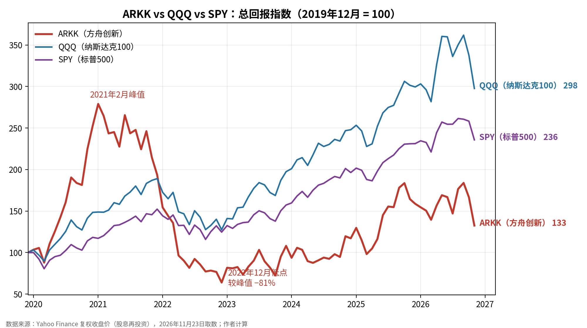
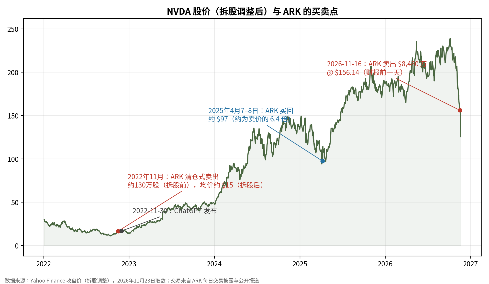

> [English version 英文版](/portfolio/cathie-wood-beta-trade/)

*本文为基于公开数据的外部分析，数据截至 2026 年 11 月 23 日。价格为 2026 年 11 月 23 日取数的拆股调整后收盘价；基金收益为股息再投资的总回报。不构成投资建议。*

先把结论摆在桌面上。Cathie Wood（木头姐）的旗舰基金 ARK Innovation（ARKK）成立于 2014 年 10 月 31 日。从成立到 2026 年 11 月 20 日——整整十二年，一个完整的牛熊周期——一个买入并持有的投资者实际拿到的是：

| 2014-10-31 → 2026-11-20 | 总回报 | 年化 | 年费率 |
| --- | --- | --- | --- |
| **ARKK** | **+249%** | **≈ +10.9%** | 0.75% |
| QQQ（纳斯达克100） | +556% | ≈ +16.9% | 0.20% |
| SPY（标普500） | +317% | ≈ +12.6% | 0.09% |

换成钱更直观：成立那天投入 1 万美元，到 2026 年 11 月 20 日，ARKK 变成约 34,900 美元，QQQ 是约 65,600 美元，SPY 是约 41,700 美元。也就是说，ARKK 的持有人为"颠覆式创新"支付的溢价，买到的是一次 −81% 的过山车，外加一份跑输指数的成绩单。这还没算费率结构的复利效应：0.75% 对 0.20%，十二年下来又是一道约 6–7 个百分点的隐形剪刀差。

请再读一遍。过去十年最著名的"选股明星"基金，全周期不仅跑输纳斯达克100，连最普通的标普500 都没跑赢——同时收着 4 到 8 倍的管理费，中间还让持有人经历了一次峰值到谷底 −81% 的崩塌。能解释她收益的东西，绝不是"可持续的选股能力"。主要是三样：**Beta**（对市场最长久期角落的永久性、集中式、效果上带杠杆的押注，而这个角落在 2020 年迎来了史上最好的一年）、**一次押对**（2018 年的特斯拉，那确实是真本事）、以及**资金流的时点**（钱在顶部涌入，收益被时点吃掉）。而她围绕核心持仓做的那些主动交易——最典型的是英伟达——是减分项，不是加分项。"她什么都没做对、全靠股票自己飞"这个零假设，经得起几乎所有检验。

*ARKK 与 QQQ、SPY 的总回报对比（2019 年 12 月 = 100）：2020 年的冲顶、−81% 的崩塌，以及至今仍跑输指数的"反弹"。数据来源：Yahoo Finance 复权收盘价，2026 年 11 月 23 日取数；作者计算。*

## 2020 年："天才之年"的解剖

2020 年 ARKK 涨了 +153%（QQQ +48%，SPY +18%），是当年全球大型股票基金的第一名，Bloomberg 把"年度最佳选股人"的头衔给了 Wood。但值得精确地看：她持有的是什么，世界又对这些股票做了什么。第一大重仓特斯拉（约占基金 10–11%）2020 年涨了 +743%；Zoom 涨了 +396%；Teladoc +139%；Roku +148%。这些都是教科书级的"疫情宅家股"，而 2020 年同时给了它们百年一遇的需求冲击、零利率、量化宽松和财政发钱。

一个由未盈利、长久期成长股组成的组合，在因子语言里就是一份"对贴现率下降的杠杆索取权"。当美联储把利率砍到零、疫情把十年的数字化进程压缩进一年，这份索取权自然爆炸。这不是说不该买这些股票，而是对暴露本身的描述。最有力的证据是对称性：2022 年利率一涨，同一个组合跌了 −67%（QQQ −33%，SPY −18%）；从 2021 年 2 月 12 日的收盘峰值 $156.58 到 2022 年 12 月 28 日的 $29.64，回撤 −81%。真正的选股 alpha 很少会以"双向两倍 Beta"的形式出现。过去五年 ARKK 的年化波动率约 43%，大约是 QQQ（约 21%）的两倍（Portfolio Visualizer，截至 2026 年 10 月）。以两倍波动、更低的长期夏普比率换来的收益，不是 alpha，是一个收着 0.75% 年费的因子。

还有第二个更安静的机制：反身性。ARKK 的规模从 2020 年初的约 30 亿美元涨到 2021 年 2 月的峰值 282 亿美元（整个 ARK 公司一度摸到约 590 亿美元）。Morningstar 指出，到 2021 年 2 月，这只基金持有其 55 只持仓股中 10 家公司至少 10% 的股份。一只这个体量的基金持续买入流动性差的小盘股时，它自己的申购资金就是推高价格的一部分，然后又被它报告为"业绩"。所谓天才之年，有一部分是基金用别人的钱把自己的持仓买了上去。

## 过山车全程：连反弹都在证明同一件事

辩护者会说——而且没说错——ARKK 后来反弹了：2023 年 +69%，2025 年 +35%（Morningstar 把 ARK 旗下基金评为 2025 年表现最好的五只 ETF 中的四只），从 2022 年 12 月的谷底到 2026 年 11 月 20 日累计 +107%。但请看同一时间窗里她本应跑赢的指数：QQQ 涨了 +133%。连"王者归来"的剧本，都只是因子本身在修复——而且修得比因子还慢一点。更关键的是位置：2026 年 11 月 20 日 ARKK 收在 $64.22，距离 2021 年 2 月的峰值还差 −59%，将近六年过去了。在故事最火爆时买入的人，趴在水下熬了近一个十年，而同期标普500 从那个峰值算起又涨了约一倍。截至 2026 年 11 月 18 日的五年年化：ARKK −8.8%，标普500 +9.3%（Morningstar 数据，经 TheStreet 报道）。

## 英伟达：对零假设最干净的一次检验

想检验一个基金经理的"主动决策"到底有没有价值，就去找她交易动作最大、最偏离"拿着不动"的那只股票。对 Wood 来说，这只股票是英伟达——而记录是残酷的，因为 ARK 入场极早：2014 年就以拆股后约 $4 的价格买入，拿了八年。然后在 2022 年第四季度，它卖出了约 130 万股（拆股前口径），其中大部分在 2022 年 11 月卖出，均价约 $146（拆股前），折合约 $15（拆股后）。Wood 在 2023 年 2 月对 CNBC 的解释是：公司很好，但估值太贵了。

ChatGPT 在 2022 年 11 月 30 日发布——就在清仓式卖出的几天之后。英伟达 2023 年涨了约 240%，然后继续涨。"什么都不做"的算术毫不含糊：仅 2022 年四季度卖出的那一批约 85.9 万股（拆股前），卖出所得约 1.26 亿美元；若持有到 2026 年 11 月 16 日英伟达收盘价 $156.14，价值约 13.4 亿美元。财经媒体对这笔卖出"错失收益"的估算从约 8.5 亿美元（以 2025 年价格计）到约 12 亿美元不等。到 2025 年 4 月，ARK 又开始买回：2025 年 4 月 7–8 日在关税暴跌中买入约 34.1 万股，价格约 $97——大约是卖价的 6.4 倍，仓位只有原来的零头。此后它一路小步加仓，到 2026 年 8 月，全家族的英伟达持仓重建到约 3 亿美元——听起来不少，但请记住那个被卖掉的批次同期价值约 13.4 亿美元：用六倍的价格，买回了不到四分之一的暴露。这就是"择时"在这只股票上的完整成绩单：卖在地板，买回在半山腰，仓位还缩了水。2026 年它继续加仓——然后在 2026 年 11 月 16 日，又以 $156.14 卖出 543,092 股、约 8,480 万美元，就在财报发布前一天；而那份财报打出了单季营收 1,158 亿美元、同比 +103%、指引 1,300 亿美元的数字。

*英伟达拆股调整后股价与 ARK 的关键交易：2022 年 11 月约 $15 卖出、2025 年 4 月约 $97 买回、2026 年 11 月 16 日 $156.14 卖出。数据来源：Yahoo Finance 收盘价，2026 年 11 月 23 日取数；交易来自 ARK 每日交易披露与公开报道。*

对最近这笔要公平一点：2026 年 11 月的卖出发生在黄仁勋突然辞职之后，ARK 称其内部评分体系下调了英伟达的领导力得分，而且股价在动荡中到 11 月 20 日确实跌到了 $125.53——单看这一笔，卖出是可以辩护的。不能辩护的是把整个序列当作"择时能力"的证据。一个在 ARK 买入时点买入英伟达、然后**什么都不做**的投资者，在这只股票上比跟着 ARK 交易的投资者多赚了大约十亿美元。这就是零假设在她交易最频繁的 AI 标的上做的检验——而且差距不是毫厘之间。

## 投资者的实际成绩，比基金本身还差

基金收益是时间加权的"标本"，真正重要的是投进去的钱赚了多少。这一层故事更黑。Morningstar 的 Amy Arnott 在 2024 年 2 月估算：截至 2023 年底的十年里，ARK 基金家族销毁了约 **143 亿美元**股东财富——全美基金家族中最差；其中 ARKK 一只就占约 71 亿美元。机制就是时点：Morningstar 的 *Mind the Gap* 研究发现，ARKK 历史上约 90% 的净流入发生在 2020 和 2021 年、即顶部附近；截至 2021 年 11 月 30 日的五年里，基金本身年化 +41.3%，而它的投资者实际只拿到年化 +9.9%。Bloomberg 的统计是最锋利的版本：ARKK 成立以来累计净流入约 120 亿美元，而 2026 年初它的资产只剩约 62 亿美元。基金本身全周期 +249%，信任它的钱加总起来却亏了几十亿。而这场游戏里唯一稳赢的参与者也赢了：《金融时报》估算 ARK 仅从 ARKK 一只基金就收了约 3.1 亿美元管理费——其中大部分是在峰值*之后*收的，因为费用按规模计提，而规模恰恰在顶部抵达。

## 必须承认的反面证据

有三点必须承认，因为它们是真的。**第一，特斯拉那一注是真本事。** 2018 年 8 月 22 日的公开信里——特斯拉约 $320、空头围猎、破产论满天飞——Wood 论证这只股票五年内值 $700 到 $4,000，并把 ARK 的模型开源给所有人挑错。$4,000 的牛市情形折合今天拆股后约 $267；特斯拉在 2021 年就越过了这条线，峰值摸到约 $410，提前两年兑现。那是与共识对立的、有研究支撑的、被证明正确的判断。但请注意：那是一次**买入并持有**的胜利——钱是"拿着不动"赚的，不是交易出来的。**第二，集中持仓是明码标价的产品。** ARKK 从未承诺分散或风控，买的人拿到的正是标签上的暴露。**第三，她不是只有一个年份。** 2017 年 ARKK 涨了 +87%，是当年同类基金第一，远超 QQQ 的 +33%——那时没有疫情、没有零利率救市，她的"颠覆"名单就已经跑出来了。这说明 2020 年之前她确实有一段真实的热手期，尽管 2017 年本身也是成长风格大年，因子的顺风从未缺席。**第四，她敢在恐慌里买。** 2025 年 4 月对英伟达和 Coinbase 的抄底、2022 年谷底拒绝割肉，这些行为纪律确实优于普通散户——只是全周期账本显示，这点优势在别处基本被抵消了。

但反面证据真正证明的东西值得看清：她职业生涯最好的一笔交易，是一次信念下注之后**三年的什么都不做**。策略的辩护者必须解释：为什么十二年每天高信念、公开透明的交易，最终跑不赢一只指数基金；为什么这只组合历史上最清晰的一次主动决策（英伟达），是一份价值十亿美元的、支持零假设的证词。

## 结论

"木头姐纯靠运气"这个说法接近真相，但更精确的表述没那么客气、却更有用：**她的收益可以被三样东西解释——因子暴露（长久期成长 Beta）、一次押中的大注（特斯拉）、以及让收益从投资者转移到基金公司的资金流时点。** 这三台引擎没有一台是选股 alpha，也没有一台是追随者能可靠复制的：Beta 在 QQQ 里只卖 0.20%（真想要杠杆也有更便宜的工具）；特斯拉那一注已经是十年前的事；而资金流时点伤害的恰恰是追随者本人。当一个"大师"的叙事声量恰好在她所押因子的峰值达到最大，正确的反应既不是崇拜也不是嘲讽，而是去看十二年经审计的、按美元加权的、相对基准的数字。ARK 的数字说得很清楚：股票本来就会飞。"天才"是可选配件。

---

**数据来源：** Yahoo Finance ARKK、QQQ、SPY、NVDA 复权价格历史（2026 年 11 月 23 日取数；收益、回撤与指数化为作者计算）· Morningstar（Amy Arnott）《15 Funds That Have Destroyed the Most Wealth Over the Past Decade》，2024 年 2 月——家族 143 亿 / ARKK 71 亿美元数字，及 Morningstar *Mind the Gap* 投资者收益估算 · Bloomberg 资金流与规模报道（ARKK 累计净流入约 120 亿 vs 2026 年初资产约 62 亿美元）· ETF.com 与 Bloomberg 关于 ARKK 2021 年 2 月 282 亿美元规模峰值 · Portfolio Visualizer 波动率数据（截至 2026 年 10 月）· ARK Invest 每日交易披露及 2022 年 11 月英伟达卖出、2025 年 4 月买回、2026 年 11 月 16 日卖出的同期报道（The Motley Fool、TipRanks、TradingView、TheStreet）· ARK Invest 致特斯拉董事会公开信，2018 年 8 月 22 日 · 《金融时报》关于 ARKK 管理费收入的报道。英伟达卖出的"错失收益"为财经媒体估算；约 12 亿美元为作者按报道的股数与价格所做的交叉核对。
