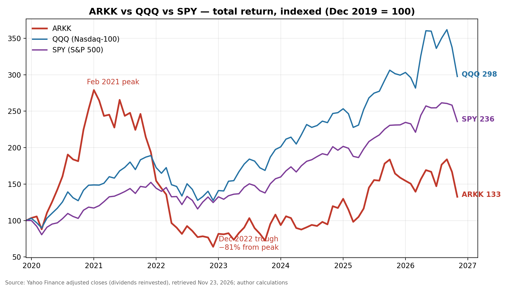
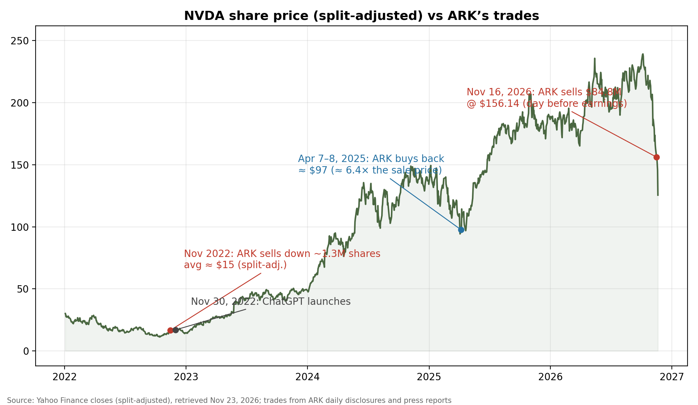

> [中文版 Chinese version](/portfolio/cathie-wood-beta-trade-zh/)

*An outside analysis based on public data as of November 23, 2026. Prices are split-adjusted closes retrieved November 23, 2026; fund returns are total returns with dividends reinvested. Not financial advice.*

Here is the whole argument in one table. ARK Innovation (ARKK), Cathie Wood's flagship, launched on October 31, 2014. From inception to November 20, 2026 — twelve years, one full cycle of boom, bust, and recovery — here is what a buy-and-hold investor actually got, against the two index funds Wood's marketing implicitly promises to outsmart:

| Oct 31, 2014 → Nov 20, 2026 | Total return | Annualized | Annual fee |
| --- | --- | --- | --- |
| **ARKK** | **+249%** | **≈ +10.9%** | 0.75% |
| QQQ (Nasdaq-100) | +556% | ≈ +16.9% | 0.20% |
| SPY (S&P 500) | +317% | ≈ +12.6% | 0.09% |

In dollars: $10,000 invested at inception became about $34,900 in ARKK, about $65,600 in QQQ, and about $41,700 in SPY. Read that again. Over its full life, the most famous stock-picking fund of the decade has underperformed not just the Nasdaq-100 but the plain S&P 500 — while charging four to eight times the fee, and while putting holders through an 81% peak-to-trough collapse in the middle. Whatever explains Cathie Wood's returns, it is not a repeatable ability to pick stocks better than an index. What explains them, mostly, is beta: a permanent, concentrated, leveraged-in-effect bet on the longest-duration corner of the equity market, which happened to have its greatest year ever in 2020 — plus one genuinely great call on Tesla, made once, in 2018. The trades she made around that bet, most damningly Nvidia, subtracted value rather than adding it. The null hypothesis — *she did nothing special, and the stocks flew anyway* — survives almost every test you can run on it.

*ARKK vs QQQ vs SPY, total return indexed to December 2019 = 100. The 2020 spike, the 81% collapse, and the recovery that still trails the index. Source: Yahoo Finance adjusted closes, retrieved November 23, 2026; author calculations.*

## 2020: anatomy of a "genius" year

ARKK returned +153% in 2020 (QQQ: +48%; SPY: +18%), the best performance of any large equity fund that year, and Bloomberg named Wood the best stock picker of 2020. It is worth being precise about what the fund owned and what the world did to it. The largest position, Tesla at roughly 10–11% of the fund, rose +743% in 2020. Zoom, a top holding, rose +396%. Teladoc rose +139%, Roku +148%. These were the canonical lockdown stocks, and 2020 handed them a once-in-a-century demand shock, zero interest rates, quantitative easing, and stimulus checks — simultaneously.

A portfolio of unprofitable, long-duration growth companies is, in factor terms, a leveraged claim on falling discount rates. When the Fed cut to zero and the pandemic pulled a decade of digital adoption into a year, that claim exploded upward. This is not a criticism of owning the stocks; it is a description of the exposure. The tell is the symmetry. When rates rose in 2022, the same portfolio fell −67% (QQQ: −33%; SPY: −18%), and from its February 12, 2021 closing peak of $156.58, ARKK fell to $29.64 by December 28, 2022 — a drawdown of −81%. Stock selection does not usually come with a beta of two in both directions. ARKK's volatility over the past five years has run at roughly 43% annualized, about double QQQ's ~21% (Portfolio Visualizer, through October 2026). Returns that arrive with twice the index's volatility and a lower long-run Sharpe ratio are not alpha. They are a factor with a fee attached — 0.75% a year, every year.

There is a second, quieter mechanism: reflexivity. ARKK's assets went from roughly $3 billion at the start of 2020 to a $28.2 billion peak in February 2021 (firm-wide, ARK touched ~$59 billion). Morningstar noted that by February 2021 the fund owned at least 10% of the shares of 10 of its 55 portfolio companies. When a fund that size keeps buying illiquid small-caps, its own inflows are part of the price action it later reports as performance. The genius year was, in part, the fund bidding up its own book with other people's money.

## The round trip, and the rebound that proves the point

Defenders note, correctly, that ARKK has rebounded: +69% in 2023, +35% in 2025 (Morningstar ranked ARK funds as four of the five best-performing ETFs of 2025), and +107% cumulatively from the December 2022 trough to November 20, 2026. But look at the same window for the index she is supposed to beat: QQQ gained +133% over that identical stretch. Even her comeback is just the factor recovering — slightly worse than the factor itself. And the level matters: at $64.22 on November 20, 2026, ARKK still sits 59% below its February 2021 peak, nearly six years later. Anyone who bought the story at its most popular moment has now spent the better part of a decade underwater, while the S&P 500 roughly doubled from that same peak. Over the five years to November 18, 2026, ARKK's annualized return was −8.8%, against +9.3% for the S&P 500 (Morningstar data, via TheStreet).

## Nvidia: the cleanest test of the null hypothesis

If you want to know whether a manager's *active decisions* add value, find the position where they traded the most against simply holding. For Wood, that position is Nvidia — and the record is brutal, because ARK was there early. ARK first bought Nvidia in 2014 at roughly $4 a share, split-adjusted. It held the stock for eight years. Then, in the fourth quarter of 2022, it sold down roughly 1.3 million shares (pre-split), the bulk of it in November 2022, at an average of roughly $146 pre-split — about $15 split-adjusted. Wood explained on CNBC in February 2023 that she liked the company but the valuation had gotten ahead of itself.

ChatGPT launched on November 30, 2022 — days after the bulk of the selling. Nvidia rose roughly 240% in 2023 and kept going. The arithmetic of "doing nothing" is not subtle: the fourth-quarter tranche alone, about 859,000 pre-split shares sold for roughly $126 million, would have been worth about $1.34 billion at Nvidia's November 16, 2026 close of $156.14. Financial-press estimates of the forgone gain run from roughly $850 million (valued in 2025) to about $1.2 billion. By April 2025 ARK was buying Nvidia back — about 341,000 shares across its funds on April 7–8, 2025, at around $97 a share: roughly 6.4 times the price at which it had sold, for a position a fraction of the original size. It added more through 2026 — then, on November 16, 2026, sold 543,092 shares for about $84.8 million at $156.14, one day before an earnings report that printed $115.8 billion in quarterly revenue, up 103% year over year, with guidance to $130 billion.

*Nvidia's split-adjusted price against ARK's major trades: the November 2022 exit at ≈$15, the April 2025 re-entry at ≈$97, and the November 2026 sale at $156.14. Source: Yahoo Finance closes, retrieved November 23, 2026; trades from ARK's daily disclosures and press reports.*

To be fair to the latest trade: the November 2026 sale followed Jensen Huang's shock resignation, ARK said its internal score for Nvidia's leadership had been downgraded, and the stock did slide to $125.53 by November 20 amid the turmoil — that sale, in isolation, is defensible. What is not defensible is the full sequence as evidence of timing skill. An investor who bought Nvidia when ARK did, and then literally never touched it, ends the story roughly a billion dollars ahead of the investor who followed ARK's trades in the same stock. That is the user's null hypothesis, tested on the manager's single most-traded AI name, and it is not close.

## The investors' record is worse than the fund's

A fund's return is a time-weighted fiction; what matters is what the dollars in it earned. Here the story darkens. Morningstar's Amy Arnott estimated in February 2024 that ARK's fund family destroyed about **$14.3 billion** of shareholder wealth over the ten years to December 31, 2023 — the worst of any fund family — with ARKK alone accounting for roughly $7.1 billion. The mechanism is timing: Morningstar's *Mind the Gap* work found that about 90% of ARKK's lifetime net inflows arrived in 2020 and 2021, near the top; over the five years to November 30, 2021, the fund returned +41.3% a year while its investors earned +9.9% a year. Bloomberg's tally is the starkest version: ARKK has taken in roughly $12 billion of net inflows since inception, yet held only about $6.2 billion of assets in early 2026. The fund is up +249% over its life; the money that trusted it is, in aggregate, down billions. Meanwhile the one participant guaranteed to win did: the Financial Times estimated ARK collected on the order of $310 million in fees from ARKK — most of it *after* the peak, because fees are charged on assets, and the assets arrived at the top.

## The honest counterpoints

Three things should be conceded, because they're true. **First, the Tesla call was real.** In an open letter on August 22, 2018 — with Tesla at about $320, short sellers circling, and bankruptcy threads trending — Wood argued the stock could be worth $700 to $4,000 within five years, and published ARK's model openly for anyone to attack. The $4,000 bull case is about $267 in today's split-adjusted terms; Tesla crossed it in 2021 and peaked near $410, two years ahead of schedule. That was differentiated, research-driven, and right when consensus was wrong. It is also, notably, a *buy-and-hold* win: the money was made by owning and sitting, not by trading. **Second, concentration is the disclosed product.** ARKK never promised diversification or risk control; buyers got exactly the exposure on the label. **Third, 2020 was not her only hot year.** ARKK returned +87% in 2017, best in its category, against QQQ's +33% — before COVID, before zero rates. She had a genuine pre-fame hot hand, even if 2017 was itself a strong growth-factor year. **Fourth, she buys panics.** The April 2025 Nvidia and Coinbase dip-buying, and her refusal to capitulate at the 2022 lows, are a genuine behavioral edge over the average retail investor — even if the record shows that edge mostly cancels out elsewhere.

But notice what the counterpoints actually establish. The best trade of her career was a single act of conviction followed by *doing nothing for three years*. The strategy's defenders must explain why twelve years of daily, high-conviction, publicly-disclosed trading produced less than an index fund — and why the clearest active decision in the portfolio's history, Nvidia, is a billion-dollar argument for the null hypothesis.

## The takeaway

"Cathie Wood is just lucky" is close, but the precise statement is less flattering and more useful: **her returns are explained by factor exposure (long-duration growth beta), one concentrated bet that paid off (Tesla), and flow timing that transferred the gains from her investors to her firm.** None of those three engines is stock-picking alpha, and none of them is something a follower can reliably harvest — the beta is available for 0.20% in QQQ (or levered, if you insist), the Tesla call is a decade old, and the flow timing worked against the followers, not for them. When a guru's narrative is loudest exactly at the moment their factor peaks, the correct response is not admiration or mockery. It is to ask what the last twelve years of audited, dollar-weighted, benchmark-relative numbers say. For ARK, they say: the stocks flew anyway. The genius was optional.

---

**Sources:** Yahoo Finance adjusted price history for ARKK, QQQ, SPY, NVDA (retrieved November 23, 2026; author calculations for returns, drawdown, and indexation) · Morningstar (Amy Arnott), "15 Funds That Have Destroyed the Most Wealth Over the Past Decade," February 2024 — $14.3B family / $7.1B ARKK figures, and Morningstar *Mind the Gap* investor-return estimates · Bloomberg flow and AUM reporting (ARKK ≈$12B cumulative net inflows vs ≈$6.2B assets, early 2026) · ETF.com and Bloomberg on ARKK's $28.2B February 2021 AUM peak · Portfolio Visualizer fund volatility data through October 2026 · ARK Invest daily trade disclosures and contemporaneous reporting of the November 2022 Nvidia sales, April 2025 repurchases, and November 16, 2026 sale (The Motley Fool, TipRanks, TradingView, TheStreet) · ARK Invest open letter to Tesla's board, August 22, 2018 · Financial Times reporting on ARKK fee income. Forgone-gain estimates for the Nvidia sales are financial-press calculations; the ≈$1.2B figure is the author's cross-check from reported share counts and prices.
