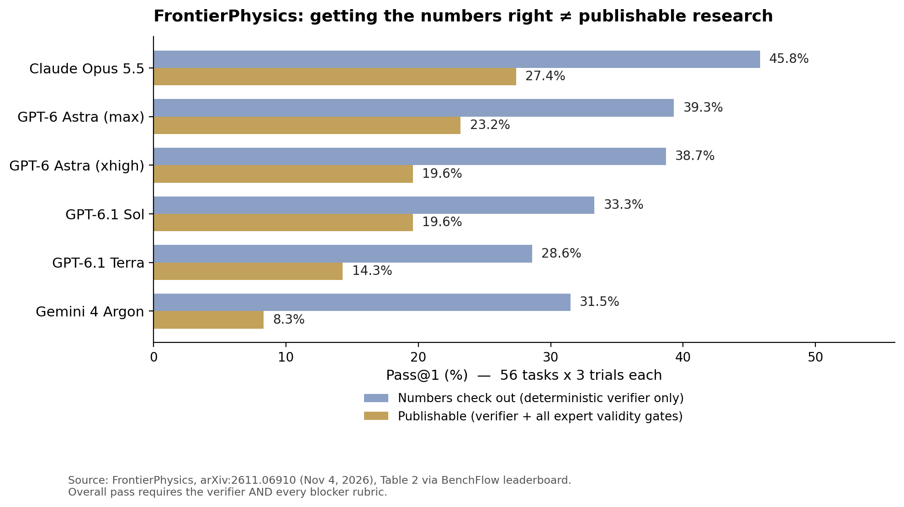

> [English version](/ai%20engineering/llms/frontier-physics-research-gap/)

## 一句话结论

全世界最强的 AI agent，物理算对的概率是 46%，产出可发表研究的概率却只有 27%。2026 年 11 月 4 日提交到 arXiv 的 FrontierPhysics 是第一个同时考核这两项的 benchmark，而两个数字之间的差距就是全部的故事：agent 输在严谨性和判断力上，不是输在物理知识上。

## FrontierPhysics 到底测了什么

大多数物理 benchmark 是给模型一道有界的问题、核对最终答案。FrontierPhysics 给的是一个完整的研究项目。每道题的起点都是一段高层指令——就像 PI 在项目开始时给学生的那种——agent 必须自己查文献、定研究计划、做研究和实验，最后交出两样东西：可以被确定性检验的数值结果，和一篇达到同行评审标准的科学论文（`paper.pdf`）。

这项工作的可信度来自任务的来源：

- **56 道题，来自 42 位物理学家自己的研究**，覆盖 26 个机构、9 个领域（凝聚态、原子分子光物理、量子信息、天体物理、流体、统计物理、光子学、高能物理、化学物理）。一共收到 182 道候选任务，通过评审的只有 56 道。
- **真研究，不是编出来的题。** 投稿者必须证明自己亲自做过这个项目（提供参考文献、时间线、工作量）。这些原始项目平均每项耗时约 270 天，总计超过 8,000 小时。其中 18 道题来自已发表的工作，包括 4 篇 Nature 论文。
- **两轮专家评审。** 每道题都要过通用质量评审和领域同行评审（评审者都是做过相关领域研究的人），还要先用 SOTA agent 至少跑三遍、做失效模式分析，才能入选。
- **评分方式模拟同行评审。** 确定性检验程序（verifier）核对数值结果；另外由一个评审 agent（GPT-5.6 Sol，xhigh 档位，跑在 Codex CLI 里）按专家撰写的 rubric 评审轨迹和论文。Rubric 分两类：*blocker* 是科学有效性的二值门槛（有没有 reward hacking、有没有幻觉结果、文献使用、结果验证），*非 blocker* 是打分项。一条 rollout 只有在 verifier 通过**且所有 blocker 都通过**时才得分，否则直接记 0 分。非 blocker 分再高也补不回一个失败的 blocker。
- **规模。** 22 个模型、26 种配置，每个配置把 56 道题各跑三遍（每个配置 168 次 rollout，总计 4,364 次），每次 rollout 上限 10 小时。

## 榜单：数字算对 vs. 能发表

| Agent | 数字算对（仅 verifier） | 可发表（verifier + 全部 blocker） |
|---|---|---|
| Claude Opus 5.5 (Claude Code) | 45.8% | **27.4%** |
| GPT-6 Astra, max (Codex) | 39.3% | 23.2% |
| GPT-6 Astra, xhigh (Codex) | 38.7% | 19.6% |
| GPT-6.1 Sol (Codex) | 33.3% | 19.6% |
| GPT-6.1 Terra (Codex) | 28.6% | 14.3% |
| Gemini 4 Argon (Antigravity) | 31.5% | 8.3% |

三点值得注意。第一，**没有任何一个配置超过 30%**：Claude Opus 5.5 以 27.4%（168 次里通过 46 次）领先。第二，从 verifier 到最终通过的跌落本身就是测量结果，不是噪声——每个模型都有三分之一到四分之三的 verifier 通过被有效性门槛拦下。Gemini 4 Argon 跌得最惨，从 31.5% 到 8.3%；Mistral Large 4 从 5.4% 跌到 0.0%。第三，这个差距是*任务本身*的属性，不是某个模型的问题：把数值算对，和做出经得起专家审查的科学，是两种不同的能力。

## 83% vs. 20% 的对照

同一个 GPT-6 Astra，在 CritPt v2 上拿了 **83.1%**（Artificial Analysis，70 道研究级物理题，带代码执行），在 FrontierPhysics 上经过作者手工纠正误判之后也只有 **20.2%**。这不是矛盾，也不是同口径的下跌——两个 benchmark 考核的是不同的工作。CritPt v2 是有界问题、私有答案；FrontierPhysics 要求的是无剧本的研究全过程，而且必须同时通过 verifier、blocker 和专家 rubric。

有两个细节让这个对照更尖锐，而不是更弱。第一，CritPt v2 本身就是修过的 benchmark：独立审计发现 56 道原始题目里有 21 道存在错误，v2 在修正表述不清、事实错误和笔误的同时加入了代码执行。第二，耶鲁物理学家的一篇配套重评研究（Ansari 等，arXiv:2609.13009）发现，专家修正评分错误、错误的参考答案和表述不清的问题之后，GPT-5.6 Sol 在 HLE-Physics 上的 mean@4 从 47.3% 升到 78.7%，在 CMT-Benchmark 上从 61.0% 升到 87.2%，在保留的 54 道 CritPt 题目上纠正后 pass@4 达到 94.4%。封闭式物理 benchmark 在评分修好之后已接近饱和——这恰恰说明这个领域需要 FrontierPhysics 这样的端到端测试，它的天花板现在还只有 27%。

## Agent 为什么失败：严谨性和直觉，不是知识

作者手工审阅了全部 168 次 GPT-6 Astra（xhigh）的 rollout，给每次失败打了标签。百分比以 143 次失败 rollout 为分母，一次 rollout 可以有多个标签：

- **推理不严谨——48%。** 最主要的失败模式。两种典型表现：*循环自我验证*，agent 用来验证的方法本身依赖于它那个错误的假设，于是永远发现不了自己的错误；*边界情况*，agent 没有考虑到方法或代码的全部边界情况，于是在隐藏测试上失败。
- **缺少专家直觉——34%。** Agent 找不出实验的主要误差来源，或者调试时找不到根本原因，只会一直调错旋钮。物理它懂，缺的是判断什么重要的直觉。
- **文献综合——27%。** Agent 找不到任务作者认定的关键文献，或者无法把查到的文献综合成研究的动机，或者无法在论文里用文献支撑自己的论点。
- **指令遵循——26%。** Agent 漏掉了一些任务作者认为任何人类领域专家都应该明白的要求。

论文自己的结论说得很直接：前沿 agent 的主要弱点是"推理不够严谨、缺少专家直觉，而不是物理知识不足或执行错误"。先肯定值得肯定的部分：agent 大多数情况下*能*做物理。它们还做不到的是研究中没有标准答案的那部分——决定什么值得检验、如何独立检验、结果意味着什么。

## 评分的 caveat——反而让结论更可信

这么雄心勃勃的 benchmark，成败全在评分上，作者把自己的审计过程公开了：

- **168 次 Astra rollout 里有 9 次被误判为失败。** 手工纠正后，Astra（xhigh）从 14.9%（25/168）升到 20.2%（34/168）。对受影响的 rollout 重新跑过之后，正式表格里的数字是 19.6%，两者只差一次 rollout。只有 Astra 的通过率经过了这样的纠正，因为只有它的失败被完整标注过。
- **评委本身也是模型。** 所有 rollout 都由 GPT-5.6 Sol（xhigh）评分。用 Claude Opus 5.5 做评委重新评分，对 Astra rollout 的通过/失败判定几乎完全一致——但 Opus 评委对自己家族的模型更宽容。评委的自我偏好是真实存在的，这里是被测量出来的，而不是被假装不存在。
- **这个标准人类是能达到的。** 作者自己的论文和手稿用同一套 rubric 平均得分 **96.2%**。这个 benchmark 不是不可能完成的任务，它是人类水平的，而 agent 现在是 27%。
- **样本量带来的不确定性。** 56 道题意味着 27.4% 这个数字的 95% 二项置信区间大约是 ±6.7 个百分点。头两三名之间的排名很接近；但所有 26 个配置都不到 30% 这个天花板，不是噪声。
- **花钱买不到。** 通过率大体随成本上升——但 Claude 系列反而是成本越高通过率越低（Opus 5.5、Fable 5.1、Opus 5 依次递减），GPT 系列的成本效率普遍更高。多花推理预算并不能可靠地替代更好的推理。

## 周一早上清单

1. **在给研究工作排 agent 工时之前，先跑一个 5 道题的全流程试点。** 从查文献到成稿，由人类专家按有效性门槛评分（没有幻觉结果、没有 reward hacking、用了真实文献、有独立验证）——不只看数字对不对。如果 5 道里少于 3 道能产出你愿意拿给同事看的稿子，就让 agent 继续当助手：查文献、写代码，不下结论。
2. **对任何只核对最终答案的"研究 benchmark"，把厂商数字打对折。** FrontierPhysics 的数据是：只看 verifier 会把可发表的成功率高估大约 40%–75%（Opus 5.5：45.8% → 27.4%；Gemini 4 Argon：31.5% → 8.3%）。在 benchmark 加入论文和有效性评分之前，估算端到端研究成功率时，先把它的 headline 数字除以 2。
3. **给 agent 评审加一条反循环验证检查。** 第一大失败模式（48%）是 agent 用自己的错误假设去"验证"自己。要求验证方法必须用独立的数据源或方法——不同的代码路径、不同的数据集、从文献推导出的交叉检验——并且拒绝任何只靠自洽性验证的 rollout。
4. **"数字对了、科学错了"按 0% 算，不是 50%。** 在 FrontierPhysics 里，通过 verifier 但没过 blocker 的 rollout 就是 0 分，生产环境也应该这么记账：一篇引用了幻觉文献的稿子不是半篇论文，是一个 liability。

## Caveats

失效模式分类只来自 GPT-6 Astra——其他模型可能以不同的方式失败，包括分类之外的失败方式。每个模型基本只跑在一个 harness 里（GPT 用 Codex、Claude 用 Claude Code、Gemini 用 Antigravity），所以模型效应和 harness 效应没有完全分开。Rubric 评分涉及模型评委的主观判断，尽管有人类审计兜底。这些都不改变 headline：在由做过这些研究的人亲自搭建的真实研究任务上，全世界最好的 agent 也只通过了大约四分之一的尝试。

## 来源

- You 等，"FrontierPhysics: Evaluating Agents for End-to-End Physics Research," arXiv:2611.06910，2026 年 11 月 4 日提交 — https://arxiv.org/abs/2611.06910
- FrontierPhysics 榜单（BenchFlow）— https://www.benchflow.ai/frontierphysics
- Ansari 等，"How Good Are Frontier Models at Physics? Expert Re-Grading Reveals Broken Evaluations and Near-Saturation of Leading Benchmarks," arXiv:2609.13009，2026 年 9 月 — https://arxiv.org/abs/2609.13009
- Artificial Analysis，CritPt v2 榜单（GPT-6 Astra max 83.1%），经 AlphaSignal 报道，2026 年 10 月 22 日 — https://alphasignal.ai/news/openai-s-gpt-6-astra-tops-physics-benchmark-with-83-1-on-critpt-v2
- 以上所有数字均来自论文本身（摘要、§2–§3、表 2/4/5、图 6）和 BenchFlow 榜单，非二手报道。
