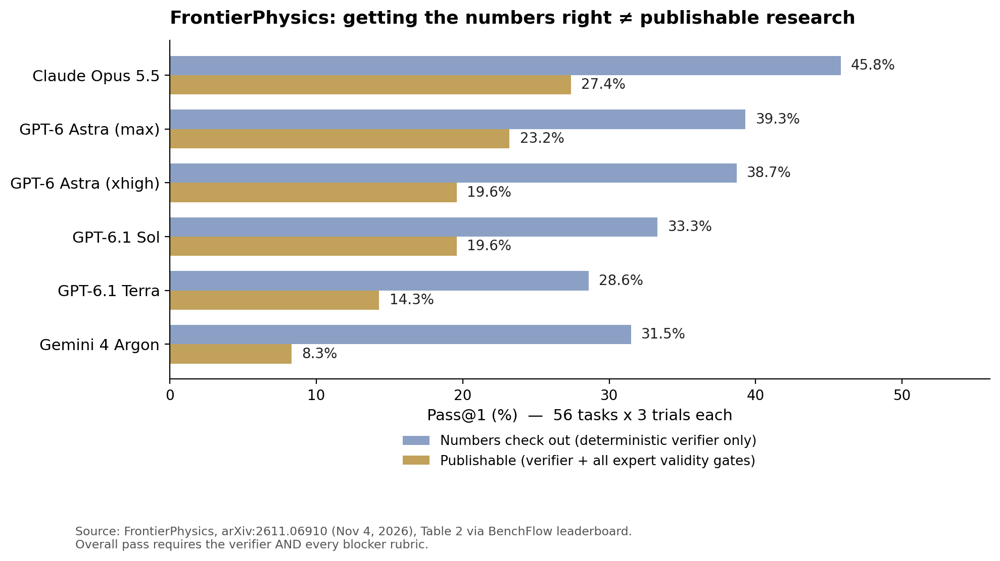

> [中文版 Chinese version](/ai%20engineering/llms/frontier-physics-research-gap-zh/)

## The finding in one line

The best AI agent in the world gets the physics right 46% of the time — and produces publishable research only 27% of the time. FrontierPhysics, submitted to arXiv on November 4, 2026, is the first benchmark that grades both, and the gap between the two numbers is the story: agents fail on rigor and judgment, not on physics knowledge.

## What FrontierPhysics actually tests

Most physics benchmarks hand a model a bounded problem and check the final answer. FrontierPhysics hands it a research project. Each task starts with a high-level prompt of the kind a principal investigator gives at the start of a project, and the agent must review the literature, develop a research plan, conduct the research and experiments, and produce two deliverables: numerical outputs that can be checked deterministically, and a scientific manuscript (`paper.pdf`) written to peer-review standards.

The provenance is what makes the result hard to dismiss:

- **56 tasks built by 42 physicists from their own research**, across 26 institutions and 9 domains (condensed matter, AMO, quantum information, astrophysics, fluids, statistical physics, photonics, high energy, chemical). 182 candidate tasks were submitted; 56 survived review.
- **Real research, not invented questions.** Contributors had to show they personally conducted the project (reference papers, timeline, effort). The underlying projects averaged ~270 days each, over 8,000 hours in total. 18 tasks come from published work, including 4 from Nature papers.
- **Two-stage expert review.** Every task passed a general quality review and a domain peer review by physicists who had done research in the field, plus a failure-mode analysis on at least three runs with state-of-the-art agents before acceptance.
- **Grading that mirrors peer review.** A deterministic verifier checks the numerical outputs. Separately, a reviewer agent (GPT-5.6 Sol at xhigh effort, in Codex CLI) grades the trajectory and manuscript against expert-authored rubrics. The rubrics split into *blockers* — binary gates on scientific validity (reward hacking, hallucination, literature use, result validation) — and scored non-blockers. A rollout scores **zero** unless the verifier passes **and every blocker passes**. High non-blocker scores cannot compensate for a failed blocker.
- **Scale.** 22 models in 26 configurations, each attempting all 56 tasks three times (168 rollouts per configuration, 4,364 rollouts total), with a 10-hour timeout cap per rollout.

## The leaderboard: right numbers vs. publishable

| Agent | Numbers check out (verifier only) | Publishable (verifier + all blockers) |
|---|---|---|
| Claude Opus 5.5 (Claude Code) | 45.8% | **27.4%** |
| GPT-6 Astra, max (Codex) | 39.3% | 23.2% |
| GPT-6 Astra, xhigh (Codex) | 38.7% | 19.6% |
| GPT-6.1 Sol (Codex) | 33.3% | 19.6% |
| GPT-6.1 Terra (Codex) | 28.6% | 14.3% |
| Gemini 4 Argon (Antigravity) | 31.5% | 8.3% |

Three things stand out. First, **no configuration passes 30%**: Claude Opus 5.5 leads at 27.4% (46 of 168 rollouts). Second, the verifier-to-overall drop is the measurement, not noise — every model loses a third to three-quarters of its verifier passes to the validity gates. Gemini 4 Argon collapses hardest, from 31.5% to 8.3%; Mistral Large 4 goes from 5.4% to 0.0%. Third, the gap is a property of the *job*, not the model: getting computed quantities right is a different skill from doing science that survives expert scrutiny.

## The 83% vs. 20% contrast

The same GPT-6 Astra that scores **83.1% on CritPt v2** (Artificial Analysis, 70 research-level physics challenges with code execution) passes **20.2%** of FrontierPhysics attempts after the authors hand-corrected its misgraded rollouts. That is not a contradiction and not a like-for-like drop — the two benchmarks grade different jobs. CritPt v2 asks bounded questions with private answers; FrontierPhysics demands an unscripted research process that must survive verifiers, blockers, and expert rubrics.

Two caveats make the contrast sharper, not weaker. First, CritPt v2 itself is a repaired benchmark: an independent audit found errors in 21 of 56 original challenges, and v2 corrected underspecified prompts, factual errors, and typos while adding code execution. Second, a companion re-grading study by Yale physicists (Ansari et al., arXiv:2609.13009) found that once experts fixed grader errors, wrong reference solutions, and ambiguous questions, GPT-5.6 Sol's mean@4 rose from 47.3% to 78.7% on HLE-Physics and from 61.0% to 87.2% on CMT-Benchmark, with corrected pass@4 reaching 94.4% on the 54 retained CritPt challenges. Closed-ended physics benchmarks are near saturation *once the grading is fixed* — which is exactly why the field needs end-to-end tests like FrontierPhysics, where the ceiling is still 27%.

## Why agents fail: rigor and intuition, not knowledge

The authors manually reviewed all 168 GPT-6 Astra (xhigh) rollouts and tagged every failure. Percentages are of the 143 failed rollouts; a rollout can carry multiple tags:

- **Non-rigorous reasoning — 48%.** The leading failure. Two recurring patterns: *circular self-verification*, where the agent's own validation method depends on its wrong assumption, so it can never discover its mistake; and *edge cases*, where the agent fails to consider all edge cases of its method or code and fails hidden tests.
- **Missing expert intuition — 34%.** Agents fail to identify the major error source of an experiment, or, when debugging, cannot find the root cause and keep tuning the wrong knob. They understand the physics; they lack the judgment for what matters.
- **Literature synthesis — 27%.** Agents fail to find the key literature the task author identified, struggle to synthesize what they found into a motivation, or cannot support their argument with literature in the manuscript.
- **Instruction following — 26%.** Agents miss requirements that task authors believe should be clear to any human domain expert.

The paper's own conclusion is blunt: "frontier agents' main weaknesses are insufficiently rigorous reasoning and limited expert intuition, rather than gaps in physics knowledge or execution errors." Praise first, because it matters: the agents mostly *can* do the physics. What they cannot yet do is the part of research that has no answer key — deciding what is worth checking, how to check it independently, and what the result means.

## The grading caveats — and why they strengthen the result

A benchmark this ambitious lives or dies on its grading, and the authors audited theirs in public:

- **9 of 168 GPT-6 Astra rollouts were incorrectly failed** by the verifier or reviewer agent. Hand-correcting them lifts Astra (xhigh) from 14.9% (25/168) to 20.2% (34/168). After re-running the affected rollouts, the published table shows 19.6% — the two figures agree within one rollout. Only Astra's pass rate was corrected this way, because only its failures were fully tagged.
- **The judge is a model too.** All rollouts were graded by GPT-5.6 Sol (xhigh). Re-grading with Claude Opus 5.5 as reviewer gave the same pass/fail decision for almost all Astra rollouts — but the Opus reviewer was more lenient on rollouts from its own model family. Judge self-preference is real, and it is measured here rather than assumed away.
- **The bar is reachable by humans.** The authors' own papers and manuscripts score **96.2% on average** under the same rubrics. The benchmark is not impossible; it is human-level, and agents are at 27%.
- **Small-N uncertainty.** 56 tasks means the 27.4% headline carries an approximate 95% binomial confidence interval of about ±6.7 points. The ranking among the top two or three configurations is close; the sub-30% ceiling for all 26 configurations is not.
- **Cost does not buy your way out.** Pass rate generally rises with cost — but for Claude models it *decreases* as cost increases, in the order Opus 5.5, Fable 5.1, Opus 5, and GPT models are generally more cost-efficient. More inference spend is not a reliable substitute for better reasoning.

## Monday-morning checklist

1. **Run a 5-task full-loop pilot before budgeting agent time on research work.** Lit review to manuscript, graded by a human expert on validity gates (no hallucinated results, no reward hacking, real literature, independent validation) — not just on whether the numbers look right. If fewer than 3 of 5 produce a manuscript you'd show a colleague, keep the agent on assistant duty: literature search and code, not conclusions.
2. **Discount any vendor "research benchmark" that only checks final answers.** FrontierPhysics says a verifier-only score overstates publishable success by roughly 40–75% (Opus 5.5: 45.8% → 27.4%; Gemini 4 Argon: 31.5% → 8.3%). Until a benchmark adds manuscript and validity grading, divide its headline number by ~2 when estimating end-to-end research success.
3. **Add a circular-verification check to agent review.** The #1 failure mode (48%) is the agent validating its own wrong assumption. Require the validation method to use an independent data source or method — different code path, different dataset, a literature-derived cross-check — and reject any run whose only validation is self-consistency.
4. **Treat "numbers right, science wrong" as 0%, not 50%.** A rollout that passes the verifier but fails a blocker scores zero in FrontierPhysics, and that is the right accounting for production too: a manuscript with hallucinated citations is not half a paper, it is a liability.

## Caveats

The failure-mode taxonomy comes from GPT-6 Astra only — other models may fail in different ways, including ways outside the taxonomy. Each model mostly ran in a single harness (Codex for GPT, Claude Code for Claude, Antigravity for Gemini), so model and harness effects are not fully separated. The rubric scores involve judgment calls by a model reviewer, even with the human audit. None of that changes the headline: on real research, built by the people who did it, the best agent in the world clears barely a quarter of attempts.

## Sources

- You et al., "FrontierPhysics: Evaluating Agents for End-to-End Physics Research," arXiv:2611.06910, submitted November 4, 2026 — https://arxiv.org/abs/2611.06910
- FrontierPhysics leaderboard (BenchFlow) — https://www.benchflow.ai/frontierphysics
- Ansari et al., "How Good Are Frontier Models at Physics? Expert Re-Grading Reveals Broken Evaluations and Near-Saturation of Leading Benchmarks," arXiv:2609.13009, September 2026 — https://arxiv.org/abs/2609.13009
- Artificial Analysis, CritPt v2 leaderboard (GPT-6 Astra max 83.1%), via AlphaSignal, October 22, 2026 — https://alphasignal.ai/news/openai-s-gpt-6-astra-tops-physics-benchmark-with-83-1-on-critpt-v2
- All figures above are from the papers themselves (abstract, §2–§3, Tables 2/4/5, Figure 6) and the BenchFlow leaderboard, not from secondary coverage.
