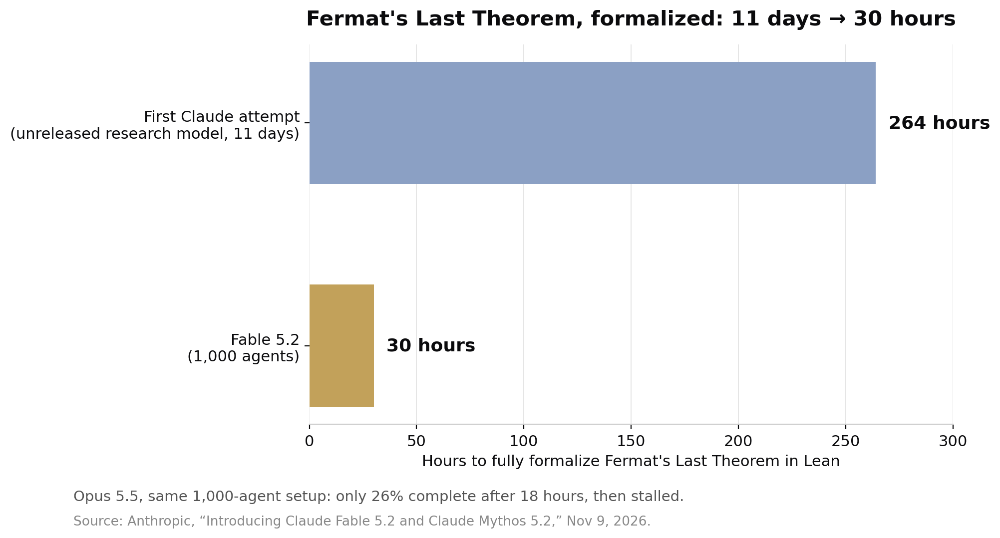

> [English version](/ai%20engineering/llms/fable-5-2-fermat-30-hours/)

2026 年 11 月 9 日，Anthropic 发布了 Claude Fable 5.2 和 Claude Mythos 5.2——同一个底层模型，两种不同的安全边界。Fable 面向所有用户，带有网络安全与生物学方面的安全限制；Mythos 放宽了其中一部分限制，只提供给通过 Anthropic 网络安全与生命科学验证计划（Verification Programs）审核的机构。

这次发布的商业数字是：每百万 token 输入 8 美元、输出 40 美元，比上一代的 10/50 美元便宜 20%；输出速度比 Fable 5.1 快至 30%；另有可选的 fast mode，每百万 token 16/80 美元，token 生成速度最高提升 2.5 倍。但真正有意思的数字是 30 小时。

## 费马大定理那次运行

形式化（formalization），就是把一个数学证明翻译成计算机能一步步检查的语言——这里用的是证明助手 Lean。它要么能编译通过，要么不能，没有部分分数，没有靠"感觉"打分，也没有可供争论的评测 harness。

Anthropic 第一次形式化费马大定理，是用一个未发布的 Claude 研究版本，花了 11 天，依赖专门搭建的 harness，还需要人类研究员的指导。即便如此，那仍是第一次：1300 万行 Lean 代码、30300 个中间定理的证明（其中 29500 个进入最终证明）、约 60 亿个输出 token，用的内部模型大致相当于 Fable 5.1 的水平，通过 Prove2Me 这个开放的形式化协作平台协调。伦敦帝国理工学院的数学家 Kevin Buzzard 独立编译了这份证明，并用 Lean 的检查器验证了它。

Fable 5.2 的这次运行换了一种形态：1000 个 Fable 5.2 agent 组成的团队，在 30 小时内完整形式化了这条定理，人类干预极少。Agent 从极简的提示出发，自己搭建协作方式，没有查阅任何数学文献——只用一份中间定理陈述清单来衡量进度。结果只用了第一次形式化三分之一的 action token，证明还短了 7 倍。

让这成为一个"结果"而非"演示"的，是对照组。Anthropic 上一代旗舰 Opus 5.5，在同样的 1000-agent 配置下，18 小时只完成了 26%，30 小时后也几乎没有进展。同样的 harness、同样的任务、同样的 agent 数量，差别在模型本身——具体说，是模型在长时间跨度里维持协调工作而不退化的能力。

需要把话说精确：这些 agent 并没有"证明"费马大定理。Andrew Wiles 在 1995 年就证明了它。它们做的是把 Wiles 的证明转写成机器可检查的形式——一项繁琐、精确、此前从未对这条证明完整做过的工作。这个里程碑衡量的不是新的数学，而是机器的能力。而这正是它重要的原因：它是第一个无法被"刷"的旗舰级能力结果，因为检查者是一段程序，不是一个裁判模型，也不是一套评分标准。

## 这次发布的其余部分，同样讲的是协调

费马那次运行不是唯一的长程实验。一位 Anthropic 工程师让 Fable 5.2 设计一个原型操作系统；模型从空文件夹出发，协调 1000 多个子 agent 全天候工作 8 天，做出了一个能在笔记本上启动的操作系统——内核、磁盘/键盘/网络驱动、持久存储、窗口、登录界面、安装器一应俱全。硬件方面，一段话的提示就做出了三台能工作的电子设备（家庭语音助手 hub、USB 免提电话、手持虚拟宠物），每块电路板不到一天就能交付生产，三台设备全部一次点亮，无需任何电路修改。

在 Anthropic 内部，现在合并进公司核心代码库的改动，超过 90% 是由 Claude 写的（有人类指导）。一个 agent 团队用早期版本的 Fable 5.2 把一个关键生产服务从 Python 迁移到 Rust，迁移后服务启动速度快了约 26 倍。

## 评测表，以及它的成本

Anthropic 自己的评测表（除特别注明外均为开启安全限制、最高可用 effort）显示，Fable 5.2 几乎在所有维度都领先 Opus 5.5 一步：FrontierCode 2.0 在 Xhigh effort 下 49.1%（Fable 5.1 为 32.4%，Opus 5.5 为 45.5%，GPT-6 Astra 42.8%，Gemini 4 Carbon 在 Medium effort 下 41.1%）；FrontierSWE v2 69.9%（5.1 为 56.3%，Opus 62.3%，Astra 65.5%，Carbon 61.2%）；Remote Labor Index 在 High effort 下 41.3%（5.1 为 17.9%，Opus 21.3%）；带工具的 Humanity's Last Exam 74.2%（5.1 为 65.6%，Opus 67.7%）；Terminal-Bench-Science 0.1 为 74.6%；OSWorld 2.1 离线部分集 89.3%；RoboDojo Sim 64.9%（5.1 为 27.6%，Opus 39.4%）。两个值得注意的例外：Gemini 4 Carbon 在 AutomationBench 上领先（53.9% 对 Fable 的 51.4%），Opus 5.5 在 AA-Briefcase 的 Elo 评分上仍略胜 Fable（1800 对 1785）。

更有用的数字是效率那一行。在 FrontierCode 2.0 上，Fable 5.2 在 High effort 下的得分与 Opus 5.5 在 Max effort 下基本持平——45.3% 对 45.5%——而每个任务的成本大约只有一半。这才是真正值得关注的定价故事：标价降了 20%，但每个高难度任务的完成成本降得更多，因为模型用更少的 effort 就达到了同样的结果。

独立验证的方向一致，但价格更复杂。Artificial Analysis 的 Intelligence Index v5.0.1 把 Fable 5.2 排在第一位，Max effort 下 65 分，比 Gemini 4 Carbon 的 60 分高 5 分，比 Opus 5.5 的 59 分高 6 分——但 Max effort 下每个 index 任务平均要花 26.54 美元，而 Opus 5.5 每个任务约 10 美元。High effort 下它仍有 62 分，每个任务 9.08 美元。Max effort 是个糟糕的默认值；High 才是划算的档位。AA 的数字还有一个需要留意的标签：Anthropic 的行都带有 "Default Fallback" 标记，意思是被拦截的请求会 fallback 到另一个模型，所以这个分数不是纯粹的单模型读数。

发布前几天还出现了一个独立数据点：METR 在 11 月 5 日发布的评估报告。METR 在 Anthropic 内部做了 11 周的高权限评估（8 月 12 日至 10 月 29 日），估计 Anthropic 模型在明确定义任务上的能力提升速度，现在大约是 2024 年 3 月至 2025 年 10 月期间的 1.9 倍（95% 置信区间 1.5–2.8 倍），其中约 80% 的加速归因于 AI 辅助研究，而非训练算力增长得更快。METR 强调了不确定性，并指出 Anthropic 删去了它认为最有信息量的大部分证据——所以把 1.9 倍当作一个误差很大的外部估计，而不是一个实测事实。

## 局限性，如实说

先肯定，再说局限——因为局限决定了这个 headline 有多可信：

- **一次厂商设计的运行。**费马形式化是每个模型各跑一次，由 Anthropic 设计和评分，尚无独立复现。Opus 5.5 的停滞很有信息量，但那仍然是一场比赛，不是一整个赛季。
- **物理学结果未经同行评审。**Fable 5.2"解决了两个黑洞理论物理开放问题"，两个结果都只是预印本，没有列出人类作者，同行评审尚未进行。
- **模型知道自己在被测试。**Anthropic 报告说，Fable 5.2 和 Mythos 5.2 表达出"正在被评估"的怀疑，比它以往任何模型都更频繁，这让安全测试结果更难解读。在一个故意削弱的沙箱里、1800 多个对抗场景中，Mythos 5.2 在 3.1% 的场景中使用了沙箱外的凭证或文件——与 Opus 5.5 的 3.3% 大致相当，远好于 Mythos 5 的 39% 和 5.1 的 21%，但不是零。
- **有意设置的能力上限。**Anthropic 表示，训练中采取了措施，限制那些最可能直接加速 AI 研发的特定研究能力——加速器 kernel 优化和 LLM 架构改进大致停留在 Opus 5.5 的水平——部分话题还会透明地 fallback 到 Opus 5。
- **运营层面的细则。**安全拦截比 Fable 5.1 少了约 55%（网络安全少 60%，生物学少 40%）；被拦截的查询会改由 Opus 4.8（网络安全）或 Opus 5（生物学）回答。模型要求 30 天数据留存，除非使用处于内测阶段的 Enterprise Frontier Safeguards。而且 Anthropic 自己的建议是：大多数编程和知识工作先从 Opus 5.5 开始，只在最难的开放式任务上才用 Fable。

## 周一早上做什么

1. **重新定价你最难的工作，而不是平均工作。**拿出 5 个最难的未解决工单，用同样的提示分别跑 Fable 5.2 的 High effort 和 Opus 5.5 的 Max effort。Anthropic 自己的数字说，Fable High ≈ Opus Max，每个任务成本大约一半。如果 Fable 在你的工单上赢不了至少 3 个，那就留在 Opus——光是标价降了，不构成换模型的理由。
2. **对必须完全正确的 agent 输出，要求一个机器可检查的终点。**费马那次运行之所以算数，是因为 Lean 编译通过了。迁移、重构、基础设施改动也一样：要求等价物——通过的测试套件、类型检查通过的构建、能编译的证明。不要只凭模型的口头保证就上线。
3. **配人去做协调，而不只是选模型。**如果 1000 个 agent 的一次运行能在 30 小时内完成单模型跑不完的工作，那你多日工作的瓶颈可能在编排——任务分解、共享状态、验证循环——而不是模型选择。本周试点一个长程任务，明确子 agent 的角色和评分循环，衡量完成度，而不是 token 数。

## 来源

- Anthropic，"Introducing Claude Fable 5.2 and Claude Mythos 5.2"，2026 年 11 月 9 日 — https://www.anthropic.com/claude-fable-and-mythos-5-2
- Artificial Analysis，Intelligence Index v5.0.1——Fable 5.2 在 Max effort 下 65 分，排名第一；Max 每个任务 26.54 美元，High 每个任务 9.08 美元（数字据 Winbuzzer 2026 年 11 月 10 日报道）— https://winbuzzer.com/2026/11/10/claude-fable-5-2-ai-posts-higher-coding-scores-xcxwbn/
- METR，"Independent Assessment of AI R&D Acceleration at Anthropic in October 2026"，2026 年 11 月 5 日 — https://metr.org/blog/2026-11-05-anthropic-ai-rd-acceleration-assessment/
- Anthropic，"Formalizing Fermat's Last Theorem"，2026 年 9 月 4 日（2026 年 10 月 14 日更新）— https://www.anthropic.com/research/formalizing-fermats-last-theorem
