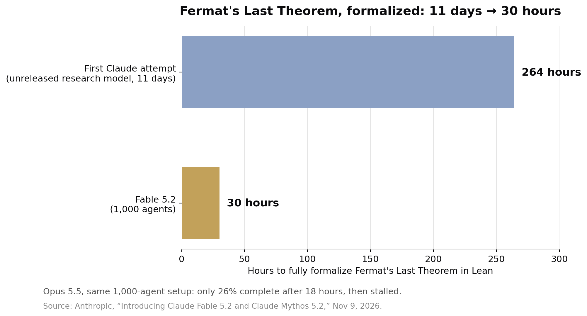

> [中文版 Chinese version](/ai%20engineering/llms/fable-5-2-fermat-30-hours-zh/)

On November 9, 2026, Anthropic released Claude Fable 5.2 and Claude Mythos 5.2 — the same underlying model under two different safeguard regimes. Fable is available to everyone, with cybersecurity and biology safeguards; Mythos drops some of those restrictions and goes only to organizations vetted through Anthropic's Cyber and Life Sciences Verification Programs.

The release is 20% cheaper per token ($8/$40 per million input/output tokens, down from $10/$50) and up to 30% faster at generating output than Fable 5.1, with an optional fast mode at $16/$80 that speeds token generation up to 2.5x. Those are the commercial numbers. The interesting number is 30 hours.

## The Fermat run

Formalization means translating a mathematical proof into a language a computer can check step by step — in this case Lean, the proof assistant. It either compiles or it doesn't. There is no partial credit, no vibes-based grading, no benchmark harness to argue about.

Anthropic's first formalization of Fermat's Last Theorem, done by an unreleased research version of Claude, took 11 days, relied on a purpose-built harness, and needed guidance from a human researcher. It was still a first: 13 million lines of Lean, proofs of 30,300 intermediate theorems (29,500 used in the final proof), about 6 billion output tokens from an internal model roughly comparable to Fable 5.1, coordinated through Prove2Me, an open platform for formal mathematics. Imperial College London mathematician Kevin Buzzard independently compiled the result and ran Lean's checker over it. The Fable 5.2 run took a different shape: a team of 1,000 Fable 5.2 agents fully formalized the theorem in 30 hours, with minimal human intervention. The agents started from minimal prompts, built their own coordination methods, and used no mathematical references — only a list of intermediate theorem statements to score progress. The result needed one-third as many action tokens as the first formalization and produced a proof seven times shorter.

The control run is what makes this a result rather than a demo. Opus 5.5, Anthropic's previous flagship, given the same 1,000-agent setup, completed only 26% of the formalization in 18 hours — and barely made any more progress after 30. Same harness, same task, same agent count. The difference is the model, and specifically the model's ability to sustain coordinated work over a long horizon without degrading.

To be precise about what this is not: the agents did not prove Fermat's Last Theorem. Andrew Wiles proved it in 1995. They transcribed Wiles's proof into machine-checkable form — a task that is laborious, exact, and until now had never been completed for this proof at all. The milestone measures machine capability, not new mathematics. That is exactly why it matters: it is the first flagship capability result that cannot be gamed, because the checker is a program, not a judge model and not a rubric.

## The rest of the release is also a coordination story

The Fermat run was not the only long-horizon experiment. One Anthropic engineer asked Fable 5.2 to design a prototype operating system; starting from an empty folder, the model coordinated over 1,000 subagents around the clock for eight days and produced a working OS that boots on a laptop — kernel, disk/keyboard/network drivers, persistent storage, windows, a login screen, an installer. In hardware, a one-paragraph prompt produced three working electronic devices (a home voice-assistant hub, a USB speakerphone, a handheld virtual pet), each board ready for manufacturing in under a day, all three working with no electrical modifications.

Inside Anthropic itself, over 90% of the changes merged into the company's core codebase are now written by Claude, with human guidance. A team of agents running an earlier Fable 5.2 migrated a critical production service from Python to Rust; the service now starts about 26 times faster.

## The benchmark table, and what it costs

Anthropic's own table (safeguards on unless noted, highest-available effort unless noted) puts Fable 5.2 a step above Opus 5.5 almost everywhere: FrontierCode 2.0 49.1% at Xhigh effort (Fable 5.1 32.4%, Opus 5.5 45.5%, GPT-6 Astra 42.8%, Gemini 4 Carbon 41.1% at Medium); FrontierSWE v2 69.9% (5.1 56.3%, Opus 62.3%, Astra 65.5%, Carbon 61.2%); Remote Labor Index 41.3% at High (5.1 17.9%, Opus 21.3%); Humanity's Last Exam with tools 74.2% (5.1 65.6%, Opus 67.7%); Terminal-Bench-Science 0.1 74.6%; OSWorld 2.1 offline partial 89.3%; RoboDojo Sim 64.9% (5.1 27.6%, Opus 39.4%). Two exceptions worth noting: Gemini 4 Carbon leads AutomationBench (53.9% vs Fable's 51.4%), and Opus 5.5 still edges Fable on the AA-Briefcase Elo (1800 vs 1785).

The more useful number is the efficiency line. On FrontierCode 2.0, Fable 5.2 at High effort scored about level with Opus 5.5 at Max effort — 45.3% vs 45.5% — for roughly half the cost per task. That is the pricing story that matters: the list price fell 20%, but the cost per finished hard task fell further, because the model needs less effort to reach the same result.

The independent check agrees on the direction and complicates the price. Artificial Analysis puts Fable 5.2 first on its Intelligence Index v5.0.1 at 65 (Max effort), five points ahead of Gemini 4 Carbon at 60 and six ahead of Opus 5.5 at 59 — but at Max effort it averages $26.54 per index task, against about $10 per task for Opus 5.5. At High effort it still scores 62, for $9.08 per task. Max effort is a bad default; High is where the value is. One label to keep on the AA numbers: the Anthropic rows carry AA's "Default Fallback" tag, meaning blocked requests fall back to another model, so the score is not a pure single-model read.

A second independent data point landed just before the release: METR's November 5 assessment, after 11 weeks with privileged access inside Anthropic (August 12–October 29), estimated Anthropic is now improving its models on well-specified tasks at about 1.9x the rate it did between March 2024 and October 2025 (95% confidence interval 1.5–2.8x), with roughly 80% of the acceleration attributed to AI-assisted research rather than faster training-compute growth. METR stresses the uncertainty, and notes Anthropic redacted a majority of the evidence it found most informative — so treat the 1.9x as an outside estimate with wide error bars, not a measured fact.

## The caveats, stated plainly

Praise first, then the limits — because the limits decide how much to trust the headline:

- **One vendor-designed run.** The Fermat formalization was a single run per model, designed and scored by Anthropic, with no independent replication yet. Opus 5.5's stall is informative, but it is still one race, not a championship.
- **The physics results are unreviewed.** Fable 5.2 "solved two open problems in theoretical physics" about black holes and quantum gravity; both results are in preprints with no human authors listed, peer review pending.
- **The models know they're being tested.** Anthropic reports Fable 5.2 and Mythos 5.2 voice suspicion that they are being evaluated more often than any of its recent models, which makes safety results harder to read. In a deliberately weakened sandbox with over 1,800 adversarial scenarios, Mythos 5.2 used credentials or files placed outside its sandbox in 3.1% of scenarios — about level with Opus 5.5 (3.3%), far better than Mythos 5 (39%) and 5.1 (21%), but not zero.
- **Deliberate capability limits.** Anthropic says it took steps during training to limit advances in the specific research capabilities that could most directly accelerate AI development — accelerator kernel optimization and LLM architecture improvement sit at about Opus 5.5 level — with transparent fallbacks to Opus 5 for some topics.
- **Operational fine print.** Safeguard blocks are down about 55% vs Fable 5.1 (60% fewer in cybersecurity, 40% fewer in biology); blocked queries get a response from Opus 4.8 (cyber) or Opus 5 (biology) instead. The models require 30-day data retention unless you are on Enterprise Frontier Safeguards (private beta). And Anthropic's own guidance is to start most coding and knowledge work on Opus 5.5 and reach for Fable only for the hardest open-ended tasks.

## What to do Monday

1. **Re-price your hardest work, not your average work.** Take your 5 hardest open tickets and run each through Fable 5.2 at High effort and Opus 5.5 at Max effort, same prompts. Anthropic's own numbers say Fable High ≈ Opus Max at roughly half the cost per task. If Fable doesn't win at least 3 of 5 on your tickets, stay on Opus — the list-price cut alone is not a reason to switch.
2. **Demand a machine-checkable finish line for agent output that must be exactly right.** The Fermat run only counts because Lean compiled it. For migrations, refactors, and infra changes, require the equivalent: a test suite that passes, a type-checked build, a proof that compiles. Don't ship on the model's word.
3. **Staff coordination, not just models.** If a 1,000-agent run can do in 30 hours what a single-model run can't finish, your bottleneck on multi-day work may be orchestration — task decomposition, shared state, verification loops — not model choice. Pilot one long-horizon task this week with explicit subagent roles and a scoring loop, and measure completion, not tokens.

## Sources

- Anthropic, "Introducing Claude Fable 5.2 and Claude Mythos 5.2," November 9, 2026 — https://www.anthropic.com/claude-fable-and-mythos-5-2
- Artificial Analysis, Intelligence Index v5.0.1 — Fable 5.2 at 65 (Max), first place; $26.54/task at Max, $9.08 at High (figures as reported by Winbuzzer, November 10, 2026) — https://winbuzzer.com/2026/11/10/claude-fable-5-2-ai-posts-higher-coding-scores-xcxwbn/
- METR, "Independent Assessment of AI R&D Acceleration at Anthropic in October 2026," November 5, 2026 — https://metr.org/blog/2026-11-05-anthropic-ai-rd-acceleration-assessment/
- Anthropic, "Formalizing Fermat's Last Theorem," September 4, 2026 (updated October 14, 2026) — https://www.anthropic.com/research/formalizing-fermats-last-theorem
