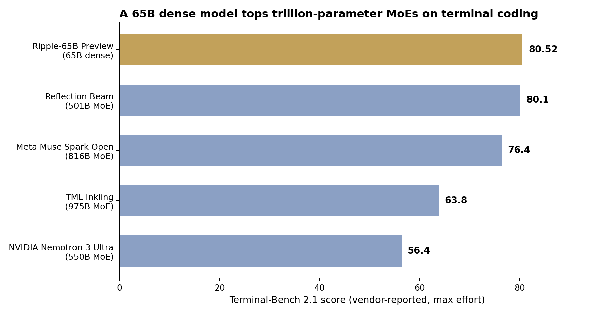

> [English version](/ai%20engineering/llms/ripple-65b-dense-beats-trillion-param-moe/)

2026 年 11 月 4 日，做芯片设计的创业公司 Ricursive Intelligence 发布了 Ripple-65B Preview：650 亿参数的**稠密**（dense）Transformer，Apache 2.0 协议，从零预训练 12 万亿 token。所谓稠密，是指每个 token 都会激活全部参数；而 MoE（混合专家）每次只激活其中一部分。厂商自报的头条数字是 **Terminal-Bench 2.1 得分 80.52**——这是一个让模型在真实终端里解决编程任务的 agentic coding 基准——超过了 Reflection Beam 501B（80.1）、Meta Muse Spark Open 816B（76.4）、Thinking Machines Inkling 975B（63.8）和 NVIDIA Nemotron 3 Ultra 550B（56.4）。

## 数字：来自 Ricursive 自己的模型卡

下表全部来自 Hugging Face 模型卡（[ricursiveAI/Ripple-65B-Preview](https://huggingface.co/ricursiveAI/Ripple-65B-Preview)），instruct BF16、最大 effort 設定。注意：这些都是厂商自报数字，写稿时还没有出现独立复现。

| 基准 | Ripple-65B | Reflection Beam 501B | Muse Spark Open 816B | Inkling 975B | Nemotron 3 Ultra 550B |
|---|---:|---:|---:|---:|---:|
| Terminal-Bench 2.1 | **80.52** | 80.1 | 76.4 | 63.8 | 56.4 |
| SWE-bench Pro v2.0 Hard | **63.8** | 60.4 | 57.1 | 47.2 | 40.1 |
| SWE-bench Verified | **81.8** | 81.8 | 81.2 | 76.4 | 66.8 |
| DeepSWE 1.1 | **54.4** | 45.2 | 46.9 | 43.0 | 35.4 |
| GPQA Diamond | **79.3** | 79.3 | 77.2 | 77.0 | 74.6 |
| SciCode | 50.0 | **52.8** | 49.1 | 46.1 | 44.6 |
| MCP Atlas | **36.7** | 34.0 | 23.2 | 21.5 | 17.5 |
| AIME 2025 | 95.8 | **99.2** | 96.5 | 94.8 | 94.8 |
| AIME 2026 | 92.1 | **96.5** | 95.3 | 93.0 | 90.0 |

诚实地读这张表：九项里 Ripple 领先或打平六项，但在 SciCode 和两届 AIME 上仍是 Beam 领先。胜利集中在 agentic coding，不是全面胜利。

## 65B 是怎么赢的：效率，而非规模

更有意思的是发布博客（[ricursive.com/ripple](https://www.ricursive.com/ripple)）里的成本账，而不是基准分数：

- **总研发成本 3200 万美元**，包括预训练 ladder、数据配比、评测、合成数据、后训练配方开发和最终的 hero run。按 Ricursive 的估计，这是上一个 agentic coding 开源 SOTA 成本的十分之一。
- **RL 只用了 140 万次 rollout** 就达到 Terminal-Bench 2.1 的 80.5 分——大约是 Reflection Beam（约 1 亿次）的 **70 分之一**。
- 相对起点的 Olmo 3 ladder，**代码任务上的计算效率提升 16 倍**：先在小规模上反复迭代 ladder（架构、数据配比、SFT/RL 配方），再跑 hero run。
- 预训练和后训练全程保持 **40% MFU**，只用简单分片，不用定制 kernel、不做量化——选稠密架构本身就是为了降低 infra 复杂度。
- 配方细节：12T 预训练 token（9.4T 在 8K 上下文，2.6T midtraining 在 64K 上下文），数据里代码占比上调到 22–26%，65 亿 token SFT，700 步 RL（128K 上下文）。模型是瘦高型：80 层、d_model 5120、滑动窗口注意力 4096、SWA 与全局层比例 3:1，外加 gated attention、global NoPE、value residuals。

这才是真正的论点：过去三年开源权重的进步主线是“用更大的 MoE、每次激活更大的一片”。Ripple 的说法是，同样的终端编程分数，可以把算力花在配方迭代上而不是参数规模上——结果模型比它打平的万亿参数级别小了 15 倍。

## 三个必须讲的 caveat

先肯定，再开刀——三个 caveat 都来自 Ricursive 自己的页面：

1. **厂商自己有两张不一样的分数表。**Hugging Face 模型卡和 Together AI 页面上的数字对不上（GPQA Diamond 79.3 对 85.2、SciCode 50.0 对 39.4、AIME 2025 95.8 对 98.3），看起来是不同 harness 设定造成的。本文全程用 Hugging Face 表，不要混用。连自己的记分板都统一不了的厂商，正确反应是自己跑 20 个任务，而不是引用头条数字。
2. **1M 上下文是外推，不是训练长度。**模型只训练到 128K 上下文，1M 是外推能力。上面所有 agent 基准都是在 128K 上限、接近上限时做轨迹摘要的条件下跑的，Together 的托管规格写的也是 128K。不要拿它规划 1M 上下文的工作。
3. **Preview、轻量后训练、纯文本、主要英文。**仓库还带 custom-code 标签，加载时需要信任远程代码。BF16 权重约 130GB；NVFP4 版约 57GB，是能塞进 DGX Spark 的那个。

## 周一早上做什么

1. **自己跑，别引用。**如果你在跑开源权重的 coding agent，本周拿 20 个自己的终端任务测一下 Ripple-65B（Together AI 托管价：输入 $0.20、输出 $0.60 每百万 token，缓存输入 $0.02）。判定规则：如果在你自己的任务上与现有的 500B+ MoE 差距在 5 分以内，就换默认模型——130GB BF16、单台 8 卡节点就能跑，tie 本身就是赢。
2. **按“每个完成任务的成本”定价，而不是按 token 定价。**3200 万美元是 Ricursive 的故事；你的故事是固定 effort 下每个解决任务的成本。续费决策前先跟踪两周。
3. **测试计划里把上下文上限设为 128K。**1M 是外推数字，需要更长上下文的任务要另外单独评估。

## 争论点

如果一个 65B 稠密模型在你自己的终端任务上打平了 500B MoE，“更大”还算一种策略吗，还是只剩习惯？MoE 时代的赌注是稀疏性能用更少的钱买到能力；Ripple 的赌注是配方能更便宜地买到能力。这两个赌注现在都能用每百万输入 token 0.20 美元验证，而你自己任务上的答案，比任何一张厂商分数表都值钱。

## 来源

- Ricursive Intelligence，Ripple-65B Preview 模型卡（Hugging Face，2026 年 11 月 4 日）：https://huggingface.co/ricursiveAI/Ripple-65B-Preview
- Ricursive Intelligence，发布博客：https://www.ricursive.com/ripple
- Together AI，Ripple-65B-Preview 定价与规格：https://www.together.ai/models/ripple-65b-preview
- 二手报道补充细节（DepthGrid，2026 年 11 月 6 日）：https://www.depthgrid.in/2026/11/ricursive-ripple-65b-preview-open-weights-benchmarks.html
