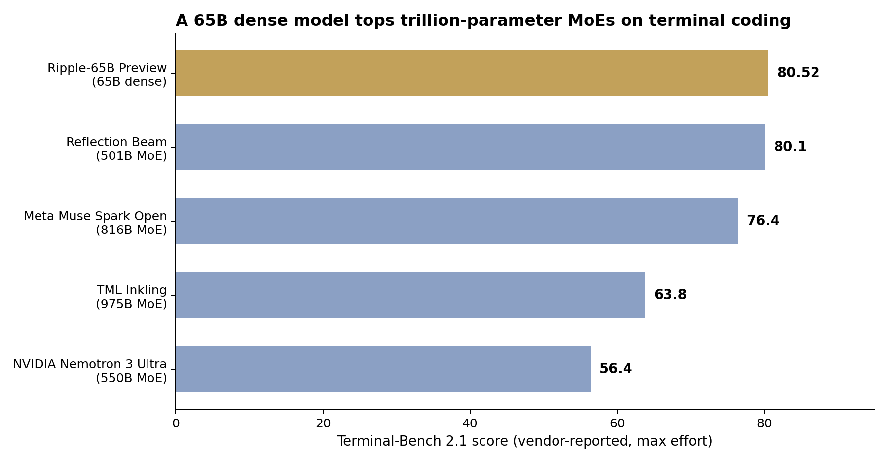

> [中文版 Chinese version](/ai%20engineering/llms/ripple-65b-dense-beats-trillion-param-moe-zh/)

On November 4, 2026, Ricursive Intelligence — a chip-design startup — released Ripple-65B Preview: a 65-billion-parameter **dense** Transformer, Apache 2.0, trained from scratch on 12 trillion tokens. Dense means every parameter fires on every token; MoE (mixture-of-experts) models activate only a slice per token. The headline number, vendor-reported: **80.52 on Terminal-Bench 2.1**, an agentic coding benchmark where the model solves real tasks inside a terminal — ahead of Reflection Beam 501B (80.1), Meta Muse Spark Open 816B (76.4), Thinking Machines Inkling 975B (63.8), and NVIDIA Nemotron 3 Ultra 550B (56.4).

## The numbers, from Ricursive's own model card

All figures below are from the Hugging Face model card ([ricursiveAI/Ripple-65B-Preview](https://huggingface.co/ricursiveAI/Ripple-65B-Preview)), instruct BF16, maximum effort. They are vendor-reported — no independent evaluation had surfaced at publication time.

| Benchmark | Ripple-65B | Reflection Beam 501B | Muse Spark Open 816B | Inkling 975B | Nemotron 3 Ultra 550B |
|---|---:|---:|---:|---:|---:|
| Terminal-Bench 2.1 | **80.52** | 80.1 | 76.4 | 63.8 | 56.4 |
| SWE-bench Pro v2.0 Hard | **63.8** | 60.4 | 57.1 | 47.2 | 40.1 |
| SWE-bench Verified | **81.8** | 81.8 | 81.2 | 76.4 | 66.8 |
| DeepSWE 1.1 | **54.4** | 45.2 | 46.9 | 43.0 | 35.4 |
| GPQA Diamond | **79.3** | 79.3 | 77.2 | 77.0 | 74.6 |
| SciCode | 50.0 | **52.8** | 49.1 | 46.1 | 44.6 |
| MCP Atlas | **36.7** | 34.0 | 23.2 | 21.5 | 17.5 |
| AIME 2025 | 95.8 | **99.2** | 96.5 | 94.8 | 94.8 |
| AIME 2026 | 92.1 | **96.5** | 95.3 | 93.0 | 90.0 |

Read the table honestly: Ripple leads or ties on six of nine, but Beam still leads on SciCode and both AIME years. The win is real on agentic coding, not universal.

## How a 65B model got there: efficiency, not scale

The launch blog ([ricursive.com/ripple](https://www.ricursive.com/ripple)) tells the more interesting story — the budget, not the benchmark:

- **$32M full R&D cost**, including the pretraining ladder, data mixing, evals, synthetic data, and the final hero run. Ricursive calls it one-tenth the cost of the previous open-weight SOTA on agentic coding (their estimate).
- **1.4M RL rollouts** to reach 80.5 on Terminal-Bench 2.1 — roughly **70x fewer** than Reflection Beam's ~100M.
- **16x compute efficiency on code** versus the Olmo 3 ladder it started from, via careful small-scale laddering (architecture, data mix, SFT/RL recipe) before the hero run.
- **40% MFU** through pretraining and post-training with simple sharding, no custom kernels, no quantization — the dense architecture was chosen explicitly to cut infrastructure complexity.
- The recipe: 12T pretraining tokens (9.4T at 8K context, then 2.6T midtraining at 64K), code upsampled in the data mix (22–26%), 6.5B tokens of SFT, 700 RL steps at 128K. Thin-and-deep shape: 80 layers, d_model 5,120, sliding-window attention 4,096 with a 3:1 SWA-to-global ratio, gated attention, global NoPE, value residuals.

The mechanism is the thesis: the last three years of open-weights progress were mostly "activate a bigger slice of a bigger MoE." Ripple says the same terminal-coding score is reachable by spending the compute on recipe iteration instead of parameter count — and the resulting model is 15x smaller than the ~1T-parameter class it ties.

## The caveats that matter

Praise first, then the sharp part — three caveats, all from Ricursive's own pages:

1. **The vendor publishes two different tables.** The Hugging Face card and the Together AI listing disagree on several numbers (GPQA Diamond 79.3 vs 85.2, SciCode 50.0 vs 39.4, AIME 2025 95.8 vs 98.3) — apparently different harness settings. I used the Hugging Face table throughout; do not mix the two. A vendor that can't keep its own scoreboard consistent is a reason to run your own 20 tasks, not to quote the headline.
2. **The 1M context is extrapolation, not training.** The model was trained to 128K context; 1M is what it extrapolates to. Every agent benchmark above was run at 128K max with trajectory summarization near the limit, and Together's hosted spec lists 128K. Do not plan 1M-context work on this model.
3. **Preview, light post-training, text-only, mostly English.** The repo also carries a custom-code tag, so loading it requires trusting remote code. BF16 weights are ~130GB; the NVFP4 build (~57GB) is the one that fits a DGX Spark.

## What to do Monday morning

1. **Replay, don't quote.** If you run open-weight coding agents, put Ripple-65B on 20 of your own terminal tasks this week (Together AI serves it at $0.20 input / $0.60 output per million tokens, $0.02 cached). Tie rule: if it lands within 5 points of your current 500B+ MoE on your tasks, switch the default — the serving footprint (130GB BF16, one 8-GPU node) and the token price make the tie a win.
2. **Price per completed task, not per token.** The $32M build cost is Ricursive's story; yours is cost per solved task at fixed effort. Track it for two weeks before any renewal decision.
3. **Cap context at 128K in your test plan.** The 1M number is extrapolation. Any task that needs more is a different evaluation.

## The debate

If a 65B dense model ties a 500B MoE on your own terminal tasks, is "bigger" still a strategy — or just a habit? The MoE era's bet was that sparsity buys capability per dollar. Ripple's bet is that recipe buys it cheaper. One of those bets is now testable for $0.20 per million input tokens, and the answer on your tasks is worth more than either vendor's table.

## Sources

- Ricursive Intelligence, Ripple-65B Preview model card (Hugging Face, Nov 4, 2026): https://huggingface.co/ricursiveAI/Ripple-65B-Preview
- Ricursive Intelligence, launch blog: https://www.ricursive.com/ripple
- Together AI, Ripple-65B-Preview pricing and specs: https://www.together.ai/models/ripple-65b-preview
- Secondary coverage with additional detail (DepthGrid, Nov 6, 2026): https://www.depthgrid.in/2026/11/ricursive-ripple-65b-preview-open-weights-benchmarks.html
