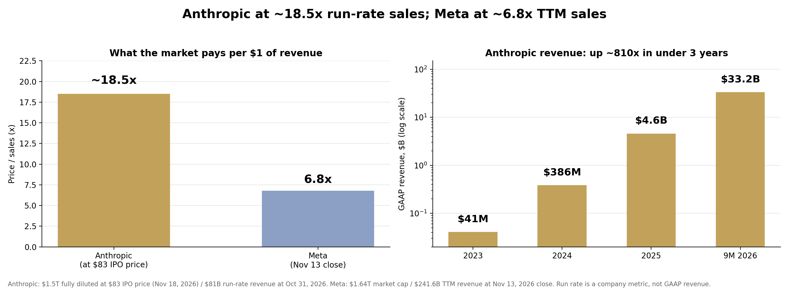

> [English version](/ai%20engineering/llms/anthropic-ipo-s1-valuation/)

Anthropic 已于 11 月 18 日周三以每股 $83 为 IPO 定价，11 月 19 日周四在纳斯达克以代码 ANT 开始交易。最终条款：发行 9.8 亿股 A 类股，募资约 $813 亿——史上最大 IPO，超过 SpaceX 的 $750 亿——全面摊薄估值约 **$1.5 万亿**，而今年 5 月的私募估值还是 $9,650 亿。Google、Nvidia、AMD、Broadcom、Micron、Microsoft、TSMC 还将同步参与 $26 亿的私募配售。据报道，认购倍数约为 6 倍。

> **更新（11 月 19 日收盘）：** ANT 首日收于 **$97.17**，较 $83 发行价上涨 **17.1%**（开盘 $111.50）。

这篇文章不是讨论 Anthropic 是不是一家好公司，而是讨论它的招股书对你的编程 Agent 账单意味着什么——以及它上市之后，你应该做什么。

## 定价：约 18.5 倍收入，Meta 只有约 6.8 倍

核心倍数：$1.5 万亿 ÷ $81B 年化收入（截至 2026 年 10 月 31 日的 run-rate revenue）——**约 18.5 倍收入**。若按 Q3 收入年化（$16.96B × 4 = $67.8B）计算，$83 的发行价对应约 22 倍。按 $47B 年化收入这一更保守的口径计算，倍数约为 32 倍。

做个对照：Meta 是一家盈利公司，过去十二个月收入 $2,416 亿，市值 $1.64 万亿（11 月 13 日收盘），**约 6.8 倍收入**。NYU 的 Aswath Damodaran 独立估算的 Anthropic 股权价值是 $1.45 万亿（11 月 3 日）。

先说两个诚实的保留意见，再进入批评。第一，run-rate revenue 是公司自定义指标，不是 GAAP 收入：过去 28 天的 consumption 费用 ×13，加上月度订阅费 ×12。Anthropic 自己提醒，它不能替代 GAAP 收入，也不是业绩预测。第二，按这个增速，倍数压缩得很快——仅 10 月一个月，run rate 就增加了 $100 亿，从 9 月 30 日的约 $710 亿涨到 $810 亿。如果 Q4 保持这个速度，$1.5 万亿几个月内就变成约 13–14 倍远期收入。看多的理由是真实存在的，只是不是唯一的理由。

## 增长是真实的

S-1 中的 GAAP 收入：2023 年 $41M，2024 年 $3.86 亿，2025 年 $45.85 亿，**2026 年前九个月 $332.4 亿**——是去年同期的 13 倍。仅 Q3 就有 $169.6 亿，环比增长 47%，同比增长 1,127%。Fortune 对招股书的解读还给出一个醒目的单位经济数字：Anthropic 每花 $1 在裸算力上，就能产生 $2 以上的收入。

## 利润线一个季度翻一次脸

2026 年 Q2，Anthropic 历史上第一次实现季度经营利润：$9.74 亿，经营利润率 8%。Q3 又翻回 **$5.67 亿经营亏损**（-3%）。前九个月经营亏损 $12.6 亿（-4%）；非 GAAP 的调整后经营利润为 $40.8 亿。

至于那些巨大的净亏损标题，两个方向都别被带偏：Q3 净亏损 $233 亿，其中 $219 亿是可转债、衍生品和 SAFE 的公允价值重估——非现金的会计记账，随 Anthropic 自身估值波动，不代表现金流出。（上半年净亏损 $807 亿，其中 $724 亿也是同类记账。）真正反映经营情况的是经营利润线，而它一个季度就翻了脸。现金目前不是瓶颈：9 月 30 日账上有 $956 亿现金和 $363 亿短期投资，IPO 和私募配售还将带来约 $1,070 亿总募资（未扣除承销费用）。

## 房东问题：分销和算力都是租来的

这是招股书里对买方最重要的一段。**2026 年上半年约 48% 的收入来自 Amazon、Google 和 Microsoft 的云市场**——2023 年是 11%，2024 年 32%，2025 年 47%。这三家公司同时是 Anthropic 的投资方、客户、分销渠道和竞争对手；6 月 30 日的净应收账款中，58% 是这些市场渠道欠的。招股书的原话是，这些平台"向终端客户开票、代我们收款，再扣除平台和其他费用后转付给我们"。

账本的另一边：**约 $9,009 亿的采购承诺与租赁总额，几乎全部与算力和基础设施有关**（11 月 10 日修订版），其中约 $4,516 亿在 2030 年底前到期，**$707 亿在 9 月 30 日之后 12 个月内到期——约等于 $810 亿 run rate 的 87%**。另有约 $1,500–1,750 亿的协议没有固定金额。仅对三大云厂商的最低算力承诺就达 $2,694 亿：Google $1,145 亿（至 2033 年）、Amazon $1,100 亿（至 2036 年）、Microsoft $449 亿。

CEO Dario Amodei 在 11 月 13 日与 JPMorgan 的活动上称，保障算力是 Anthropic"最深层的商业困境"，并表示公司"提前采购得相对较少"——IPO 的现金就是用来对冲两边猜错的缓冲。公平地说一句：$9,009 亿这个数字混合了长期照付不议（take-or-pay）合同和可以短期终止的 GPU 租赁，并非全部无条件。但方向是明确的：算力账单已经提前数年锁定，而且是招股书里最大的数字。

## 编程就是收入——而且是按月结算的

Claude Code 是楔子产品，S-1 把它量化了。2026 年 Q3，不用 Claude Code 的 Claude Enterprise 用户平均每月花费**不到 $75**，而使用 Claude Code 的企业用户中，花费最高的 5% **大约是这个数字的 20 倍**。净收入留存率（NRR）约为 900%（截至 9 月 30 日）。过去十二个月花费 $10 万以上的客户，从一年前的约 950 家增长到**超过 11,900 家**；超过 1,900 家年花费 $100 万以上，约 250 家超过 $1,000 万。

但底层的结构是消费制，不是合同制。**前九个月收入的 79% 是按用量计费的 consumption 收入**；截至 6 月 30 日，未确认的合同收入（剩余履约义务）只有 $108 亿，对比前九个月 $332 亿的收入。客户随时可以走——Fortune 报道，招股书显示客户消费曾在截至 1 月 2 日的两周内下降约 20%，之后才恢复。集中度在改善（前五大客户约占前九个月收入的 25%，没有单一客户超过 10%，Q3 有 79% 的收入来自前五大客户之外，而 Q1 是 64%），但前九个月收入的 5–7% 来自后来被发现违反使用政策或商业条款的客户。

所以：支撑 18.5 倍估值的收入集中在编程领域，按 token 计费，大多按月结算，还要经过买方自己的云厂商的市场渠道。这是一门很强的生意，但不是锁定的年金。

## 今天做什么

**1. 它已经上市了，先给自己定好退出价。** 如果 Claude Code 占你 AI 支出的 30% 以上，本周就拿 20 个真实 PR 跑一遍第二套 harness。Harness 这一层是可以替换的：只换 harness、不换模型，每任务成本最多能差 3 倍，分数却基本不变——见我们 10 月 26 日关于 harness 经济学的文章（[Harness buys tokens](/ai%20engineering/llms/harness-buys-tokens/)）。退出方案测试起来很便宜，跳过它的代价很贵。如果第二套 harness 在你自己的任务上差距在 5 个百分点以内，你就有了可信的谈判筹码——而这才是续约时唯一有效的杠杆。

**2. 用 S-1 自己的条款去谈判。** Anthropic 的收入 79% 是按月结算的 consumption，合同 backlog 只有 $108 亿。永远不要为一个按用量计费的产品预付一整年——对方刚在 SEC 文件里承认，自己的客户随时可以离开。用任何年度承诺去换书面的价格锁定或阶梯折扣，并且在续约之前、而不是之后，把退出条款写进合同。

**3. 把账单当成房东的租金来做预算。** Anthropic 自己未来 12 个月内到期的承诺就有 $707 亿——相当于其 run rate 的 87%。这种成本压力只会朝一个方向传导。给 2027 年的编程 Agent 预算留 20% 的应急额度并按季度复核价格；如果人均成本在一个季度内上涨超过 20%，而能力没有提升，就触发第 1 步的 harness 切换。

## 辩论

看多的一方值得认真听：一个月增加 $100 亿 run rate，收入同比增长 13 倍，连竞争对手都拿 $26 亿来投票。如果这个增速保持下去，今天的 18.5 倍就是明年的约 10 倍，上面的分析看起来就像在为四舍五入的误差较真。

但买方的问题和投资者的问题不一样。投资者为增长付费，买方为账单付费——而这份账单对应的是按月结算的产品、经由竞争对手的市场渠道分销、运行在提前数年锁定、相当于 run rate 11 倍的算力上。所以：**你愿意为模型付 18.5 倍收入的溢价，还是自己拥有 harness、按需租用模型？**

## 注意事项

- IPO 已于 11 月 18 日以每股 $83 定价，11 月 19 日以代码 ANT 开始交易。首日收盘价已于 11 月 19 日补入：$97.17，较发行价上涨 17.1%（开盘 $111.50）。
- $1.5 万亿是 $83 发行价对应的全面摊薄估值。Damodaran 的 $1.45 万亿是独立估算，不是市场价格。
- 认购约 6 倍是 Bloomberg 的报道，不是招股书条款。
- Run-rate revenue 是 Anthropic 的自定义指标（过去 28 天 ×13 + 月度订阅 ×12），不是 GAAP 收入，也不是预测。2023–2025 年和前九个月的数字是 GAAP 口径；季度数字未经审计。
- $9,009 亿的承诺总额混合了照付不议合同和可短期取消的租赁；招股书没有拆分。
- 本文不是投资建议，文中的所有数字均来自公开的 S-1 及其修订版、IPO 定价公告，或下面引用的报道，不涉及任何非公开信息。

## 来源

- Anthropic, PBC，IPO 定价公告，2026 年 11 月 18 日——每股 $83、9.8 亿股 A 类股、总募资约 $813 亿、全面摊薄估值约 $1.5 万亿；11 月 19 日以 ANT 开始交易。见 [TechCrunch，2026 年 11 月 18 日](https://techcrunch.com/2026/11/18/anthropic-reportedly-prices-ipo-at-83-a-share-above-projected-range/)。
- Anthropic, PBC, Form S-1/A 第二次修订版，2026 年 11 月 10 日提交（SEC EDGAR）——$81B run rate、$9,009 亿承诺、Q3 财务数据；8.25 亿股、$70–$78 为最初提交的区间。详细解读见 [AI Early Edition，2026 年 11 月 16 日](https://aiearlyedition.com/tape/anthropic-ipo-roadshow-compute/)和 [The Parameter，2026 年 11 月 16 日](https://theparameter.ai/a/anthropic-ipo-week/)。
- Anthropic, PBC, Form S-1/A 第一次修订版，2026 年 11 月 2 日提交——Q3 收入 $169.6 亿、经营亏损 $5.67 亿、$8,954 亿采购承诺。见 [Digital Applied，2026 年 11 月 2 日](https://www.digitalapplied.com/blog/anthropic-s1-amendment-api-customers)。
- Anthropic, PBC, Form S-1，2026 年 10 月 26 日提交——上半年收入 $162.9 亿、48% 市场渠道占比、客户数量。见 [Capital & Compute](https://capitalandcompute.net/blog/how-does-anthropic-make-money/)。
- Claude Code 20 倍数字与客户集中度，来自 S-1，见 [Alex Kras，"Reading Anthropic's S-1 as a Claude Code user"](https://alexkras.com/reading-anthropics-s-1-as-a-claude-code-user/)。
- Run rate 定义与 10 月 $100 亿增量：[FourWeekMBA](https://fourweekmba.com/ai-anthropics-run-rate-hit-81b-october-added-2-2x-2025-sales/)。
- Meta 市值 $1.64 万亿、TTM 收入 $2,416 亿、市销率约 6.8 倍（2026 年 11 月 13 日收盘）：[GreekSoup，META fundamentals](https://greeksoup.ai/stocks/us/meta/)。
- Damodaran 股权价值 $1.45 万亿，2026 年 11 月 3 日：[ExpertBeacon](https://expertbeacon.com/anthropic-ipo-valuation-damodaran/)。
- 只换 harness、每任务成本最多差 3 倍、分数不变：[我们 2026 年 10 月 26 日的文章](/ai%20engineering/llms/harness-buys-tokens/)，arXiv:2610.04433。

