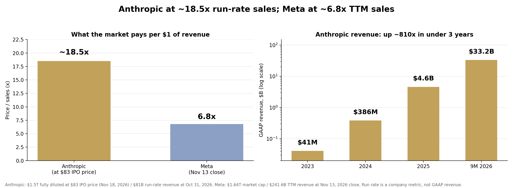

> [中文版 Chinese version](/ai%20engineering/llms/anthropic-ipo-s1-valuation-zh/)

Anthropic priced its IPO on Wednesday, November 18, at $83 a share and starts trading Thursday, November 19, on Nasdaq as ANT. The final terms: 980 million Class A shares, raising about $81.3 billion — the largest IPO on record, passing SpaceX's $75 billion — for a fully diluted valuation of about $1.5 trillion, against a $965 billion private valuation in May. A $26 billion private placement from Google, Nvidia, AMD, Broadcom, Micron, Microsoft and TSMC runs alongside. The order book was reportedly about 6x oversubscribed.

This is not a post about whether Anthropic is a good company. It is a post about what its own filing says your coding-agent bill is built on — and what to do about it now that the company is public.

## The price tag: ~18.5x sales, vs Meta at ~6.8x

The headline multiple: $1.5 trillion divided by $81 billion of run-rate revenue as of October 31, 2026 — **about 18.5x sales**. On Q3 revenue annualized ($16.96B × 4 = $67.8B), the $83 price is ~22x. On a $47 billion annualized revenue base — the conservative yardstick from earlier scepticism about this valuation — the multiple is ~32x.

For scale, Meta — a profitable company with $241.6 billion of trailing-twelve-month revenue — trades at a $1.64 trillion market cap, **about 6.8x sales** (November 13 close). NYU's Aswath Damodaran, valuing Anthropic independently, put equity value at $1.45 trillion on November 3.

Two honest caveats, before the critique. First, run-rate revenue is a company metric, not GAAP revenue: trailing 28-day consumption fees × 13 plus monthly subscription fees × 12. Anthropic warns it is not a substitute for GAAP revenue or a forecast. Second, at this growth rate the multiple compresses fast — October alone added $10 billion of run rate, up from ~$71 billion at September 30. If Q4 holds that pace, $1.5 trillion is roughly 13–14x forward sales within months. The bull case is real. It just isn't the only case.

## The growth is real

GAAP revenue, from the S-1: $41 million in 2023, $386 million in 2024, $4.585 billion in 2025, and **$33.24 billion in the first nine months of 2026** — 13x the same period a year earlier. Q3 alone was $16.96 billion, up 47% on Q2 and 1,127% year over year. Fortune's reading of the filing adds a striking unit-economic line: Anthropic generates more than $2 of revenue for every $1 spent on raw computing power.

## The profit line flips quarter to quarter

Q2 2026 produced Anthropic's first-ever quarterly operating profit: $974 million, an 8% margin. Q3 swung back to a **$567 million operating loss** (-3% margin). For the nine months, the operating loss is $1.26 billion (-4% margin); adjusted operating income, a non-GAAP measure, is $4.08 billion.

Ignore the giant net-loss headlines in both directions: the Q3 net loss of $23.3 billion is $21.9 billion of non-cash fair-value remeasurement on convertible notes, derivatives and SAFEs — an accounting mark that moves with Anthropic's own valuation, not cash out the door. (The first-half net loss of $80.7 billion was $72.4 billion the same kind of charge.) The operating line is the number that reflects running the business, and it flipped sign in one quarter. Cash is not the constraint right now: $95.6 billion in cash and $36.3 billion in short-term investments at September 30, before about $107 billion of gross proceeds from the IPO and the concurrent private placement.

## The landlord problem: distribution and compute are both rented

This is the part of the filing that matters most to a buyer. About **48% of first-half 2026 revenue arrived through the cloud marketplaces of Amazon, Google and Microsoft** — up from 11% in 2023, 32% in 2024 and 47% in 2025. Those three companies are simultaneously Anthropic's investors, customers, distribution partners and competitors, and 58% of net accounts receivable at June 30 was owed by the marketplaces. The filing says the platforms "bill end customers, collect payments on our behalf, and remit such amounts to us, net of applicable platform and other fees."

On the other side of the ledger: **~$900.9 billion of aggregate purchase commitments and leases, substantially all compute and infrastructure** (S-1/A, November 10), including about $451.6 billion due before the end of 2030 and **$70.7 billion due in the 12 months after September 30 — about 87% of the $81 billion run rate**. Another $150–175 billion is estimated under deals with no fixed dollar amount. Minimum compute commitments to the big three alone total $269.4 billion: $114.5 billion to Google through 2033, $110 billion to Amazon through 2036, $44.9 billion to Microsoft.

CEO Dario Amodei called securing compute Anthropic's "deepest business dilemma" at a JPMorgan event on November 13, and said the company buys "relatively little" compute in advance — the IPO cash is a buffer against guessing wrong in either direction. One fairness note: the $900.9 billion mixes long take-or-pay deals with GPU rentals either side can end on short notice, so not all of it is unconditional. But the direction is unambiguous: the compute bill is contracted years ahead, and it is the largest single number in the filing.

## Coding is the revenue — and it is month-to-month

Claude Code is the wedge, and the S-1 quantifies it. In Q3 2026, Claude Enterprise users who did not use Claude Code spent **less than $75 per month on average**, while **the top 5% of Claude Enterprise users who used Claude Code spent approximately 20 times that amount**. Net revenue retention is about 900% as of September 30. Customers spending $100,000+ over the trailing twelve months grew from ~950 a year earlier to **more than 11,900**; more than 1,900 spend $1 million+, about 250 spend $10 million+.

But the structure underneath is consumption, not contracts. **79% of nine-month revenue is consumption-based**; remaining performance obligations (contracted revenue not yet recognized) were just $10.8 billion at June 30, against $33.2 billion of nine-month revenue. Customers can walk — Fortune reports the filing shows customer consumption dropped ~20% in the two weeks ending January 2 before recovering. Concentration is improving (top five customers ~25% of nine-month revenue, no single customer over 10%, 79% of Q3 revenue from outside the top five vs 64% in Q1), but 5–7% of nine-month revenue came from customers later found to be violating usage policy or commercial terms.

So: the revenue that justifies an 18.5x multiple is concentrated in coding, billed by the token, mostly month-to-month, and distributed through the buyer's own cloud vendors. That is a strong business. It is not a locked-in annuity.

## What to do today

**1. Price your exit now that it is listed.** If Claude Code tops 30% of your AI spend, run a second harness on 20 real PRs this week. The harness layer is replaceable: swapping harnesses moves per-task cost up to 3x at flat scores, with no capability gain — our October 26 piece on harness economics ([Harness buys tokens](/ai%20engineering/llms/harness-buys-tokens/)). The exit is cheap to test and expensive to skip. If the second harness lands within 5pp on your own tasks, you have a credible walk-away — which is the only leverage that matters in a renewal.

**2. Renegotiate on the S-1's own terms.** Anthropic's revenue is 79% month-to-month consumption with $10.8 billion of contracted backlog. Never prepay a full year for a consumption-priced product whose vendor just told the SEC its own customers can leave. Trade any annual commit for a written price lock or a volume tier — and get the exit clause in writing before the renewal, not after.

**3. Budget the bill like a landlord's rent.** $70.7 billion of Anthropic's own commitments fall due in the next 12 months — 87% of its run rate. That cost pressure points one way. Put a 20% contingency line on your 2027 coding-agent budget with a quarterly price review, and if per-engineer cost rises more than 20% in a quarter with no capability gain, trigger the harness swap from step 1.

## The debate

The bull case deserves its hearing: $10 billion of run rate added in a single month, revenue growing 13x year over year, a $26 billion vote of confidence from the companies that also sell against it. If that growth holds, today's 18.5x is next year's ~10x, and the argument above looks like fussing over a rounding error.

But the question for a buyer is different from the question for an investor. An investor pays for the growth. A buyer pays the bill — and the bill is for a month-to-month product, distributed through its rivals' marketplaces, running on compute contracted years ahead at 11x the run rate. So: **would you pay an 18.5x-sales premium for the model — or own the harness and rent the model?**

## Caveats

- The IPO priced at $83 a share on November 18; Anthropic begins trading November 19 on Nasdaq as ANT. The first trade had not printed at the time of writing, and no first-day price is quoted in this post.
- The $1.5 trillion is the fully diluted valuation at the $83 IPO price. Damodaran's $1.45 trillion is an independent estimate, not a market price.
- The order-book oversubscription (~6x) is Bloomberg reporting, not a filing term.
- Run-rate revenue is Anthropic's own metric (trailing 28 days × 13 + monthly subscriptions × 12), not GAAP revenue and not a forecast. The 2023–2025 and nine-month figures are GAAP; quarterly figures are unaudited.
- The $900.9 billion commitment total mixes take-or-pay contracts with shorter, cancellable rentals; the filing does not split them.
- Nothing here is investment advice, and nothing in this post draws on any non-public information. All figures are from the public S-1 and its amendments, the IPO pricing release, or from the reporting cited below.

## Sources

- Anthropic, PBC, IPO pricing release, November 18, 2026 — $83 a share, 980M Class A shares, ~$81.3B gross proceeds, ~$1.5T fully diluted valuation; trading begins November 19 on Nasdaq as ANT. Covered at [TechCrunch, November 18, 2026](https://techcrunch.com/2026/11/18/anthropic-reportedly-prices-ipo-at-83-a-share-above-projected-range/).
- Anthropic, PBC, Form S-1/A Amendment No. 2, filed November 10, 2026 (SEC EDGAR) — $81B run rate at October 31, $900.9B commitments, Q3 financials; 825M shares at $70–$78 as originally filed. Covered in detail at [AI Early Edition, November 16, 2026](https://aiearlyedition.com/tape/anthropic-ipo-roadshow-compute/) and [The Parameter, November 16, 2026](https://theparameter.ai/a/anthropic-ipo-week/).
- Anthropic, PBC, Form S-1/A Amendment No. 1, filed November 2, 2026 — Q3 revenue $16.96B, operating loss $567M, $895.4B purchase commitments. Covered at [Digital Applied, November 2, 2026](https://www.digitalapplied.com/blog/anthropic-s1-amendment-api-customers).
- Anthropic, PBC, Form S-1, filed October 26, 2026 — H1 revenue $16.29B, 48% marketplace share, customer counts. Covered at [Capital & Compute](https://capitalandcompute.net/blog/how-does-anthropic-make-money/).
- Claude Code 20x figure and customer concentration, from the S-1 as read at [Alex Kras, "Reading Anthropic's S-1 as a Claude Code user"](https://alexkras.com/reading-anthropics-s-1-as-a-claude-code-user/).
- Run-rate definition and October $10B increase: [FourWeekMBA](https://fourweekmba.com/ai-anthropics-run-rate-hit-81b-october-added-2-2x-2025-sales/).
- Meta market cap $1.64T, TTM revenue $241.6B, price/sales ~6.8x at November 13, 2026 close: [GreekSoup, META fundamentals](https://greeksoup.ai/stocks/us/meta/).
- Damodaran $1.45T equity value, November 3, 2026: [ExpertBeacon](https://expertbeacon.com/anthropic-ipo-valuation-damodaran/).
- Harness-swap cost up to 3x at flat scores: [our October 26, 2026 piece](/ai%20engineering/llms/harness-buys-tokens/) on arXiv:2610.04433.
