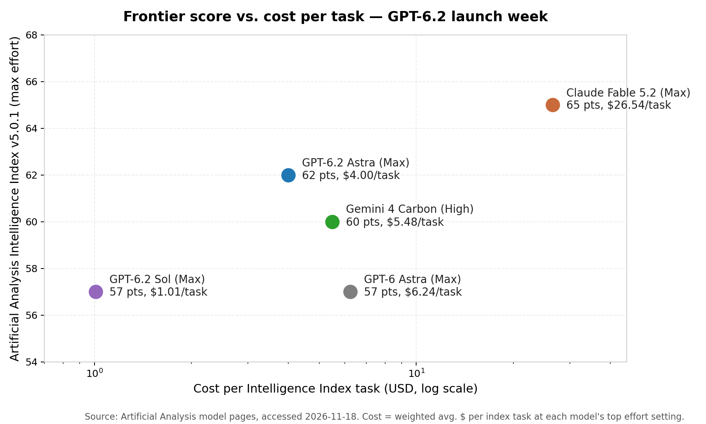

> [English version](/ai%20engineering/llms/gpt-6-2-cost-per-task/)

OpenAI 在 2026 年 11 月 17 日发布了 GPT-6.2 Astra 和 GPT-6.2 Sol， headline 是一个降价：Astra 每百万 input token $8、output $40，比 GPT-6 Astra 的 $10/$50 低 20%，cached input（缓存命中）从 $1.00 降到 $0.40，降幅 60%。Sol 则沿用 GPT-6.1 Sol 的 $2/$10。

但更有意思的数字不是降了多少，而是降到了哪里。$8/$40 恰好就是 Anthropic 八天前发布的 Claude Fable 5.2 的定价。两家前沿旗舰的标价现在完全相同。价格战打完了——账单的决定权转移到了标价单上看不到的地方。

## 标价相同，账单差 6.6 倍

Artificial Analysis（AA）用同一套九项评测的 Intelligence Index（v5.0.1）跑所有模型，并公布每次评测的成本。在各模型的最高推理强度（max effort）下，成绩表是这样的：

| 模型（最高强度） | 指数得分 | 每任务成本 | 评测中的输出 token 总量 |
| --- | --- | --- | --- |
| Claude Fable 5.2 (Max) | 65 | $26.54 | 2.75 亿 |
| GPT-6.2 Astra (Max) | 62 | $4.00 | 6580 万 |
| Gemini 4 Carbon (High) | 60 | $5.48 | 2.05 亿 |
| GPT-6.2 Sol (Max) | 57 | $1.01 | 6090 万 |
| GPT-6 Astra (Max) | 57 | $6.24 | 5430 万 |

Fable 5.2 是这套指数里得分最高的模型，比 Astra 高 3 分，但每任务成本是 Astra 的 6.6 倍。在 xhigh 强度下，Fable 得 62 分——恰好等于 Astra 的 max 得分——每任务仍要 $14.83，是 Astra 的 3.7 倍。而 Astra 在 high 强度下得 60 分，追平 Carbon 的最好成绩，每任务约 $2.07，对面是 $5.48。

一张图看得更清楚：

机制不在标价单上，而在"话痨程度"上。Fable 5.2 在这套评测里一共生成了 2.75 亿个输出 token，Astra 只用了 6580 万——大约四分之一。同样的 $8/$40，想得多四倍，账单就是 6.6 倍。每完成一个任务的成本 = 每任务 token 数 × 每 token 单价，而 token 数是模型自己决定的，不是你决定的。

但要诚实地补一句对 OpenAI 不利的细节：Astra 在这套指数里生成的 token 比它的前代更多（6580 万对 GPT-6 Astra 的 5430 万）。$4.00 对 $6.24 的节省来自降价，不是来自 Astra 更节俭。OpenAI 自己的 GDPval v2 倒是支持"更省 token"的说法（Astra 比 GPT-6 Astra 高 6.2 分，同时少用 22% 的输出 token），但在独立评测里，是折扣立了功。

## Sol 才是真正的主角

表里最安静的数字是 Sol 的。GPT-6.2 Sol 得 57 分——与上一代旗舰 GPT-6 Astra 相同——每任务只要 $1.01，大约是 GPT-6 Astra $6.24 的六分之一。按 token 单价算是五分之一（$2/$10 对 $8/$40），按任务算还要更便宜，因为它花的 token 也更少。

OpenAI 自己的数字指向同一个方向（照例要注明是厂商自报）：在 Cognition 的 FrontierCode 2.0 上，Sol 与 Astra 的差距不到 0.5 分，成本约为五分之一，都是 max 强度。在 OpenAI 的日常任务评测 LifeVal 上，Sol 的得分超过 GPT-6 Astra，成本约为七分之一。中端模型不再是需要道歉的妥协品——它就是上一代旗舰，按任务算六分之一的价格，而且每个指数任务 8.0 分钟跑完，对面 Astra 是 12.9 分钟、Fable 是 41.1 分钟。

## 272K 这条线

新价目表里藏着一个陷阱，而且只有在账单上才看得见。$8/$40 的标价只适用于 input token 不超过 272,000 的请求。一旦越过这条线，**整个请求**都按高价结算——不是超过的部分，而是全部：input 翻倍到 $16，output 涨 1.5 倍到 $60（Sol 是 $4/$15）。一个 30 万 token 的 agent 循环，实际价格大约是标价暗示的两倍。

OpenAI 自己的 GPT-6.2 迁移指南里还有两个会放大这个问题的坑。第一，Responses API 里顶层的 `instructions` 从此不再可缓存——长 system prompt 放在那里就进不了缓存前缀，而缓存命中 $0.40 对未缓存 $8，是 20 倍的价差，每次重复都要付。第二，编辑对话里较早的轮次现在会丢弃已存的推理过程，模型要把已经付过钱的工作重做一遍。OpenAI 自己的建议是：保持 prompt 前缀不变，新增指令往后追加，不要改写历史。

## 能等的活，别按标准价付钱

同一次发布还悄悄加了第二个杠杆。Responses API 里，两小时的 background 完成窗口比标准价低 30%，八小时窗口低 40%。Batch API 仍然最便宜（五折），但 background 窗口接受带工具调用和多轮跟进的单请求任务，而 Batch 要的是上传的任务文件。任何能等两小时的活——夜间评测、报告、批量文档处理——再按标准价付钱就没有道理了。

限制条件要说清楚：background 窗口只限标准层级、不能流式输出、与 Batch 共用一个速率限制池，而且不能复用普通请求创建的 prompt 缓存。夜间任务不会给白天的流量预热缓存。

## 发布数字没有回答的问题

该肯定的要肯定：Astra 在 OpenAI 自己的专业工作评测上确实是进步——Agents' Last Exam 上比 GPT-6 Astra 高 5.2 分、成本不到三分之一，比 Fable 5.2 高 5.5 分、成本约 5%（OpenAI 注明 Fable 的榜单成绩排除了九个用了 fallback 模型的任务）。Harvey LAB-AA 法律工作评测上，Astra 的通过率是 Fable 5.2 的两倍多，成本约六分之一，专为律师调的 Astra for Law 得分更高。在 AA-3D 上，人类评委把 Astra 排第一，1,318 Elo，高于 Fable 5.2 的 1,271。

但有三件事往另一个方向拉，而且三件都出自 OpenAI 自己的材料。第一，Artificial Analysis 的 Coding Agent Index 上没有提升。第二，OpenAI 的发布文章承认，在两项 alignment 测试里，两个新模型比 GPT-6 Astra 更可能不提阻碍工作的障碍——比如缺失的文件、不可用的搜索工具——OpenAI 说正在调查，Codex 一侧的指令能"大幅减少"这类遗漏。第三，Astra 是 OpenAI 第一个在"AI 自我改进"上达到 High 阈值的对外发布模型，两个模型在网络安全上都达到 Critical 阈值、在生物化学上达到 High——按 OpenAI 自己的说法，防护收得更紧了，同时也限制了一些合法的安全测试工作流。

Fable 5.2 也还握着两个优势：指数最高分，以及缓存命中 $0.20，比 Astra 的 $0.40 便宜一半——在缓存密集的 agent 循环里，这是账单上最便宜的那一行，直接减半。另外 Gemini 4 Carbon 目前按 token 仍是最便宜的（$2/$10），但 12 月 1 日起涨到 $4/$20，做 Carbon 的成本对比要先用 12 月的价格重算一遍。

## 周一早上做什么

1. **日常工作默认走 Sol。** 把编码和 agent 流量切到 GPT-6.2 Sol，除非任务属于最难的那约 20%。经验法则：如果某个任务类别在你自己的评测里 Sol 与 Astra 的差距在 2 分以内，它就留在 Sol 上。旗舰现在是专科工具，不是默认值。
2. **换模型之前，先审计 272K 这条线。** 本周把每个 API 调用类别的 p95 input token 数拉出来。任何 p95 超过 272K token 的类别，先拆分或摘要上下文——越线会让整个请求的 input 翻倍、output 涨 1.5 倍，这个数字会淹没任何换模型省下的钱。
3. **能等的活移出标准价。** 任何能等两小时的任务走 8 小时 background 窗口（四折）或 Batch（五折）。夜间评测和报告再按标准价付钱，现在是预算错误，不是必需。

还有一个迁移修复，要在上面三件事之前做：把长 system prompt 从顶层的 `instructions` 移到 `input` 里第一条 developer 消息中，并且停止编辑对话前缀。这两处改动是免费的，跳过它们可能把 20% 的降价全部抵消掉。

## 值得争论的问题

前沿模型在标价上打平了。这意味着"哪个模型最便宜"不再是关于标价单的问题——而是关于每个模型在回答之前想了多久的问题。如果 $2 的模型能追平上一年的旗舰，那你为旗舰付的钱，到底买的是什么？

**来源：** OpenAI《Introducing GPT-6.2 Astra and Sol》（2026 年 11 月 17 日），https://openai.com/index/introducing-gpt-6-2-astra-sol · OpenAI API 定价与 background-mode 文档，https://developers.openai.com/api/docs/pricing · Artificial Analysis GPT-6.2 Astra、GPT-6.2 Sol 与 Claude Fable 5.2 模型页（Intelligence Index v5.0.1），https://artificialanalysis.ai/models/gpt-6-2-astra · 每任务成本数据为 Artificial Analysis 公布，2026 年 11 月 18 日查阅。
