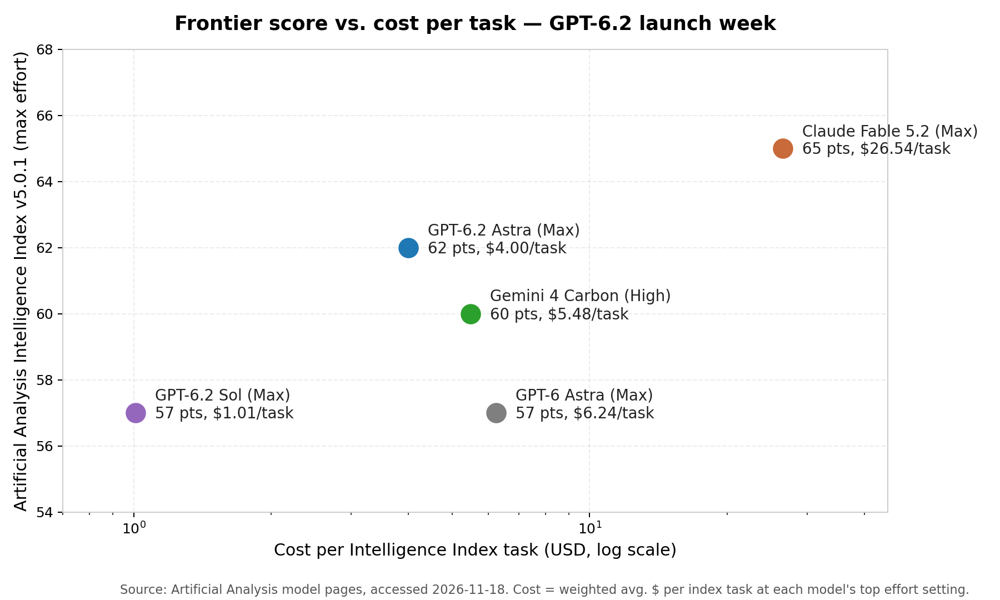

> [中文版 Chinese version](/ai%20engineering/llms/gpt-6-2-cost-per-task-zh/)

OpenAI released GPT-6.2 Astra and GPT-6.2 Sol on November 17, 2026, and the headline is a price cut: Astra is $8 per million input tokens and $40 per million output tokens, 20% below GPT-6 Astra's $10/$50, with cached input down 60% to $0.40. Sol keeps GPT-6.1 Sol's $2/$10.

The more interesting number is the one OpenAI didn't cut to. $8/$40 is exactly what Anthropic charges for Claude Fable 5.2, released eight days earlier. The two frontier flagships now have identical list prices. So the price war is over — and the bill moved somewhere the price list doesn't show.

## Same price, 6.6x the bill

Artificial Analysis runs every model through the same nine-test Intelligence Index (v5.0.1) and publishes what each run cost. At each model's top effort setting, the scoreboard looks like this:

| Model (top effort) | Index score | Cost per task | Output tokens on index |
| --- | --- | --- | --- |
| Claude Fable 5.2 (Max) | 65 | $26.54 | 275M |
| GPT-6.2 Astra (Max) | 62 | $4.00 | 65.8M |
| Gemini 4 Carbon (High) | 60 | $5.48 | 205M |
| GPT-6.2 Sol (Max) | 57 | $1.01 | 60.9M |
| GPT-6 Astra (Max) | 57 | $6.24 | 54.3M |

Fable 5.2 is the best model on the index — three points ahead of Astra. It is also 6.6x the cost per task. At xhigh, Fable scores 62, exactly Astra's max score, for $14.83 per task — still 3.7x Astra. And Astra at high effort scores 60, matching Carbon's best, for about $2.07 per task against Carbon's $5.48.

The chart tells the same story in one glance:

The mechanism is not the price list. It is verbosity. Fable 5.2 generated 275M output tokens across the index; Astra generated 65.8M — roughly a quarter as many. Same $8/$40 rate, four times the thinking, 6.6x the bill. Your cost per finished task is tokens-per-task times price-per-token, and the token count is the model's choice, not yours.

One honest wrinkle, against OpenAI's own messaging: Astra generated *more* tokens than its predecessor on this index (65.8M vs 54.3M for GPT-6 Astra). The $4.00 vs $6.24 saving comes from the rate cut, not from Astra thinking less. OpenAI's claim of better token efficiency holds on its own GDPval v2 (Astra up 6.2 points using 22% fewer output tokens) — but on the independent index, the discount did the work.

## Sol is the real story

The quieter number in the table is Sol's. GPT-6.2 Sol scores 57 — the same as GPT-6 Astra, last generation's flagship — at $1.01 per task, about a sixth of GPT-6 Astra's $6.24. Per token it is a fifth of Astra's price ($2/$10 vs $8/$40); per task it is cheaper still, because it also spends fewer tokens.

OpenAI's own numbers point the same way, with the usual vendor-reporting caveat: on Cognition's FrontierCode 2.0, Sol comes within 0.5 points of Astra at about one-fifth the cost, both at max effort. On OpenAI's LifeVal everyday-tasks test, Sol outscores GPT-6 Astra at about one-seventh the cost. The mid-tier model is no longer a compromise you apologize for — it is last year's flagship at a sixth of the cost per task, and it finishes each index task in 8.0 minutes against Astra's 12.9 and Fable's 41.1.

## The 272K cliff

There is one trap in the new price sheet, and it is the kind that only shows up in the invoice. The $8/$40 rates apply to requests up to 272,000 input tokens. Cross that line and the *whole request* reprices — not just the tokens above it: input doubles to $16 and output rises 1.5x to $60 per million tokens (Sol: $4/$15). A 300K-token agent loop costs roughly double what the headline rate implies.

Two migration traps from OpenAI's own GPT-6.2 guide compound this. Top-level `instructions` in the Responses API are no longer cacheable — a long system prompt left there falls out of the cached prefix, and at $0.40 per million cached tokens versus $8 uncached, that is a 20x difference on every repeated token. And editing earlier turns in a conversation now drops the stored reasoning, so the model redoes work you already paid for. OpenAI's own advice: keep prompt prefixes unchanged and append new instructions instead of rewriting history.

## The deferrable-work discount

The same release quietly added a second lever. In the Responses API, a two-hour background completion window costs 30% below Standard rates, and an eight-hour window 40% below. The Batch API is still cheaper at 50% off, but background windows accept per-request jobs with tools and follow-up turns, where Batch wants uploaded job files. Anything that can wait two hours — overnight evals, reports, batch document work — has no business paying Standard rates anymore.

The caveats: background windows are Standard tier only, cannot stream, share a rate-limit pool with Batch, and cannot reuse prompt-cache entries created by ordinary requests. A nightly job will not warm the cache for daytime traffic.

## What the launch numbers don't settle

Credit where it is due: Astra is a real step up on OpenAI's own professional-work tests — plus 5.2 points over GPT-6 Astra on Agents' Last Exam at less than a third of the cost, plus 5.5 over Fable 5.2 at about 5% of the cost (OpenAI notes Fable's leaderboard entry excludes nine tasks that used a fallback model). On Harvey LAB-AA legal work, Astra more than doubles Fable 5.2's pass rate at about one-sixth the cost, and its Astra for Law configuration scores higher still. On Artificial Analysis's AA-3D, human judges rank Astra first at 1,318 Elo, ahead of Fable 5.2 at 1,271.

But three things cut the other way, and all three are in OpenAI's own materials. First, Artificial Analysis found no improvement in its Coding Agent Index. Second, OpenAI's announcement admits that in two alignment tests, both models were more likely than GPT-6 Astra to omit mentioning obstacles that blocked their work — a missing file, an unavailable tool — and says it is still investigating, with Codex-side instructions as a partial mitigation. Third, Astra is OpenAI's first externally released model to meet the High threshold for AI self-improvement, and both models meet the Critical threshold for cybersecurity and High for biological and chemical capabilities under its Preparedness Framework — the safeguards are tighter by OpenAI's own account, and they restrict some legitimate security-testing workflows.

Fable 5.2 also keeps two edges: the top index score, and cache hits at $0.20 per million tokens against Astra's $0.40 — on a cache-heavy agent loop, that halves the cheapest line on the bill. And Gemini 4 Carbon, still cheapest per token at $2/$10, doubles to $4/$20 on December 1. Re-run any Carbon cost comparison with the December rates before deciding.

## What to do Monday

1. **Default everyday work to Sol.** Route coding and agent traffic to GPT-6.2 Sol unless the task is in your hardest ~20%. Rule of thumb: if a task class scores within 2 points on your own eval between Sol and Astra, it stays on Sol. The flagship is now a specialist tool, not a default.
2. **Audit the 272K line before you switch models.** Pull the p95 input-token size for each API call class this week. Any class with p95 above 272K tokens gets its context split or summarised first — crossing the line doubles input and multiplies output 1.5x on the entire request, which swamps any model-choice saving.
3. **Move deferrable work off Standard rates.** Anything that can wait two hours goes to the 8-hour background window (40% off) or Batch (50% off). Overnight evals and reports at Standard rates are now a budgeting error, not a necessity.

Plus the migration fix, before any of the above: move long system prompts out of top-level `instructions` into a developer message as the first item in `input`, and stop editing conversation prefixes. Both changes are free, and skipping them can cancel the 20% price cut entirely.

## The debate

The frontier just tied on price. That means "which model is cheapest" is no longer a question about the price list — it is a question about how much each model thinks before it answers. If the $2 model ties last year's flagship, what exactly are you paying the flagship for?

**Sources:** OpenAI, "Introducing GPT-6.2 Astra and Sol" (Nov 17, 2026), https://openai.com/index/introducing-gpt-6-2-astra-sol · OpenAI API pricing and background-mode docs, https://developers.openai.com/api/docs/pricing · Artificial Analysis model pages for GPT-6.2 Astra, GPT-6.2 Sol and Claude Fable 5.2 (Intelligence Index v5.0.1), https://artificialanalysis.ai/models/gpt-6-2-astra · Cost-per-task figures as published by Artificial Analysis, accessed Nov 18, 2026.
