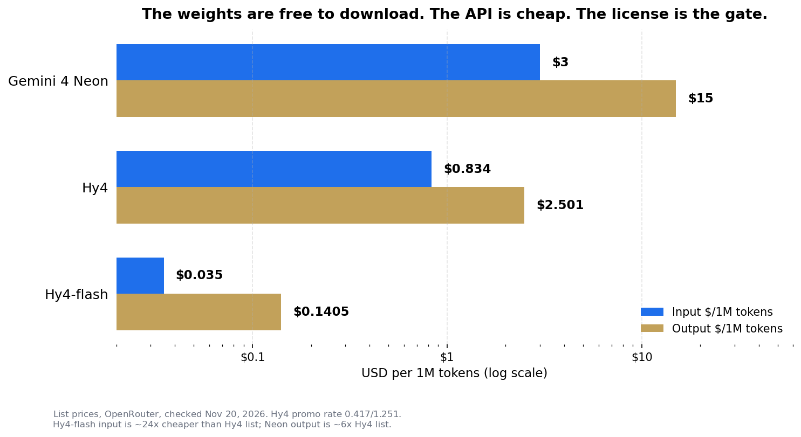

> [English version](/ai%20engineering/llms/hy4-license-gate/)

2026 年 11 月 20 日，腾讯发布了旗舰模型 Hy4 的开源权重——指令模型、FP8 量化版和预训练基座，一起上架 Hugging Face、ModelScope 和 GitCode，还附了一份 system card。纸面参数很硬：7700 亿参数的 MoE（混合专家）主干，每 token 激活 490 亿参数，上下文 1048576 个 token，原生支持文本、图像和视频理解。

权重可以免费下载。在规模上使用它，现在要谈判。8 月的预览版用的是 Apache 2.0 许可证。正式版换成了新的腾讯 Hy 许可证 1.0 版——以 Apache 2.0 为底，加了一节，改写了谁能大规模商用这个模型。许可证文件第一段就写明了："This License is not the Apache License, Version 2.0（本许可证不是 Apache 2.0 许可证）。"

这次换证就是新闻本身。参数、跑分、价格，都是让这次换证变得重要的上下文。

## 这个模型本身怎么样

先肯定值得肯定的地方：Hy4 是开源权重里很强的旗舰，腾讯的模型卡在长处和短处上都写得异常坦率。主干 78 层——1 层 dense、77 层 MoE，每层 256 个路由专家加 1 个共享专家，每 token 激活 top-8；视觉编码器 12.3 亿参数；内置了一个 33 亿参数的 DFly2 推测解码 drafter，复用模型的 KV 缓存。注意力机制是门控 DeepSeek 稀疏注意力（Gated DSA）加多头潜在注意力（MLA）。模型支持 CLI 和 GUI 的 computer-use 工作流，还针对 Blender、CAD 等专业软件做了训练。

最值得看的厂商数据，是那些扎在真实工作而不是通用跑分上的。金融与办公场景，腾讯搭了数千个真实工作空间、数万个任务，然后在 579 个真实金融任务上评估 Hy4，评审是 213 位金融从业者——其中 153 位是头部金融机构的专家，70% 以上有五年以上从业经验。Hy4 平均 3.04 分（满分 4 分），高于 DeepSeek-V4.1-Flash 的 2.97、Kimi K3.1 Pro 的 2.68 和 GLM-5.3 的 2.68。同一批内部评估里，腾讯称幻觉率从预览版的 15.76% 降到 5.45%，臆测性错误从 23.1% 降到 5.6%。游戏开发上，相对预览版 GameDev 提升 19.1%、GameLogic 提升 9.8%。这些都是厂商自己的评估数字，没有独立复现——当作厂商的最佳情况来读，别当作定论。

模型卡对差距也毫不含糊："与顶级闭源模型之间仍有明显差距，尤其是在研究级数学、长程编程、模型自我改进和高级视觉问答等高难度内部基准上。"这种坦率值得记一笔。Hy4 是开源权重里的旗舰，不是 frontier 杀手。

API 价格按 frontier 标准算很便宜。Hy4 自 11 月 4 日上线以来在 OpenRouter 的标价是每百万 token 输入 0.834 美元、输出 2.501 美元（当前还有 0.417/1.251 美元的促销价）。小弟 Hy4-flash——2200 亿总参数、每 token 激活 120 亿，同样 100 万上下文——标价 0.035/0.1405 美元。对比一下，11 月 18 日发布的 Google Gemini 4 Neon 标价 3/15 美元。Hy4-flash 的输入价大约是 Hy4 标价的 1/24；Neon 的输出价大约是 Hy4 的 6 倍。

## 第 10 条到底写了什么

腾讯 Hy 许可证的附加商业条款全在第 10 条，短到可以逐字拆解。"MaaS"（模型即服务）指的是向第三方提供模型推理或微调的远程访问——比如通过 API，让对方提交输入、指定参数或训练数据。模型能力只限定在特定功能或工作流里的终端产品（没有通用模型访问权）不算，仅仅把请求转发给独立运营的第三方模型服务也不算。

如果你运营 MaaS 业务，在以下两种情况中任何一种成立时，必须先从腾讯拿到单独的书面许可，才能使用这些权重——或者继续使用：

- **（a）你的全球总收入在任意连续 12 个月内超过 5000 万美元**——"whether or not such revenue is derived from the Work（无论该收入是否来自本作品）"。这句是锋利的部分：触发条件是你公司的总收入，不是模型带来的收入。一家年收入 6000 万美元的公司，哪怕只是给一个副业项目套个 Hy4 的 API，也触发了这条。
- **（b）在任何产品或服务月活超过 1 亿的那个月之前**——不论收入多少。一个免费的、用户量巨大的消费产品，哪怕收入为零，也触发了这条。

第 10.3 条豁免了"纯内部使用"，前提是模型、衍生作品及其输出都不提供给第三方。这条豁免要仔细读：它不只管谁能调用模型。如果你的"内部"智能体输出会到达客户手里——客服智能体起草的回复、嵌进产品的 copilot、引用了模型输出的 API 响应——输出已经提供给了第三方，豁免就不存在了。许可问题联系 hy_partners@tencent.com。

还有一条值得知道："衍生作品"明确包括任何微调、量化、蒸馏、合并或剪枝后的模型权重。蒸馏绕不开第 10 条——蒸馏出来的衍生品仍然受约束，而且第 10 条"对每一位接收者继续适用"。

连媒体都没注意到这次换证。TechNode 当天的报道写的是旗舰模型"采用 Apache 2.0 许可证"。Hugging Face 上的许可证文件写的是另一回事，模型卡上的徽章写的是"Tencent Hy License"。如果报道这次发布的新闻编辑部在第一天就把许可证写错了，你的模型准入清单大概率也会错。

## 这已经是模式，不是个案

16 天前，月之暗面发布了 Kimi K3.1 Pro 的权重——2.8 万亿参数 MoE，每 token 激活 1040 亿，100 万上下文，磁盘占用约 1.56 TB——用的是它自己的 Kimi K3.1 Pro 许可证。形状一样，数字更低：MaaS 运营商 12 个月总收入超过 2000 万美元，商用前需要单独签协议；月活超过 1 亿、或月收入超过 2000 万美元的产品，必须在界面显著位置展示"Kimi K3.1-Pro"。内部使用同样豁免。

而且腾讯是一次性给整个 Hy 家族换了许可证：11 月 18 日发布权重的 Hy4-flash，同样用腾讯 Hy 许可证。一个月，两个旗舰，两个定制许可证。"开源权重"这个标签现在可靠地只意味着一件事——可以免费下载；而许可证可靠地决定了第二件事——大规模部署是免费的，还是要谈判的。

趋势很清楚。预览版到正式版换证是最能说明问题的信号：厂商可以先用 Apache 2.0 的预览版做大采用量，等到正式发布、切换成本最高的时候，再换上带规模门槛的条款。你 8 月评估的权重，许可证和 11 月部署的不是同一份。

## 周一早上做什么

**1. 在模型准入清单最前面加一道 10 分钟的许可证关卡——在跑分之前，不是在跑分之后。**每个开源权重候选模型，先回答三个问题：我们的部署有没有任何一处向第三方提供推理或微调的远程访问（API 算，嵌进特定功能里大概不算）？我们的全球总收入有没有超过许可证的门槛——Hy4 是 5000 万美元，Kimi K3.1 Pro 是 2000 万美元？有没有任何一个用这个模型的产品月活超过 1 亿？任何一条触发，先给许可方发邮件。花一周时间跑分一个法务批不下来的模型，是你技术栈里最贵的免费下载。

**2. 把许可证版本和权重哈希一起钉在模型注册表里，每次检查点升级都重新核对。**把许可证当成带版本号的依赖项，和权重同等对待。预览版到正式版换证现在是已经演示过的模式，不是假想：Hy4 的 Apache 2.0 预览版变成了腾讯 Hy 许可证正式版。如果你的注册表只记检查点名字，一次悄悄的换证会直接穿过下一次升级，没人发现。

**3. 审计内部使用的边界，不只是部署的边界。**豁免覆盖的是模型、衍生品及其输出都不到达第三方的使用。把你内部模型输出的去向都画出来——发给客户的草稿、嵌进产品的 copilot、引用了模型输出的 API 响应。如果输出会到达客户手里，你就不是"内部使用"，你指望的那条豁免并不适用。

这些都不是在说不要用 Hy4。纯内部使用它是免费的，权重今天就能下载，API 很便宜，厂商自己的模型卡对它与闭源 frontier 的差距也很诚实。这是在说，别只用跑分表评估开源权重模型。跑分告诉你模型能做什么；许可证告诉你以你的规模，你有没有权利这么做——而答案现在取决于你的收入和用户量，不取决于模型的质量。

## 辩论

如果一个模型可以免费下载，但在 5000 万美元收入或 1 亿用户之上需要厂商的书面许可，它还算"开源"吗——还是说，那是一个带规模付费墙的免费层？如果预览版是 Apache 2.0、正式版不是，许可证换证在漏斗的哪一步就不再是细节、而变成了产品本身？

## 来源与注意事项

- 腾讯 Hy4 模型卡，Hugging Face（规格、金融评估、已知局限、发布通知）：https://huggingface.co/tencent/Hy4
- 腾讯 Hy 许可证 1.0 版（Hy4 仓库中的 LICENSE 文件，第 10 条）：https://huggingface.co/tencent/Hy4/resolve/main/LICENSE
- TechNode《腾讯发布 Hy4 模型权重，支持百万 token 上下文》，2026 年 11 月 20 日（发布日期；注意：其 Apache 2.0 的说法与许可证文件矛盾）：https://technode.com/2026/11/20/tencent-releases-hy4-model-weights-with-million-token-context/
- OpenRouter Hy4 定价（标价 $0.834/$2.501，促销价 $0.417/$1.251；2026 年 11 月 4 日上线）：https://openrouter.ai/tencent/hy4
- OpenRouter Hy4-flash 定价（$0.035/$0.1405）：https://openrouter.ai/tencent/hy4-flash
- Google Gemini 4 Neon 定价（$3/$15，100 万上下文，2026 年 11 月 18 日发布）：https://www.feixiaohao.com/en/news/15538879.html
- Kimi K3.1 Pro 许可证条款（2000 万美元 MaaS 触发线，1 亿月活 / 2000 万美元月收入展示要求）：https://themerkle.com/kimi-k31-pro-open-weights-vs-the-api-what-each-option-actually-lets-you-do 与 https://www.qovery.com/blog/kimi-k3-1-pro-self-host-kubernetes-gpu-memory-multi-node
- Hy4-flash 开源权重同样使用腾讯 Hy 许可证（2026 年 11 月 18 日）：https://www.orcarouter.ai/blog/tencent-hy4-flash-open-weights

注意事项：Hy4 的金融、游戏开发与幻觉率数字来自腾讯自己的评估，尚未有独立复现。Kimi 的许可证数字来自三份独立的二手报道，彼此一致；许可证文件本身才是权威文本。API 价格为 2026 年 11 月 20 日核查的 OpenRouter 标价，会变动——促销价已经与标价不同。本文不是法律建议；许可证文件本身很短，你们公司真正需要的是花五分钟读第 10 条，而不是读这篇文章。
