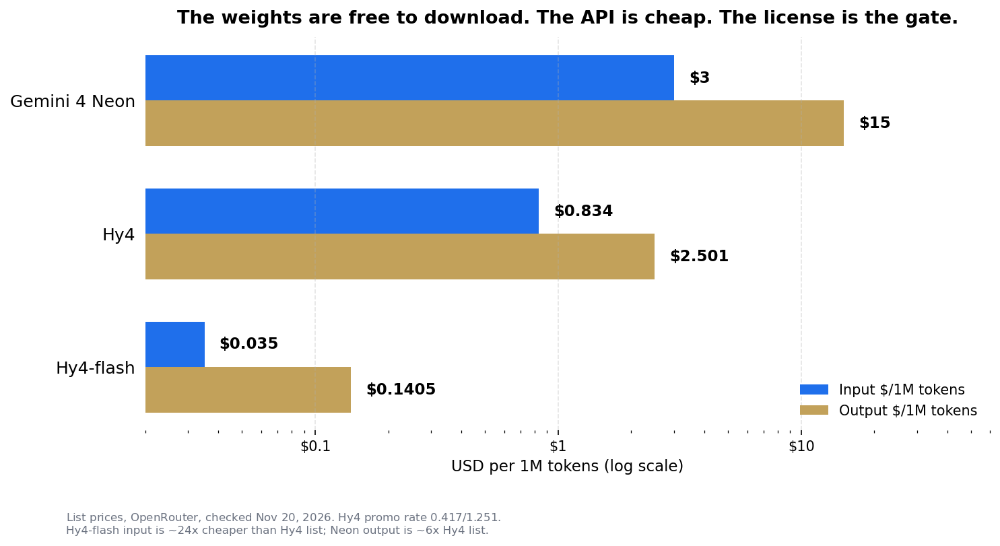

> [中文版 Chinese version](/ai%20engineering/llms/hy4-license-gate-zh/)

Tencent published the open weights for Hy4, its flagship model, on November 20, 2026 — the instruct model, an FP8-quantized version, and the pre-trained base, on Hugging Face, ModelScope, and GitCode, plus a system card. The headline specs are serious: a 770-billion-parameter mixture-of-experts backbone with 49 billion parameters active per token, a 1,048,576-token context window, and native text, image, and video understanding.

The weights are free to download. Using them at scale is now a negotiation. The August preview shipped under Apache 2.0. The full release ships under a new Tencent Hy License, version 1.0 — derived from Apache 2.0, with one added section that changes who can deploy the model commercially. The license file says so in its first paragraph: "This License is not the Apache License, Version 2.0."

That switch is the story. Everything else — the parameters, the benchmarks, the price — is the context that makes the switch matter.

## What the model is

Credit where it is due: Hy4 is a strong open-weights flagship, and Tencent's model card is unusually candid about both its strengths and its limits. The backbone is 78 layers — one dense layer, 77 MoE layers, 256 routed experts plus one shared expert per layer, top-8 activated — with a 1.23B-parameter vision encoder and a built-in 3.3B-parameter DFly2 speculative-decoding drafter that reuses the model's KV cache. Attention is Gated DeepSeek Sparse Attention with multi-head latent attention. The model supports computer-use workflows across CLI and GUI, and Tencent trained it on specialized software including Blender and CAD.

The vendor-reported results that matter most are the ones grounded in real work rather than generic benchmarks. For finance and office workflows, Tencent built thousands of realistic workspaces and tens of thousands of tasks, then evaluated Hy4 on 579 real-world financial tasks with 213 finance professionals — 153 of them experts from leading financial institutions, more than 70% with over five years of industry experience. Hy4 averaged 3.04 out of 4, ahead of DeepSeek-V4.1-Flash at 2.97, Kimi K3.1 Pro at 2.68, and GLM-5.3 at 2.68. On the same internal evaluations, Tencent says Hy4 cut the hallucination rate from 15.76% on the preview to 5.45%, and speculative errors from 23.1% to 5.6%. For game development, it reports +19.1% on GameDev and +9.8% on GameLogic versus the preview. These are vendor numbers from Tencent's own evaluations, not independent replication — read them as the vendor's best case, not as settled fact.

The model card is equally direct about the gap that remains: "a notable gap remains between it and top proprietary models, particularly on challenging internal benchmarks for research-level mathematics, long-horizon coding, model self-improvement, and advanced visual question answering." That honesty is worth noting. Hy4 is a flagship among open weights, not a frontier-beater.

The API price is cheap by frontier standards. Hy4 has been live on OpenRouter since its November 4 launch at a list price of $0.834 per million input tokens and $2.501 per million output tokens (a promotional rate of $0.417/$1.251 is currently showing). Its smaller sibling Hy4-flash — 220 billion total parameters, 12 billion active, also 1M context — lists at $0.035/$0.1405. For comparison, Google's Gemini 4 Neon, launched November 18, lists at $3/$15. Hy4-flash's input price is roughly 24x cheaper than Hy4's list price; Neon's output price is roughly 6x Hy4's.

## Section 10, decoded

The Tencent Hy License's additional commercial terms live in Section 10, and the section is short enough to quote in full effect. "MaaS" — model-as-a-service — means giving third parties remote access to model inference or fine-tuning, for example through an API, letting them submit inputs or specify parameters or training data. End-user products whose model capabilities are confined to specific features or workflows, without general-purpose model access, are excluded, as is merely relaying requests to an independently operated third-party model service.

If you operate a MaaS business, you must obtain a separate written license from Tencent before using the weights — or continuing to use them — in either of two cases:

- **(a) Your aggregate worldwide gross revenue exceeds US$50 million in any consecutive 12-month period** — "whether or not such revenue is derived from the Work." That last clause is the sharp edge: the trigger is your company's total revenue, not revenue from the model. A $60M-revenue company that serves Hy4 through an API for a side project trips the gate even if the model itself earns nothing.
- **(b) Before using the weights in or for any product or service with more than 100 million monthly active users in any calendar month** — at any revenue level. A free consumer product with a huge user base trips the gate even with zero revenue.

Section 10.3 exempts use "solely for internal purposes, provided that neither the Work, any Derivative Works, nor their outputs are made available to third parties." Read that exemption carefully: it is not just about who can call the model. If your "internal" agent's outputs reach customers — a support agent drafting replies, a copilot embedded in a product — the outputs are available to third parties and the exemption is gone. Licensing questions go to hy_partners@tencent.com.

One more clause worth knowing: "Derivative Works" explicitly include any fine-tuned, quantized, distilled, merged, or pruned versions of the model weights. You cannot distill your way out of Section 10 — a distilled derivative is still covered, and Section 10 "shall continue to apply to every recipient."

The press missed the switch. TechNode's same-day report on the release says the flagship is "available under the Apache 2.0 license." The license file on Hugging Face says otherwise, and the badge on the model card reads "Tencent Hy License." If a newsroom covering the release got the license wrong on day one, your intake checklist probably would too.

## This is now a pattern, not a one-off

Sixteen days earlier, Moonshot AI published the weights for Kimi K3.1 Pro — a 2.8-trillion-parameter MoE, 104 billion active per token, 1M context, about 1.56 TB on disk — under its own custom Kimi K3.1 Pro License. The shape is the same and the numbers are lower: MaaS operators with aggregate revenue above $20 million in any 12 months need a separate agreement before commercial use, and products above 100 million monthly active users — or above $20 million in monthly revenue — must prominently display "Kimi K3.1-Pro." Internal use is exempt there too.

And Tencent applied the same license to the whole Hy family at once: the smaller Hy4-flash, whose weights were released November 18, ships under the Tencent Hy License as well. Two flagships, two custom licenses, one month. The "open weights" label now reliably means one thing — free to download — and the license reliably decides a second thing — free to deploy at scale, or negotiated.

The direction of travel is clear. The preview-to-release license change is the tell: a vendor can ship an Apache 2.0 preview to build adoption, then swap in scale-gated terms at general availability, when switching costs are highest. The weights you evaluated in August are not the license you deploy in November.

## What to do on Monday

**1. Put a 10-minute license gate at the front of your model intake checklist — before benchmarking, not after.** For every open-weights candidate, answer three questions: does any part of our deployment give third parties remote access to inference or fine-tuning (an API counts; an embedded feature probably doesn't)? Is our aggregate worldwide revenue above the license's threshold — $50M for Hy4, $20M for Kimi K3.1 Pro? Does any product using the model pass 100M monthly active users? If any trigger fires, email the licensor first. A week of benchmarking a model your legal team cannot approve is the most expensive free download in your stack.

**2. Pin the license version next to the weights hash in your model registry, and re-verify it on every checkpoint upgrade.** Treat the license as a versioned dependency, exactly like the weights. Preview-to-GA license changes are now a demonstrated pattern, not a hypothetical: Hy4's Apache 2.0 preview became a Tencent Hy License release. If your registry records only the checkpoint name, a quiet license swap will sail through your next upgrade unnoticed.

**3. Audit the internal-use boundary, not just the deployment boundary.** The exemption covers use where neither the model, its derivatives, nor their outputs reach third parties. Map every place your internal model's outputs go — customer-facing drafts, embedded copilots, API responses that quote model output. If outputs reach customers, you are not internal anymore, and the exemption you were counting on does not apply.

None of this is an argument against using Hy4. For purely internal use it is free, the weights are downloadable today, the API is cheap, and the vendor's own card is honest about where the model still lags the closed frontier. It is an argument against evaluating open-weights models on benchmark tables alone. The benchmark tells you what the model can do. The license tells you whether you are allowed to do it at your scale — and the answer now depends on your revenue and your user count, not on the model's quality.

## The debate

If a model is free to download but needs the vendor's written permission above $50 million in revenue or 100 million users, is it still "open" — or is that a free tier with a paywall at scale? And if the preview is Apache 2.0 and the release is not, at what point in the funnel does the license change stop being a detail and start being the product?

## Sources and caveats

- Tencent Hy4 model card, Hugging Face (specs, finance evaluation, known limitations, release notice): https://huggingface.co/tencent/Hy4
- Tencent Hy License, Version 1.0 (LICENSE file in the Hy4 repository, Section 10): https://huggingface.co/tencent/Hy4/resolve/main/LICENSE
- TechNode, "Tencent releases Hy4 model weights with million-token context," November 20, 2026 (release date; note: its Apache 2.0 claim contradicts the license file): https://technode.com/2026/11/20/tencent-releases-hy4-model-weights-with-million-token-context/
- OpenRouter, Hy4 pricing (list $0.834/$2.501, promo $0.417/$1.251; released Nov 4, 2026): https://openrouter.ai/tencent/hy4
- OpenRouter, Hy4-flash pricing ($0.035/$0.1405): https://openrouter.ai/tencent/hy4-flash
- Google Gemini 4 Neon pricing ($3/$15, 1M context, launched Nov 18, 2026): https://www.feixiaohao.com/en/news/15538879.html
- Kimi K3.1 Pro license terms ($20M MaaS trigger, 100M MAU / $20M monthly revenue attribution): https://themerkle.com/kimi-k31-pro-open-weights-vs-the-api-what-each-option-actually-lets-you-do and https://www.qovery.com/blog/kimi-k3-1-pro-self-host-kubernetes-gpu-memory-multi-node
- Hy4-flash open weights under the Tencent Hy License (Nov 18, 2026): https://www.orcarouter.ai/blog/tencent-hy4-flash-open-weights

Caveats: Hy4's finance, game-dev, and hallucination numbers are vendor-reported from Tencent's own evaluations and have no independent replication yet. The Kimi license figures come from secondary reporting that agrees across three independent write-ups; the license file itself is the authoritative text. API prices are OpenRouter list prices checked November 20, 2026 and change — the promo rate already differs from list. Nothing here is legal advice; the license file is short, and the relevant question for your company is a five-minute read of Section 10, not this article.
