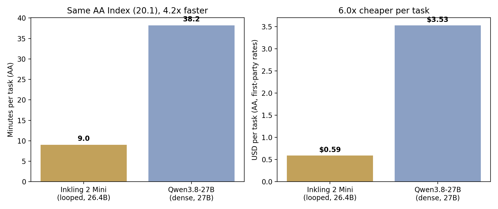

> [English version](/ai%20engineering/llms/inkling-2-mini-looped-local/)

Thinking Machines Lab 于 2026 年 11 月 20 日发布 Inkling 2 Mini：一个为本地运行而生的开放权重多模态模型。它的想法简单，而且是真正出现在已发布权重里的新东西——不存更多层，而是把已有的层重复跑。

## 机制

循环式 Transformer（looped transformer）指的是对每个 token 把同一批已存储的层重复运行多次。Inkling 2 Mini 存储 24 层：前 6 层和后 6 层各跑一次，中间 12 层跑三遍，每个 token 合计 48 次层运算。模型总参数 26.4B、单次激活 3.4B；把重复计算算进去，每 token 有效权重激活约 5.4B。

这笔交易——每 token 多花算力、不多存权重——让权重文件只有约 20GB（大部分权重用 NVFP4、最后四层用 MXFP8，且与训练时精度一致）。官方建议 Apple Silicon 至少 32GB 统一内存，其他平台至少 32GB 显存。上下文最高 100 万 token，许可证为 Apache 2.0（另附可接受使用政策）。

Thinking Machines 的内部扩展实验称：在 512K token 的 agent 轨迹上，非循环基线需要多花 140% 的推理算力才能达到循环模型的 loss。这是厂商数字，但它把赌注说得很清楚：深度可以用算力租，不必用内存买。

## 数字

Artificial Analysis 给 Inkling 2 Mini 和阿里稠密模型 Qwen3.8-27B 的智能指数同为 20.1。在这个平局下，AA 报告 Inkling 单任务约快 4.2 倍（9.0 对 38.2 分钟）、约便宜 6 倍（按第一方 API 价格 $0.59 对 $3.53），算力用量约少 2.8 倍。

厂商自报的编程结果方向一致：DeepSWE v1.1 48.2% 对 Qwen3.8-27B 的 42.2%，SWE-bench Verified 79.2% 对 77.8%，LongBench v2 66.9% 对 52.3%。在独立复现出来之前，这些都应按实验室自报看待。

## 边界：循环造不出事实

事实召回主要取决于模型存了多少，而不是把自己的层重读几遍。在 AA-Omniscience 上，Inkling 2 Mini 得分 -8.6、无幻觉率 63.4%，落后于 Qwen3.8-27B（-6.4、71.4%）。模型卡还注明它在细节指令遵循上偏弱，调试时有重复推理的倾向。循环买来的是推理深度，不是知识。

## 周一怎么做

1. **本地模型按你机器上的解码速度评判，而不是按能不能装下。** 能装进 20GB 但解码很慢的模型是演示，不是工具。在它取代云端调用做交互工作之前，先要求在你自己的硬件上持续至少 30 token/秒。
2. **按任务类型分工。** Agent 编程和长上下文是循环真正划算的地方；事实性、重召回的工作应继续用更大或云端模型——上面的 Omniscience 差距就是理由，不是脚注。
3. **给循环的失败模式设上限。** 设定输出和 agent 轮次上限；已记录的重复调试倾向意味着不限上限的本地 agent 会悄悄烧掉一下午。

## 留给讨论的问题

如果深度可以用算力租，本地模型之争就不再是谁能在 32GB 里塞更多权重，而是谁把每个 token 的算力花得更好。对你的工作负载、你的机器、你实测的每秒 token 数来说，一个每 token 思考三遍的循环 26B，会比只思考一遍的稠密 27B 更适合做笔记本默认模型吗？

来源：Thinking Machines Lab 发布公告与模型卡（经 LM Studio 摘要，2026 年 11 月 20 日）；Artificial Analysis 智能指数 v5.0 对比（VentureBeat 2026 年 11 月 21 日报道）。
