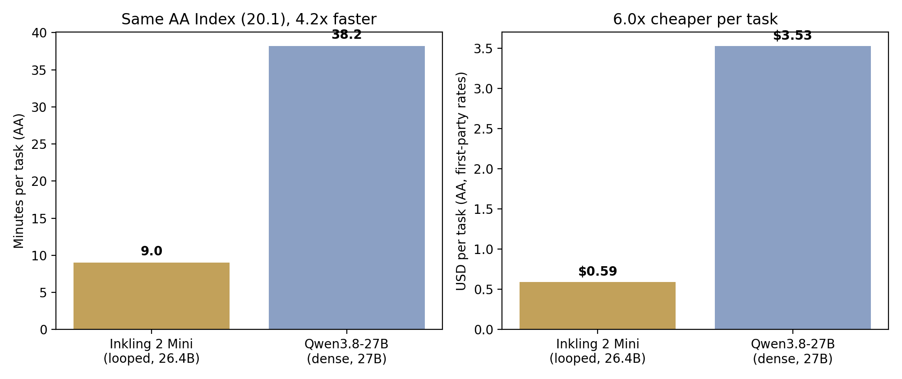

> [中文版 Chinese version](/ai%20engineering/llms/inkling-2-mini-looped-local-zh/)

Thinking Machines Lab released Inkling 2 Mini on November 20, 2026: an open-weights, multimodal model built to run locally. Its idea is simple and genuinely new in a shipped checkpoint — instead of storing more layers, re-run the ones you have.

## The mechanism

A looped transformer reuses the same stored layers several times for each token. Inkling 2 Mini stores 24 layers. The first 6 and last 6 run once; the middle 12 run three times, for 48 layer applications per token. The model has 26.4B total parameters and 3.4B active per pass; counting the repeated passes, it uses 5.4B effective weight activations per token.

That trade — more compute per token, no more stored weights — is why the checkpoint is about 20GB (most weights in NVFP4, the last four layers in MXFP8, the same precision used in training). Thinking Machines recommends 32GB or more of unified memory on Apple Silicon, or 32GB or more of VRAM elsewhere. Context is up to 1 million tokens, and the license is Apache 2.0 (plus a separate acceptable-use policy).

In internal scaling tests, Thinking Machines reports a non-looping baseline needed 140% more inference compute to match the looped model's loss on 512K-token agentic traces. That is a vendor number, but it states the bet clearly: depth can be rented with compute instead of bought with memory.

## The numbers

Artificial Analysis scores both Inkling 2 Mini and Alibaba's dense Qwen3.8-27B at 20.1 on its Intelligence Index. At that tie, AA reports Inkling runs about 4.2x faster per task (9.0 vs 38.2 minutes) and about 6x cheaper per task ($0.59 vs $3.53 at first-party API rates), using roughly 2.8x less compute.

Vendor-reported coding results point the same way: DeepSWE v1.1 48.2% vs 42.2% for Qwen3.8-27B, SWE-bench Verified 79.2% vs 77.8%, and LongBench v2 66.9% vs 52.3%. Treat those as lab-reported until independent replication lands.

## The limit: looping cannot create facts

Factual recall scales mostly with how much a model stored, not how many times it re-reads its own layers. On AA-Omniscience, Inkling 2 Mini scores -8.6 with a 63.4% non-hallucination rate, behind Qwen3.8-27B (-6.4, 71.4%). The model card also notes weaker detailed instruction following and a tendency toward repetitive reasoning while debugging. Looping buys reasoning depth. It does not buy knowledge.

## What to do on Monday

1. **Judge local models by decode speed on your machine, not by whether they fit.** A model that fits in 20GB but decodes slowly is a demo, not a tool. Require at least 30 tokens/second sustained on your own hardware before it replaces a cloud call for interactive work.
2. **Split the workload by type.** Agentic coding and long-context work are where the loop pays. Factual, recall-heavy work should stay on a larger or cloud model — the Omniscience gap above is the reason, not a footnote.
3. **Cap the loop's failure mode.** Set output and agent-turn limits; the documented repetitive-debugging tendency means an uncapped local agent can burn an afternoon quietly.

## The open question

If depth can be rented with compute, the local-model race stops being about who fits the most weights in 32GB and becomes about who spends each token's compute best. Is a looped 26B that thinks three times per token a better laptop default than a dense 27B that thinks once — for your workload, on your machine, at your measured tokens per second?

Sources: Thinking Machines Lab announcement and model card (via LM Studio summary, Nov 20, 2026); Artificial Analysis Intelligence Index v5.0 comparison reported by VentureBeat, Nov 21, 2026.
